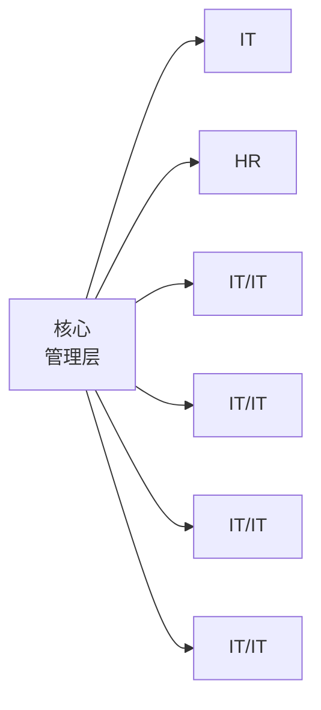

# 人与社会

# List 19 个人与集体

## 一、高频类目联想

## 情节发展：人物背景→巧解分歧→同台献艺→传承心意

## 人物背景

李明 born (出生) 在普通工薪家庭，从小就是个热心肠的 guy (男人)。大一开学时，他发现校园像个微缩 society (社会)，有形形色色的 person (人):打橄榄球的 man (男人)、来自不同 race (种族) 的国际生。每个 individual ( 个 体 ) 都带着独特的 personality (个性)。

natural_image

Illustration of a smiling boy walking on a sunny street with other people and trees in the background (no text or symbols)

## 巧解分歧

他加入“多元文化 association (社团)”，第一次策划活动就遇到挑战：有人觉得公示成员 private (隐私的) 联系方式侵犯 privacy (隐私),有人因 gender (性别) 分工争议闹矛盾。李明突然想起笔记本里 ancient ( 古 老 的 ) 部 落 的 故 事 —族人用不同颜色的石子标记各自擅长的技能，从不用“应该”定义谁。他突然明白：团队像块拼图，每个 being (人) 都有自己的位置——他连夜修改方案，并在例会时强调“尊重”是 moral  (道德) 底线。

natural_image

Group of people gathered around a table in a meeting room, with art and diagrams on the table (no visible text or symbols)

## 同台献艺

后来，协会联合街舞社、环保 union (协会) 组成跨社团 group (组织)，甚至吸引了校 party (党派) 代表关注。他们在文化节上表演融合各民族舞蹈的节目，舞台上，穿旗袍的 woman (女士) 和穿非洲长袍的男生并排旋转，台下的掌声让李明突然懂了“humanity”(人性) 的意义：不是消除差异，而是让每种声音都被听见。

natural_image

Stage performance with two dancers in traditional costumes, audience cheering in foreground (no visible text or symbols)

## 传承心意

毕业时，李明在校园角落种了棵“多元树”，树下石碑刻着:“无论我们的 status (地位) 是怎样的，但我们都继承了祖先的智慧，也该成为未来的 legacy(遗产)。”如今，这棵树成了新生必打卡的地标，化作了年轻灵魂里的光，继续照亮关于“尊重与联结”的 relationship  ( 关 系 ) 课。

natural_image

Illustration of a tree with a small stone bearing Chinese characters, set against a garden with greenery and autumn foliage (no readable text or symbols)

## 二、词汇学习

born /bɔ: rn/

n. 出生的；与生俱来的；产生的；v.承担；忍受妙记:born 发音“嘣”联想到婴儿出生时“嘣”的一声来到世界。

## 考点点拨

①在使用时，born 需要 be 动词 ( is/ was/ are/ were ) 才完整。

He was born in 1990.

他出生于 1990 年。

She was born into a very musical family.她生于音乐之家。

He was born with only one lung.他生下来就只有一个肺。

②派生词：

birth n.出 生 ; 起 源 ; 血统;

③born 是 bear 的过去分词 (bear-bore-born)

guy /gai/

n. 男人；兄弟（或姐妹）们；固定拉绳；v. 戏弄用支索稳定；

妙记：这位 guy 不就是说唱歌手 Gai 吗？

## 考点点拨

①“guy”作单数时通常指男性“家伙，小伙子”，不能用于指代女性。而复数形式“guys”在口语中可以指代“诸位，朋友们”，且不分性别。

②熟词僻义:“guy”可作动词，意为“嘲弄，取笑”。

person /'p3:rsən/

n. 人；自然人；家伙；角色

妙记：per ( 每 个 ) son( 儿 子 ) 都 能 成 人 (person) 。

## 考点点拨

①person 强调单个的人，是可数名词，如 three persons were interviewed。

②考研常见用法：

in person 亲自

personal touch 个人风格

interpersonal skills 人际交往能力

Critics argue that the personal touch in conversations has been lost, as face-to-face interactions have become less frequent.

批评家指出，随着面对面交流日益减少，对话中的人情味也逐渐消失。

③派生词：

personal adj.个人的;私人的

personality n.个 性 ; 人 格 ; 名 人

personnel n. 公 司 全 体 员 工 ; 人 事 部 门 ;adj. 人员的；有关人事的

man /mæn/

n. 成年男人；人类；伙计；v. 负责；操控

妙记：man 发音似“蛮”,这个蛮勇的男人 (man)。

## 考点点拨

①man 的复数形式为 men。

②man 与 woman 相对应，woman 意为“成年女性”,搭配 single woman 单身女性。woman 的复数形式为 women，如 women in leadership 女性领导力。

③派生词：

manual adj.手工的;

manual task 手工任务

manly adj.有男子气概的;果断的

manpower n.劳动力;人力

manpower crisis 人力危机

race /reis/

n. 人种；民族；赛跑；竞争；v. 比赛；快速运转

妙 记 :不 同 race ( 种 族 ) 的 选 手 在 赛 跑 中 race (竞争)。

natural_image

Colorful cartoon illustration of children running on a red track with stars in the sky (no text or symbols)

## 考点点拨

①race 作名词表示“种族；民族”时，常用于社会文化、历史类话题，涉及种族歧视 (racial discrimination)、

种族差异 (race differences)。

②race 作名词在表示“竞赛”时常见用法:
a race against time 与时间赛跑
a horse race 赛 马
③race 作动词表示“竞赛”时，固定搭配有
race to do sth. 竞相做某事
race against/ with 与 …… 竞 争

individual /,ındı'vıdzuəl/

n. 个人；个体；有个性的人；adj. 单独的；独特的；个人的

妙记:indi 发音似影帝、vidual 发音似喂猪，影帝喂猪 (individual) 是个人独特的行为。

text_image

individual

## 考点点拨

①individual 作 单 数 时 , 表 示 一 个 人 , 用 作“as an individual”,其复数形式 individuals 则表示多个人。常与“群体”概念作对比，强调“独立个体”，真题中出现 individual decisions(个人决定 ) 与 collective wisdom (群体智慧) 形成对比。
②individual 作形容词时表示个人的，强调“独特性”,真题中 individual activity 为个人活动。常见用法:
individual rights 个人权利
individual initiative 个人主动性

association /ə,sousi'erfən/

n. 协会；联盟；联系；交往

妙记：as- ( 加 强 )+ soci- ( 社 会 , 如 social )+-ation (名词后缀)→“加入社会”→联盟、社团。

## 考点点拨

①association 常用来表示“协会、社团”,比如 trade association 行业协会
research association 研究协会
medical association 医学协会
② association 还用来表示“关联、联想、联合”,比如 the association between A and B 意思是 A 与 B 的

关 联 ,in association with 与……联合。

## 【2015 年英语 (一)】

Working with the American Statistical Association, the journal has appointed seven experts to a statistics board of reviewing editors.

该期刊与美国统计协会合作，任命 7 名专家加入到一个统计审核编委会。

③派生词：

associate v.联 想 ; 支 持 ;n. 同 事 ; 副 职 ; 联 想 ;adj.副的；有关联的；

an associate dean at a university 大学的一位副院长 associate A with B 将 A 与 B 相关联

be associated with 与……有关联

Success is not always associated with material wealth.成功并非总与物质财富相关联。

private /'praIvIt/

adj. 私有的；民营的；私下的 n. 二等兵；自然人；家伙；角色

妙记:“private”发音似“扑入爱河特”，可联想“私下里扑入爱河是私人的事”。

## 考点点拨

① 近义词辨析：private & personal

● private : 强调“私人所有，不公开的”,如 a private letter ;在 考 试 中 的 常 见 搭 配 为 in private 私下地; private education 私立教育; private enterprise 私营企业;

● personal 强调“个人的”,如 personal opinion。

②派生词：

privacy n.隐 私 ; 秘 密 ; 清 净

privately adv.私 下 地 ; 秘 密 地

gender /'dzendər/

n. 性别；（总称）男性，女性

妙 记 :gender 发音似“真的”，想象到在病房，医生说“我真的不能告诉你孩子的 gender (性别)

## 考点点拨

①gender 指社会文化建构的性别角色、区别于 sex 指生物学性别。

While sex is determined by biology, gender varies across cultures and can change over time.

虽然生理性别由生物学决定，但社会性别因文化而

异，并可能随时间改变。

②考研中常见用法：

gender equality 性别平等

gender discrimination 性 别 歧 视

gender difference 性别差异

gender identity 性别认同

ancient /'emnSənt/

adj.古代的；古老的；老的；n. 古代人

妙记：an (一个) + cient (发音似“神”)=一个神，神在古代存在，故 ancient 为古代的。

## 考点点拨

ancient 常见用法：

an ancient civilization/ building 古 代 文 明/ 建 筑

in ancient times 在 古 代

preserve ancient heritage 保护文化遗产

being /'bi:m/

n. 生物；存在；本质；人；v.因为；由于；位于（be 的现在分词）

妙记:being 发音似“必应”，“人”是必然应当的存在。

## 考点点拨

①being 表示“人、生物”时，常用于抽象概念，如：

human being 人 类

social being 社 会 人

intelligent being 智 慧 生 命

rational being 理 性 的 人

②being 还用来表示“存在”

The problem of being has puzzled philosophers for centuries.

存在的问题困扰哲学家数百年。

③being 作为 be 的动名词形式，还用在非谓语、现在分词、独立主格等情况中。例如：

Being cautious is a virtue in examinations.

谨慎是考试中的美德。

moral /'mo:rəl/

adj.有关道德的；品行端正的；能辨别是非的；n.道德标准；寓意

妙记:moral 发音似“猫肉”，吃猫肉不道德，可以

联想 moral 为道德。

①moral 作形容词时表示“道德的”，考试中常见用法：

moral principles 道德原则

moral dilemma 道德困境

a moral obligation 道义上的义务

morally obligated 道义上有责任的

②moral 用作名词时表示“道德；寓意”，真题出现：

decline in public morals 公德滑坡

traditional morals 传统道德

the moral of a story 故事的寓意

moral consensus 道德共识

③派生词：

morality n.道德;道德体系

搭配：professional morality 职业道德

union /'ju:njən/

n. 工会；联盟；联合；婚姻

妙 记 : uni- ( 一 ) + on (在••••••上)= union, 多个个体合在一起，即为 union。

## 考点点拨

①固定搭配：

in union 联 合 ; 一 致

form a union 组 建 联 盟/ 工会

union movement 工会运动

②派生词：

unite v.联 合

搭配：unit e against a common enemy 联合对抗共同敌人；

unity n.团 结 ; 统 一

group /gru:p/

n. 集体；组；乐团；v. 聚集；将……分类

妙 记 : 这 群 ( group ) 人 按 年 龄 分 组 ( group ) 后聚 集 (group ) 在舞台上，为观众献上了一组动人的歌曲。

## 考点点拨

①注意该词的单复数变化

group 在强调整体时用单数：

The group is responsible for the project.

团队对项目负责。

group 在强调个体成员时用复数：

The group are divided on the solution.

团队成员对解决方案意见不一。

②固定搭配：

group sth. into sth. 将 ……分 组/ 归类

Data is grouped into four major categories.

数据被归为四大类。

be grouped as 被归类为

These theories are grouped as“postmodernist”.

这些理论被归为“后现代主义”类。

n 聚会；派对；党派，政党 v. 尽情欢乐；adj.分割开的

妙 记 : party 发音似爬梯、参加派对 (party ) 要爬梯。

natural_image

Colorful cartoon character scene with a castle and balloons, no visible text or symbols

## 考点点拨

①party 的核心意思:“聚会、派对”,如

charity party 慈善晚会

hold a party 举办派对

a housewarming party 乔迁聚会

②party 还表示“政党、党派”,如

the Communist Party of China 中国共产党

the ruling party 执 政 党

③除以上用法，party 还可以用在法律、合同语境当中，表示“当事人、一方”，如

both parties 双 方

the innocent party 无 过 错 方

n. 人类（总称）；人性；人道、仁慈

妙记：human ( 人 ) +- ity ( 名 词 后 缀 ) = humanity 人性。

## 考点点拨

①humanity 可作:“人类”的总称

【2013 英语 (一)】

Humanity has the necessary agro-technological tools to

eradicate hunger.

人类拥有必要的农业技术工具来消除饥饿。

②humanity 还表示“人性、人道、仁慈”

the best of humanity 人性的光辉

lose touch with humanity 失去人性

③其复数形式 humanities 表示人文学科

Students of humanities need to develop critical thinking skills.

人文学科的学生需培养批判性思维能力。

④派生词：

humanistic adj.人文主义的;人文科学的

humanistic disciplines 人文学科

scientific disciplines 科学学科

humanitarian adj.人道主义的;慈善的

Humanitarian aid is crucial in disaster relief.

人道主义援助在救灾工作中至关重要。

n. 法律地位；（社会）身份；状况、情形

妙 记 : st (联想为“石头”) + at ( 在 )+us ( 我 们 )=石头在我们身上压着，因为“地位”低。

## 考点点拨

①status 的核心意思为“地位、身份”，常见用法：

social status 社 会 地 位

economic status 经 济 地 位

professional status 职业地位

【2015 年英语 ( 一 ) 阅读】

The writing is on the wall for all European royals, with their historic, symbolic status justifying no more than a passing mention.

欧洲王室大势已去，其历史象征性地位仅值得一笔带过。

②status 的引申义为“状态、情形”= state of affairs status of disease 疾病的性质

Students’ financial stress is related to their decision to drop out of school, and today's status quo in higher education may not be sustainable.

学生的经济压力与其辍学决定相关，当前高等教育的现状可能难以持续。

③易混词辨析：

status 地位、情形

state 状况、陈述

statue 雕 像

stature 身 高

④派生词：

statutory adj.法定的;法规规定的

The statutory period for patent protection is 20 years.专利保护的法定期限为 20 年。

statute n.法 令 ; 法 规

statute law 成文法

legacy /'legəsi/

n. 遗产；后遗症

妙 记 : leg-(= law 法 律 ) +-acy( 名 词 后 缀 ) = legacy 依法继承的财产，引申为“遗产”。

## 考点点拨

①legacy 作为“遗产”时，尤指“文化、历史遗产”,如 The ancient castle is a legacy of the Ming Dynasty.这座古城是明朝的文化遗产。
②legacy 还可引申为“遗留问题”,搭配为 a legacy of。… the legacy of gender inequality persists in the workplace.

职场中性别不平等的遗留问题依然存在。

③派生词：

legislation n.法律条文

Environmental legislation has improved air quality.

环境立法改善了空气质量。

allegation n.声 称 ; 指 控

Allegations of fraud affected the company's reputation.欺诈指控影响了公司声誉。

relationship /rI'leIʃәnʃIp/

n. 关系；关联

妙 记 : relation( 关 系 ) +-ship( 词 缀 , 表 状 态 ) = relationship 关系。

## 考点点拨

①高频搭配：

build a relationship 建立一段关系

strengthen a relationship 强化一段关系

have a relationship with 与 ×× 有关系

the relationship between ×× 之间的关系

②派生词：

relate v.联 系 ; 涉 及 ;

搭 配 : re late A to B

relative adj.相 对 的 ; 相 关 的 ;n. 亲 戚

relation n.关系

relativity n.相 对 论 ; 相 关 性

## List 20 生物与关系身份（1）

## 一、类目联想

情节发展：稚童成长→青春绽放→成家立业

## 稚童成长

从 infant (婴儿) 长成儿童后，小林的 childhood ( 童 年 ) 充满欢笑。relative (亲戚) 们常逗这个活泼的 kid (小孩):“长大后想做什么呀？”他总是对着涂鸦咿咿呀呀。

natural_image

Illustration of a smiling baby sitting together with adults watching (no text or symbols)

## 青春绽放

teenager ( 青 少 年 ) 时 期 , 他 和 female ( 女 性 ) 同 桌 组 成 学 习 pair ( 搭 档 ), 与 male (男性) 好友的 friendship (友谊) 则建立在篮球场上。他始终坚持画画，坚信:“青春 (youth ) 就是要敢做梦。”

text_image

青春！you
就是苦啊！

## 成家立业

成为 adult (成年人) 后，小林逐渐从 amateur (业余爱好者) 蜕变成职业画家，并在自己画展上遇见未来的 spouse/couple (配偶)，可谓爱情事业双丰收。

natural_image

Illustration of two people in formal attire conversing indoors with framed pictures on the wall (no text or symbols visible)

## 二、词汇学习

infant /'mnfənt/

n. 婴儿；adj.供婴幼儿用的；初期的

妙记：谐音“婴烦特”→婴儿哭闹的时候特别烦人 → 婴 儿 (infant )。

## 考点点拨

①常见释义：婴儿

【2015 年英语 (一)】

Infants rarely survived the journey.

婴儿很少能挺过这段旅程。

②常见词组：infant school 幼儿学校

③派生词：

infancy n.幼年，婴儿期

childhood /'tfarldhud/

n. 童年，幼年时代

妙记：child 小 孩 +hood 表示事物的状态→处于小孩的状态→childhood 童年时期。

## 考点点拨

①常见释义：童年

The smell of freshly baked cookies always brings back warm memories of my childhood.

新鲜出炉的饼干香气总让我想起温暖的童年回忆。

②固定搭配：second childhood 第二童年;老年昏聩状态

③派生词：

child n.儿 童

kid /kıd/

n. 小孩；v. 戏弄，开玩笑；adj. 较年幼的

妙记：谐音“可的”，给孩子 (kid) 开一些适当的玩 笑 (kid ) 是可以的。

## 考点点拨

①常见释义：孩子

【2016 年 英 语 (二 )】

These kids are going to be surrounded by computers for

the rest of their lives.

这些孩子往后余生都会被计算机所围绕。

②熟词僻义：戏弄，开玩笑

The twins love kidding their teacher by switching seats and pretending to be each other.

这对双胞胎喜欢互换座位假装对方来戏弄老师。

amateur /'æmətər/

n.业余爱好者；外行；adj. 非专业的；不熟练的

妙记：谐音“矮模特”→模特大多是高的，矮模特会让人觉得是业余的 ( amateur )。

natural_image

Illustration of a woman and a child standing together in a fashion setting (no text or symbols visible)

## 考点点拨

①常见释义：业余的

【2020 年英语 (一)】

Moreover, the amateur tradition in music criticism has been in headlong retreat.

此外，音乐评论的业余传统已经迅速衰退。

②常见词组：

amateurs and professionals 业余选手和职业选手

③派生词：

amateurism n.业 余 性

teenager /'ti:neidzər/

n.（13 至 19 岁之间的）青少年

妙记:teen (表示十几，其中 13—19 的英文都是以 teen 结 尾 )+age ( 年 龄 ) → (13 至 19 岁 之 间 的 ) 青少年。

## 考点点拨

①常见释义：青少年

【2023 年英语 (二)】

Teenagers are paradoxical.

青少年是矛盾的。

②派生词：

teenage adj.青 少 年 的 ; 十 几 岁 的 ;n. 青少年时期

youth /ju:θ/

n.青少年时期（尤指成年以前）年轻人；青春，朝气

妙记：谐音“忧思”，处于青少年时期 ( youth) 的孩子也总是充满忧思。

natural_image

Person holding a document in a dimly lit indoor setting (no visible text or symbols)

## 考点点拨

①常见释义：青年人

【2004 年】

The resulting discontent may in turn lead more youths into criminal behavior.

由此产生的不满情绪可能会进一步促使更多年轻人走上犯罪道路。

②单词辨析：teenager & youth

年龄范围

teenager 特 指 13—19 岁 的 青 少 年 ( 因 数 字 13—19 的英文以“-teen”结尾);

● youth 通 常 指 15—24 岁 ( 联 合 国 定 义 ) 或 更 宽 泛的青年阶段。

词性侧重

● teenager 是名词，强调具体年龄段的个体特征 (如叛逆、活力)；

● youth 既可作名词指代青年群体 (集合名词时常用 the youth),也可表示抽象概念“青春”。

adult /'æd^lt//ə'dalt/

n. 成年人或动物 adj. 成年的

妙记：谐音“爱倒腾”，成年人有更多精力，所以他 们 爱 倒 腾 (adult )。

natural_image

Collage of four photos showing people in outdoor settings, including a person at a table, a group of people, and a family (no visible text or symbols)

## 考点点拨

①常见释义：成年人

【2024 年英语 (一】

By contrast, in hunter-gatherer societies adults other than the parents can provide almost half of a child's care.相反、在狩猎采集社会中，除了父母之外的成年人能够为孩子提供将近一半的照料。

②派生词：

adulthood n.成年，成人时期

spouse /spaus/

n. 配偶；v、和……结婚

妙记：谐音“死抱死”、夫妻 (spouse ) 就是死也要抱在一起死。

natural_image

Black-and-white photo of a person inside a large, irregularly shaped container (no visible text or symbols)

## 考点点拨

①常见释义：配偶

【2016 年英语 (一)】

A young man can decide on a likely spouse on his own and then ask his parents to arrange the marriage negotiations.

一个年轻人可以自己决定心仪的配偶，然后请父母来安排婚事的协商。

②派生词：

spousal adj.结婚的;与婚姻有关的，配偶的

pair /per/

n. 一对，一双；v. 使成对

妙记：谐音“配二”，无论是一双 (pair )，还是使成对 (pair )，都是把两者配起来。

## 考点点拨

固定搭配：

pair... with...;... be paired with... 将••••••与•

The chef paired the steak with a bold red wine.

主厨将牛排搭配醇厚的红酒。

The black dress was perfectly paired with pearl earrings.

这条黑裙与珍珠耳饰搭配绝佳。

in pairs 成双地，成对地

Students worked in pairs to solve the math problems.

学生们两人一组合作解答数学题。

couple /'kp(ə)l/

n. 两个，几个，夫妻；v.结合；(把设备等) 连接：形成一双

妙 记 : 夫 妻 (couple ) 是 两 个 (couple ) 利益结合 (couple ) 在一起的人。

## 考点点拨

①常见释义：夫妻

Outwardly, the couple seemed perfectly happy.

表面上看，这对夫妇似乎幸福美满。

②固定搭配：

a couple of 几 个 ; 两 个

【1999 年】

Basic computer skills take— at the very longest—a couple of months to learn.

基本的计算机操作技能最多只需几个月就能学会。

● couple A with B A 与 B 结 合

The professor coupled theoretical lectures with handson lab sessions.

教授将理论讲座与实际操作课程相结合。

male /meIl/

adj. 男 性 的 ; 雄 的 ;n. 男 性

妙记：谐音“没偶”→世界上男性人 口占比更大。所 以 更 多 的 男 性 (male ) 将会没有配偶。

bar

| Category | Value |
| --- | --- |
| Normal | ~125 |
| Completely | ~85 |

## 考点点拨

①常见释义：男性

The city's population consists of 52% male residents ••配对 and 48% female.

该 城 市 人 口 中 52% 为男性居民，48% 为女性。

②单词辨析：man & male

词性范围差异

male 是生物学性别分类术语，适用于所有雄性生物 ( 人 类/动 物/植 物)；

man 特指人类成年男性，强调社会角色。

适用场景不同

正 式 文 件/科学研究常用 male:

the deceased was a male aged 25

死者为 25 岁男性

日常社交称呼常用 man:

This man helped me carry luggage.

这位男士帮我搬行李。

注：female 和 woman 的辨析与此类似

③派生词：

female adj.女 性 的 , 母 的 , 雌 的 ;n. 女 性

adj.女性的、母的，雌的；n. 女性

妙记：fe ( 非 ) + male ( 男 性 ) →不是男性→女性。

text_image

Two pictograms showing gender symbols: one with a checkmark and another with a red cross, likely indicating selection or confirmation.

## 考点点拨

①常见释义：女性

【2020 年英语 (一 )】

Female participation on corporate boards may not currently mirror the percentage of women in the general population, but so what?

女性在公司董事会中的参与比例或许目前并未映射出女性在整体人口中的占比相匹配，但这又怎样呢？

②派生词：

male adj. 男 性 的 ; 雄 的 n. 男 性

n. 亲戚 adj. 相关联的，比较的；相对的

妙记：亲 戚 (relative) 是 指 血 缘 上 相 关 联 的 (relative ) 一群人。

natural_image

Illustration of a family of five sitting together under a tree (no text or symbols)

## 考点点拨

①常见释义：亲戚
②固定搭配：be relative to 与⋯⋯ 相 关/ 相对

The salary increase will be relative to employee performance this year.

加薪幅度将与员工今年的表现相关。

The ship's position is relative to the lighthouse coordinates.

船只位置是相对于灯塔坐标确定的。

③派生词：

relativity n.(物理) 相对论;相对性

relatively adv.相当地，相对地

n. 友谊

妙 记 : friend ( 朋 友 ) +ship ( 船 ), 友 谊 (friendship ) 的 小 船 (ship ) 说翻就翻。

natural_image

Two-panel image showing a person rowing a small boat on water and another person creating a boat on water (no text or symbols visible)

## 考点点拨

①常见释义：友谊

True friendship means standing by each other during difficult times.

真正的友谊意味着在困难时刻互相支持。

②派生词：

friend n.朋 友

friendly adj.亲切的，友善的

## List 21 生物与关系身份（2）

## 一、类目联想

## 情节发展：筹备之争→智慧调解→比赛过程→圆满落幕

## 筹备之争

大学图书馆 owner (所有者) 张教授召集委员会 holder (负责人) 商讨文化节活动安排。local (本地的) 负责人希望突出 native (本土的) 特 色 , 而 foreign (外国的) 留学生 representative (代表) 提议加入 alien ( 异 国 ) 元素，双方相持不下。

text_image

大学图书馆馆馆馆馆馆馆馆馆馆馆馆馆馆馆馆馆馆馆馆馆馆馆馆馆馆馆馆馆馆馆馆馆馆馆馆馆馆馆馆馆馆馆馆馆馆馆馆馆馆馆馆馆馆馆馆馆馆馆馆馆馆馆馆馆馆馆馆馆馆馆馆馆馆馆馆馆馆馆馆馆馆馆馆馆馆馆馆馆馆馆馆馆馆馆馆馆馆馆馆馆馆馆馆馆馆馆馆馆馆馆馆馆馆馆馆馆馆馆馆馆馆馆馆馆馆馆馆馆馆馆馆馆馆馆馆馆馆馆馆馆馆馆馆馆馆馆馆馆馆馆馆馆馆馆馆馆馆馆馆馆馆馆馆馆馆馆馆馆馆馆馆馆馆馆馆馆馆馆馆馆馆馆馆馆馆馆馆馆馆馆馆馆馆馆馆馆馆馆馆馆馆馆馆馆馆馆馆馆馆馆馆馆馆馆馆馆馆馆馆馆馆馆馆馆馆馆馆馆馆馆馆馆馆馆馆馆馆馆馆馆馆馆馆馆馆馆馆馆馆馆馆馆馆馆馆馆馆馆馆馆馆馆馆馆馆馆馆馆馆馆馆馆馆馆馆馆馆馆馆馆馆馆馆馆馆馆馆馆馆馆馆馆馆馆馆馆馆馆馆馆馆馆馆馆馆馆馆馆馆馆馆馆馆馆馆馆馆馆馆馆馆馆馆馆馆馆馆馆馆馆馆馆馆馆馆馆馆馆馆馆馆馆馆馆馆馆馆馆馆馆馆馆馆馆馆馆馆馆馆馆馆馆馆馆馆馆馆馆馆馆馆馆馆馆馆馆馆馆馆馆馆馆馆馆馆馆馆馆馆馆馆馆馆馆馆馆馆馆馆馆馆馆馆馆馆馆馆馆馆馆馆馆馆馆馆馆馆馆馆馆馆馆馆馆馆馆馆馆馆馆馆馆馆馆馆馆馆馆馆馆馆馆馆馆馆馆馆馆馆馆馆馆馆馆馆馆馆馆馆馆馆馆馆馆馆馆馆馆馆馆馆馆馆馆馆馆馆馆馆馆馆馆馆馆馆馆馆馆馆馆馆馆馆馆馆馆馆馆馆馆馆馆馆馆馆馆馆馆馆馆馆馆馆馆馆馆馆馆馆馆馆馆馆馆馆馆馆馆馆馆馆馆馆馆馆馆馆馆馆馆馆馆馆馆馆馆馆馆馆馆馆馆馆馆馆馆馆馆馆馆馆馆馆馆馆馆馆馆馆馆馆馆馆馆馆馆馆馆馆馆馆馆馆馆馆馆馆馆馆馆馆馆馆馆馆馆馆馆馆馆馆馆馆馆馆馆馆馆馆馆馆馆馆馆馆馆馆馆馆馆馆馆馆馆馆馆馆馆馆馆馆馆馆馆馆馆馆馆馆馆馆馆馆馆馆馆馆馆馆馆馆馆馆馆馆馆馆馆馆馆馆馆馆馆馆馆馆馆馆馆馆馆馆馆馆馆馆馆馆馆馆馆馆馆馆馆馆馆馆馆馆馆馆馆馆馆馆馆馆馆馆馆馆馆馆馆馆馆馆馆馆馆馆馆馆馆馆馆馆馆馆馆馆馆馆馆馆馆馆馆馆馆馆馆馆馆馆馆馆馆馆馆馆馆馆馆馆馆馆馆馆馆馆馆馆馆馆馆馆馆馆馆馆馆馆馆馆馆馆馆馆馆馆馆馆馆馆馆馆馆馆馆馆馆馆馆馆馆馆馆馆馆馆馆馆馆馆馆馆馆馆馆馆馆馆馆馆馆馆馆馆馆馆馆馆馆馆馆馆馆馆馆馆馆馆馆馆馆馆馆馆馆馆馆馆馆馆馆馆馆馆馆馆馆馆馆馆馆馆馆馆馆馆馆馆馆馆馆馆馆馆馆馆馆馆馆馆馆馆馆馆馆馆馆馆馆馆馆馆馆馆馆馆馆馆馆馆馆馆馆馆馆馆馆馆馆馆馆馆馆馆馆馆馆馆馆馆馆馆馆馆馆馆馆馆馆馆馆馆馆馆馆馆馆馆馆馆馆馆馆馆馆馆馆馆馆馆馆馆馆馆馆馆馆馆馆馆馆馆馆馆馆馆馆馆馆馆馆馆馆馆馆馆馆馆馆馆馆馆馆馆馆馆馆馆馆馆馆馆馆馆馆馆馆馆馆馆馆馆馆馆馆馆馆馆馆馆馆馆馆馆馆馆馆馆馆馆馆馆馆馆馆馆馆馆馆馆馆馆馆馆馆馆馆馆馆馆馆馆馆馆馆馆馆馆馆馆馆馆馆馆馆馆馆馆馆馆馆馆馆馆馆馆馆馆馆馆馆馆馆馆馆馆馆馆馆馆馆馆馆馆馆馆馆馆馆馆馆馆馆馆馆馆馆馆馆馆馆馆馆馆馆馆馆馆馆馆馆馆馆馆馆馆馆馆馆馆馆馆馆馆馆馆馆馆馆馆馆馆馆馆馆馆馆馆馆馆馆馆馆馆馆馆馆馆馆馆馆馆馆馆馆馆馆馆馆馆馆馆馆馆馆馆馆馆馆馆馆馆馆馆馆馆馆馆馆馆馆馆馆馆馆馆馆馆馆馆馆馆馆馆馆馆馆馆馆馆馆馆馆馆馆馆馆馆馆馆馆馆馆馆馆馆馆馆馆馆馆馆馆馆馆馆馆馆馆馆馆馆馆馆馆馆馆馆馆馆馆馆馆馆馆馆馆馆馆馆馆馆馆馆馆馆馆馆馆馆馆馆馆馆馆馆馆馆馆馆馆馆馆馆馆馆馆馆馆馆馆馆馆馆馆馆馆馆馆馆馆馆馆馆馆馆馆馆馆馆馆馆馆馆馆馆馆馆馆馆馆馆馆馆馆馆馆馆馆馆馆馆馆馆馆馆馆馆馆馆馆馆馆馆馆馆馆馆馆馆馆馆馆馆馆馆馆馆馆馆馆馆馆馆馆馆馆馆馆馆馆馆馆馆馆馆馆馆馆馆馆馆馆馆馆馆馆馆馆馆馆馆馆馆馆馆馆馆馆馆馆馆馆馆馆馆馆馆馆馆馆馆馆馆馆馆馆馆馆馆馆馆馆馆馆馆馆馆馆馆馆馆馆馆馆馆馆馆馆馆馆馆馆馆馆馆馆馆馆馆馆馆馆馆馆馆馆馆馆馆馆馆馆馆馆馆馆馆馆馆馆馆馆馆馆馆馆馆馆馆馆馆馆馆馆馆馆馆馆馆馆馆馆馆馆馆馆馆馆馆馆馆馆馆馆馆馆馆馆馆馆馆馆馆馆馆馆馆馆馆馆馆馆馆馆馆馆馆馆馆馆馆馆馆馆馆馆馆馆馆馆馆馆馆馆馆馆馆馆馆馆馆馆馆馆馆馆馆馆馆馆馆馆馆馆馆馆馆馆馆馆馆馆馆馆馆馆馆馆馆馆馆馆馆馆馆馆馆馆馆馆馆馆馆馆馆馆馆馆馆馆馆馆馆馆馆馆馆馆馆馆馆馆馆馆馆馆馆馆馆馆馆馆馆馆馆馆馆馆馆馆馆馆馆馆馆馆馆馆馆馆馆馆馆馆馆馆馆馆馆馆馆馆馆馆馆馆馆馆馆馆馆馆馆馆馆馆馆馆馆馆馆馆馆馆馆馆馆馆馆馆馆馆馆馆馆馆馆馆馆馆馆馆馆馆馆馆馆馆馆馆馆馆馆馆馆馆馆馆馆馆馆馆馆馆馆馆馆馆馆馆馆馆馆馆馆馆馆馆馆馆馆馆馆馆馆馆馆馆馆馆馆馆馆馆馆馆馆馆馆馆馆馆馆馆馆馆馆馆馆馆馆馆馆馆馆馆馆馆馆馆馆馆馆馆馆馆馆馆馆馆馆馆馆馆馆馆馆馆馆馆馆馆馆馆馆馆馆馆馆馆馆馆馆馆馆馆馆馆馆馆馆馆馆馆馆馆馆馆馆馆馆馆馆馆馆馆馆馆馆馆馆馆馆馆馆馆馆馆馆馆馆馆馆馆馆馆馆馆馆馆馆馆馆馆馆馆馆馆馆馆馆馆馆馆馆馆馆馆馆馆馆馆馆馆馆馆馆馆馆馆馆馆馆馆馆馆馆馆馆馆馆馆馆馆馆馆馆馆馆馆馆馆馆馆馆馆馆馆馆馆馆馆馆馆馆馆馆馆馆馆馆馆馆馆馆馆馆馆馆馆馆馆馆馆馆馆馆馆馆馆馆馆馆馆馆馆馆馆馆馆馆馆馆馆馆馆馆馆馆馆馆馆馆馆馆馆馆馆馆馆馆馆馆馆馆馆馆馆馆馆馆馆馆馆馆馆馆馆馆馆馆馆馆馆馆馆馆馆馆馆馆馆馆馆馆馆馆馆馆馆馆馆馆馆馆馆馆馆馆馆馆馆馆馆馆馆馆馆馆馆馆馆馆馆馆馆馆馆馆馆馆馆馆馆馆馆馆馆馆馆馆馆馆馆馆馆馆馆馆馆馆馆馆馆馆馆馆馆馆馆馆馆馆馆馆馆馆馆馆馆馆馆馆馆馆馆馆馆馆馆馆馆馆馆馆馆馆馆馆馆馆馆馆馆馆馆馆馆馆馆馆馆馆馆馆馆馆馆馆馆馆馆馆馆馆馆馆馆馆馆馆馆馆馆馆馆馆馆馆馆馆馆馆馆馆馆馆馆馆馆馆馆馆馆馆馆馆馆馆馆馆馆馆馆馆馆馆馆馆馆馆馆馆馆馆馆馆馆馆馆馆馆馆馆馆馆馆馆馆馆馆馆馆馆馆馆馆馆馆馆馆馆馆馆馆馆馆馆馆馆馆馆馆馆馆馆馆馆馆馆馆馆馆馆馆馆馆馆馆馆馆馆馆馆馆馆馆馆馆馆馆馆馆馆馆馆馆馆馆馆馆馆馆馆馆馆馆馆馆馆馆馆馆馆馆馆馆馆馆馆馆馆馆馆馆馆馆馆馆馆馆馆馆馆馆馆馆馆馆馆馆馆馆馆馆馆馆馆馆馆馆馆馆馆馆馆馆馆馆馆馆馆馆馆馆馆馆馆馆馆馆馆馆馆馆馆馆馆馆馆馆馆馆馆馆馆馆馆馆馆馆馆馆馆馆馆馆馆馆馆馆馆馆馆馆馆馆馆馆馆馆馆馆馆馆馆馆馆馆馆馆馆馆馆馆馆馆馆馆馆馆馆馆馆馆馆馆馆馆馆馆馆馆馆馆馆馆馆馆馆馆馆馆馆馆馆馆馆馆馆馆馆馆馆馆馆馆馆馆馆馆馆馆馆馆馆馆馆馆馆馆馆馆馆馆馆馆馆馆馆馆馆馆馆馆馆馆馆馆馆馆馆馆馆馆馆馆馆馆馆馆馆馆馆馆馆馆馆馆馆馆馆馆馆馆馆馆馆馆馆馆馆馆馆馆馆馆馆馆馆馆馆馆馆馆馆馆馆馆馆馆馆馆馆馆馆馆馆馆馆馆馆馆馆馆馆馆馆馆馆馆馆馆馆馆馆馆馆馆馆馆馆馆馆馆馆馆馆馆馆馆馆馆馆馆馆馆馆馆馆馆馆馆馆馆馆馆馆馆馆馆馆馆馆馆馆馆馆馆馆馆馆馆馆馆馆馆馆馆馆馆馆馆馆馆馆馆馆馆馆馆馆馆馆馆馆馆馆馆馆馆馆馆馆馆馆馆馆馆馆馆馆馆馆馆馆馆馆馆馆馆馆馆馆馆馆馆馆馆馆馆馆馆馆馆馆馆馆馆馆馆馆馆馆馆馆馆馆馆馆馆馆馆馆馆馆馆馆馆馆馆馆馆馆馆馆馆馆馆馆馆馆馆馆馆馆馆馆馆馆馆馆馆馆馆馆馆馆馆馆馆馆馆馆馆馆馆馆馆馆馆馆馆馆馆馆馆馆馆馆馆馆馆馆馆馆馆馆馆馆馆馆馆馆馆馆馆馆馆馆馆馆馆馆馆馆馆馆馆馆馆馆馆馆馆馆馆馆馆馆馆馆馆馆馆馆馆馆馆馆馆馆馆馆馆馆馆馆馆馆馆馆馆馆馆馆馆馆馆馆馆馆馆馆馆馆馆馆馆馆馆馆馆馆馆馆馆馆馆馆馆馆馆馆馆馆馆馆馆馆馆馆馆馆馆馆馆馆馆馆馆馆馆馆馆馆馆馆馆馆馆馆馆馆馆馆馆馆馆馆馆馆馆馆馆馆馆馆馆馆馆馆馆馆馆馆馆馆馆馆馆馆馆馆馆馆馆馆馆馆馆馆馆馆馆馆馆馆馆馆馆馆馆馆馆馆馆馆馆馆馆馆馆馆馆馆馆馆馆馆馆馆馆馆馆馆馆馆馆馆馆馆馆馆馆馆馆馆馆馆馆馆馆馆馆馆馆馆馆馆馆馆馆馆馆馆馆馆馆馆馆馆馆馆馆馆馆馆馆馆馆馆馆馆馆馆馆馆馆馆馆馆馆馆馆馆馆馆馆馆馆馆馆馆馆馆馆馆馆馆馆馆馆馆馆馆馆馆馆馆馆馆馆馆馆馆馆馆馆馆馆馆馆馆馆馆馆馆馆馆馆馆馆馆馆馆馆馆馆馆馆馆馆馆馆馆馆馆馆馆馆馆馆馆馆馆馆馆馆馆馆馆馆馆馆馆馆馆馆馆馆馆馆馆馆馆馆馆馆馆馆馆馆馆馆馆馆馆馆馆馆馆馆馆馆馆馆馆馆馆馆馆馆馆馆馆馆馆馆馆馆馆馆馆馆馆馆馆馆馆馆馆馆馆馆馆馆馆馆馆馆馆馆馆馆馆馆馆馆馆馆馆馆馆馆馆馆馆馆馆馆馆馆馆馆馆馆馆馆馆馆馆馆馆馆馆馆馆馆馆馆馆馆馆馆馆馆馆馆馆馆馆馆馆馆馆馆馆馆馆馆馆馆馆馆馆馆馆馆馆馆馆馆馆馆馆馆馆馆馆馆馆馆馆馆馆馆馆馆馆馆馆馆馆馆馆馆馆馆馆馆馆馆馆馆馆馆馆馆馆馆馆馆馆馆馆馆馆馆馆馆馆馆馆馆馆馆馆馆馆馆馆馆馆馆馆馆馆馆馆馆馆馆馆馆馆馆馆馆馆馆馆馆馆馆馆馆馆馆馆馆馆馆馆馆馆馆馆馆馆馆馆馆馆馆馆馆馆馆馆馆馆馆馆馆馆馆馆馆馆馆馆馆馆馆馆馆馆馆馆馆馆馆馆馆馆馆馆馆馆馆馆馆馆馆馆馆馆馆馆馆馆馆馆馆馆馆馆馆馆馆馆馆馆馆馆馆馆馆馆馆馆馆馆馆馆馆馆馆馆馆馆馆馆馆馆馆馆馆馆馆馆馆馆馆馆馆馆馆馆馆馆馆馆馆馆馆馆馆馆馆馆馆馆馆馆馆馆馆馆馆馆馆馆馆馆馆馆馆馆馆馆馆馆馆馆馆馆馆馆馆馆馆馆馆馆馆馆馆馆馆馆馆馆馆馆馆馆馆馆馆馆馆馆馆馆馆馆馆馆馆馆馆馆馆馆馆馆馆馆馆馆馆馆馆馆馆馆馆馆馆馆馆馆馆馆馆馆馆馆馆馆馆馆馆馆馆馆馆馆馆馆馆馆馆馆馆馆馆馆馆馆馆馆馆馆馆馆馆馆馆馆馆馆馆馆馆馆馆馆馆馆馆馆馆馆馆馆馆馆馆馆馆馆馆馆馆馆馆馆馆馆馆馆馆馆馆馆馆馆馆馆馆馆馆馆馆馆馆馆馆馆馆馆馆馆馆馆馆馆馆馆馆馆馆馆馆馆馆馆馆馆馆馆馆馆馆馆馆馆馆馆馆馆馆馆馆馆馆馆馆馆馆馆馆馆馆馆馆馆馆馆馆馆馆馆馆馆馆馆馆馆馆馆馆馆馆馆馆馆馆馆馆馆馆馆馆馆馆馆馆馆馆馆馆馆馆馆馆馆馆馆馆馆馆馆馆馆馆馆馆馆馆馆馆馆馆馆馆馆馆馆馆馆馆馆馆馆馆馆馆馆馆馆馆馆馆馆馆馆馆馆馆馆馆馆馆馆馆馆馆馆馆馆馆馆馆馆馆馆馆馆馆馆馆馆馆馆馆馆馆馆馆馆馆馆馆馆馆馆馆馆馆馆馆馆馆馆馆馆馆馆馆馆馆馆馆馆馆馆馆馆馆馆馆馆馆馆馆馆馆馆馆馆馆馆馆馆馆馆馆馆馆馆馆馆馆馆馆馆馆馆馆馆馆馆馆馆馆馆馆馆馆馆馆馆馆馆馆馆馆馆馆馆馆馆馆馆馆馆馆馆馆馆馆馆馆馆馆馆馆馆馆馆馆馆馆馆馆馆馆馆馆馆馆馆馆馆馆馆馆馆馆馆馆馆馆馆馆馆馆馆馆馆馆馆馆馆馆馆馆馆馆馆馆馆馆馆馆馆馆馆馆馆馆馆馆馆馆馆馆馆馆馆馆馆馆馆馆馆馆馆馆馆馆馆馆馆馆馆馆馆馆馆馆馆馆馆馆馆馆馆馆馆馆馆馆馆馆馆馆馆馆馆馆馆馆馆馆馆馆馆馆馆馆馆馆馆馆馆馆馆馆馆馆馆馆馆馆馆馆馆馆馆馆馆馆馆馆馆馆馆馆馆馆馆馆馆馆馆馆馆馆馆馆馆馆馆馆馆馆馆馆馆馆馆馆馆馆馆馆馆馆馆馆馆馆馆馆馆馆馆馆馆馆馆馆馆馆馆馆馆馆馆馆馆馆馆馆馆馆馆馆馆馆馆馆馆馆馆馆馆馆馆馆馆馆馆馆馆馆馆馆馆馆馆馆馆馆馆馆馆馆馆馆馆馆馆馆馆馆馆馆馆馆馆馆馆馆馆馆馆馆馆馆馆馆馆馆馆馆馆馆馆馆馆馆馆馆馆馆馆馆馆馆馆馆馆馆馆馆馆馆馆馆馆馆馆馆馆馆馆馆馆馆馆馆馆馆馆馆馆馆馆馆馆馆馆馆馆馆馆馆馆馆馆馆馆馆馆馆馆馆馆馆馆馆馆馆馆馆馆馆馆馆馆馆馆馆馆馆馆馆馆馆馆馆馆馆馆馆馆馆馆馆馆馆馆馆馆馆馆馆馆馆馆馆馆馆馆馆馆馆馆馆馆馆馆馆馆馆馆馆馆馆馆馆馆馆馆馆馆馆馆馆馆馆馆馆馆馆馆馆馆馆馆馆馆馆馆馆馆馆馆馆馆馆馆馆馆馆馆馆馆馆馆馆馆馆馆馆馆馆馆馆馆馆馆馆馆馆馆馆馆馆馆馆馆馆馆馆馆馆馆馆馆馆馆馆馆馆馆馆馆馆馆馆馆馆馆馆馆馆馆馆馆馆馆馆馆馆馆馆馆馆馆馆馆馆馆馆馆馆馆馆馆馆馆馆馆馆馆馆馆馆馆馆馆馆馆馆馆馆馆馆馆馆馆馆馆馆馆馆馆馆馆馆馆馆馆馆馆馆馆馆馆馆馆馆馆馆馆馆馆馆馆馆馆馆馆馆馆馆馆馆馆馆馆馆馆馆馆馆馆馆馆馆馆馆馆馆馆馆馆馆馆馆馆馆馆馆馆馆馆馆馆馆馆馆馆馆馆馆馆馆馆馆馆馆馆馆馆馆馆馆馆馆馆馆馆馆馆馆馆馆馆馆馆馆馆馆馆馆馆馆馆馆馆馆馆馆馆馆馆馆馆馆馆馆馆馆馆馆馆馆馆馆馆馆馆馆馆馆馆馆馆馆馆馆馆馆馆馆馆馆馆馆馆馆馆馆馆馆馆馆馆馆馆馆馆馆馆馆馆馆馆馆馆馆馆馆馆馆馆馆馆馆馆馆馆馆馆馆馆馆馆馆馆馆馆馆馆馆馆馆馆馆馆馆馆馆馆馆馆馆馆馆馆馆馆馆馆馆馆馆馆馆馆馆馆馆馆馆馆馆馆馆馆馆馆馆馆馆馆馆馆馆馆馆馆馆馆馆馆馆馆馆馆馆馆馆馆馆馆馆馆馆馆馆馆馆馆馆馆馆馆馆馆馆馆馆馆馆馆馆馆馆馆馆馆馆馆馆馆馆馆馆馆馆馆馆馆馆馆馆馆馆馆馆馆馆馆馆馆馆馆馆馆馆馆馆馆馆馆馆馆馆馆馆馆馆馆馆馆馆馆馆馆馆馆馆馆馆馆馆馆馆馆馆馆馆馆馆馆馆馆馆馆馆馆馆馆馆馆馆馆馆馆馆馆馆馆馆馆馆馆馆馆馆馆馆馆馆馆馆馆馆馆馆馆馆馆馆馆馆馆馆馆馆馆馆馆馆馆馆馆馆馆馆馆馆馆馆馆馆馆馆馆馆馆馆馆馆馆馆馆馆馆馆馆馆馆馆馆馆馆馆馆馆馆馆馆馆馆馆馆馆馆馆馆馆馆馆馆馆馆馆馆馆馆馆馆馆馆馆馆馆馆馆馆馆馆馆馆馆馆馆馆馆馆馆馆馆馆馆馆馆馆馆馆馆馆馆馆馆馆馆馆馆馆馆馆馆馆馆馆馆馆馆馆馆馆馆馆馆馆馆馆馆馆馆馆馆馆馆馆馆馆馆馆馆馆馆馆馆馆馆馆馆馆馆馆馆馆馆馆馆馆馆馆馆馆馆馆馆馆馆馆馆馆馆馆馆馆馆馆馆馆馆馆馆馆馆馆馆馆馆馆馆馆馆馆馆馆馆馆馆馆馆馆馆馆馆馆馆馆馆馆馆馆馆馆馆馆馆馆馆馆馆馆馆馆馆馆馆馆馆馆馆馆馆馆馆馆馆馆馆馆馆馆馆馆馆馆馆馆馆馆馆馆馆馆馆馆馆馆馆馆馆馆馆馆馆馆馆馆馆馆馆馆馆馆馆馆馆馆馆馆馆馆馆馆馆馆馆馆馆馆馆馆馆馆馆馆馆馆馆馆馆馆馆馆馆馆馆馆馆馆馆馆馆馆馆馆馆馆馆馆馆馆馆馆馆馆馆馆馆馆馆馆馆馆馆馆馆馆馆馆馆馆馆馆馆馆馆馆馆馆馆馆馆馆馆馆馆馆馆馆馆馆馆馆馆馆馆馆馆馆馆馆馆馆馆馆馆馆馆馆馆馆馆馆馆馆馆馆馆馆馆馆馆馆馆馆馆馆馆馆馆馆馆馆馆馆馆馆馆馆馆馆馆馆馆馆馆馆馆馆馆馆馆馆馆馆馆馆馆馆馆馆馆馆馆馆馆馆馆馆馆馆馆馆馆馆馆馆馆馆馆馆馆馆馆馆馆馆馆馆馆馆馆馆馆馆馆馆馆馆馆馆馆馆馆馆馆馆馆馆馆馆馆馆馆馆馆馆馆馆馆馆馆馆馆馆馆馆馆馆馆馆馆馆馆馆馆馆馆馆馆馆馆馆馆馆馆馆馆馆馆馆馆馆馆馆馆馆馆馆馆馆馆馆馆馆馆馆馆馆馆馆馆馆馆馆馆馆馆馆馆馆馆馆馆馆馆馆馆馆馆馆馆馆馆馆馆馆馆馆馆馆馆馆馆馆馆馆馆馆馆馆馆馆馆馆馆馆馆馆馆馆馆馆馆馆馆馆馆馆馆馆馆馆馆馆馆馆馆馆馆馆馆馆馆馆馆馆馆馆馆馆馆馆馆馆馆馆馆馆馆馆馆馆馆馆馆馆馆馆馆馆馆馆馆馆馆馆馆馆馆馆馆馆馆馆馆馆馆馆馆馆馆馆馆馆馆馆馆馆馆馆馆馆馆馆馆馆馆馆馆馆馆馆馆馆馆馆馆馆馆馆馆馆馆馆馆馆馆馆馆馆馆馆馆馆馆馆馆馆馆馆馆馆馆馆馆馆馆馆馆馆馆馆馆馆馆馆馆馆馆馆馆馆馆馆馆馆馆馆馆馆馆馆馆馆馆馆馆馆馆馆馆馆馆馆馆馆馆馆馆馆馆馆馆馆馆馆馆馆馆馆馆馆馆馆馆馆馆馆馆馆馆馆馆馆馆馆馆馆馆馆馆馆馆馆馆馆馆馆馆馆馆馆馆馆馆馆馆馆馆馆馆馆馆馆馆馆馆馆馆馆馆馆馆馆馆馆馆馆馆馆馆馆馆馆馆馆馆馆馆馆馆馆馆馆馆馆馆馆馆馆馆馆馆馆馆馆馆馆馆馆馆馆馆馆馆馆馆馆馆馆馆馆馆馆馆馆馆馆馆馆馆馆馆馆馆馆馆馆馆馆馆馆馆馆馆馆馆馆馆馆馆馆馆馆馆馆馆馆馆馆馆馆馆馆馆馆馆馆馆馆馆馆馆馆馆馆馆馆馆馆馆馆馆馆馆馆馆馆馆馆馆馆馆馆馆馆馆馆馆馆馆馆馆馆馆馆馆馆馆馆馆馆馆馆馆馆馆馆馆馆馆馆馆馆馆馆馆馆馆馆馆馆馆馆馆馆馆馆馆馆馆馆馆馆馆馆馆馆馆馆馆馆馆馆馆馆馆馆馆馆馆馆馆馆馆馆馆馆馆馆馆馆馆馆馆馆馆馆馆馆馆馆馆馆馆馆馆馆馆馆馆馆馆馆馆馆馆馆馆馆馆馆馆馆馆馆馆馆馆馆馆馆馆馆馆馆馆馆馆馆馆馆馆馆馆馆馆馆馆馆馆馆馆馆馆馆馆馆馆馆馆馆馆馆馆馆馆馆馆馆馆馆馆馆馆馆馆馆馆馆馆馆馆馆馆馆馆馆馆馆馆馆馆馆馆馆馆馆馆馆馆馆馆馆馆馆馆馆馆馆馆馆馆馆馆馆馆馆馆馆馆馆馆馆馆馆馆馆馆馆馆馆馆馆馆馆馆馆馆馆馆馆馆馆馆馆馆馆馆馆馆馆馆馆馆馆馆馆馆馆馆馆馆馆馆馆馆馆馆馆馆馆馆馆馆馆馆馆馆馆馆馆馆馆馆馆馆馆馆馆馆馆馆馆馆馆馆馆馆馆馆馆馆馆馆馆馆馆馆馆馆馆馆馆馆馆馆馆馆馆馆馆馆馆馆馆馆馆馆馆馆馆馆馆馆馆馆馆馆馆馆馆馆馆馆馆馆馆馆馆馆馆馆馆馆馆馆馆馆馆馆馆馆馆馆馆馆馆馆馆馆馆馆馆馆馆馆馆馆馆馆馆馆馆馆馆馆馆馆馆馆馆馆馆馆馆馆馆馆馆馆馆馆馆馆馆馆馆馆馆馆馆馆馆馆馆馆馆馆馆馆馆馆馆馆馆馆馆馆馆馆馆馆馆馆馆馆馆馆馆馆馆馆馆馆馆馆馆馆馆馆馆馆馆馆馆馆馆馆馆馆馆馆馆馆馆馆馆馆馆馆馆馆馆馆馆馆馆馆馆馆馆馆馆馆馆馆馆馆馆馆馆馆馆馆馆馆馆馆馆馆馆馆馆馆馆馆馆馆馆馆馆馆馆馆馆馆馆馆馆馆馆馆馆馆馆馆馆馆馆馆馆馆馆馆馆馆馆馆馆馆馆馆馆馆馆馆馆馆馆馆馆馆馆馆馆馆馆馆馆馆馆馆馆馆馆馆馆馆馆馆馆馆馆馆馆馆馆馆馆馆馆馆馆馆馆馆馆馆馆馆馆馆馆馆馆馆馆馆馆馆馆馆馆馆馆馆馆馆馆馆馆馆馆馆馆馆馆馆馆馆馆馆馆馆馆馆馆馆馆馆馆馆馆馆馆馆馆馆馆馆馆馆馆馆馆馆馆馆馆馆馆馆馆馆馆馆馆馆馆馆馆馆馆馆馆馆馆馆馆馆馆馆馆馆馆馆馆馆馆馆馆馆馆馆馆馆馆馆馆馆馆馆馆馆馆馆馆馆馆馆馆馆馆馆馆馆馆馆馆馆馆馆馆馆馆馆馆馆馆馆馆馆馆馆馆馆馆馆馆馆馆馆馆馆馆馆馆馆馆馆馆馆馆馆馆馆馆馆馆馆馆馆馆馆馆馆馆馆馆馆馆馆馆馆馆馆馆馆馆馆馆馆馆馆馆馆馆馆馆馆馆馆馆馆馆馆馆馆馆馆馆馆馆馆馆馆馆馆馆馆馆馆馆馆馆馆馆馆馆馆馆馆馆馆馆馆馆馆馆馆馆馆馆馆馆馆馆馆馆馆馆馆馆馆馆馆馆馆馆馆馆馆馆馆馆馆馆馆馆馆馆馆馆馆馆馆馆馆馆馆馆馆馆馆馆馆馆馆馆馆馆馆馆馆馆馆馆馆馆馆馆馆馆馆馆馆馆馆馆馆馆馆馆馆馆馆馆馆馆馆馆馆馆馆馆馆馆馆馆馆馆馆馆馆馆馆馆馆馆馆馆馆馆馆馆馆馆馆馆馆馆馆馆馆馆馆馆馆馆馆馆馆馆馆馆馆馆馆馆馆馆馆馆馆馆馆馆馆馆馆馆馆馆馆馆馆馆馆馆馆馆馆馆馆馆馆馆馆馆馆馆馆馆馆馆馆馆馆馆馆馆馆馆馆馆馆馆馆馆馆馆馆馆馆馆馆馆馆馆馆馆馆馆馆馆馆馆馆馆馆馆馆馆馆馆馆馆馆馆馆馆馆馆馆馆馆馆馆馆馆馆馆馆馆馆馆馆馆馆馆馆馆馆馆馆馆馆馆馆馆馆馆馆馆馆馆馆馆馆馆馆馆馆馆馆馆馆馆馆馆馆馆馆馆馆馆馆馆馆馆馆馆馆馆馆馆馆馆馆馆馆馆馆馆馆馆馆馆馆馆馆馆馆馆馆馆馆馆馆馆馆馆馆馆馆馆馆馆馆馆馆馆馆馆馆馆馆馆馆馆馆馆馆馆馆馆馆馆馆馆馆馆馆馆馆馆馆馆馆馆馆馆馆馆馆馆馆馆馆馆馆馆馆馆馆馆馆馆馆馆馆馆馆馆馆馆馆馆馆馆馆馆馆馆馆馆馆馆馆馆馆馆馆馆馆馆馆馆馆馆馆馆馆馆馆馆馆馆馆馆馆馆馆馆馆馆馆馆馆馆馆馆馆馆馆馆馆馆馆馆馆馆馆馆馆馆馆馆馆馆馆馆馆馆馆馆馆馆馆馆馆馆馆馆馆馆馆馆馆馆馆馆馆馆馆馆馆馆馆馆馆馆馆馆馆馆馆馆馆馆馆馆馆馆馆馆馆馆馆馆馆馆馆馆馆馆馆馆馆馆馆馆馆馆馆馆馆馆馆馆馆馆馆馆馆馆馆馆馆馆馆馆馆馆馆馆馆馆馆馆馆馆馆馆馆馆馆馆馆馆馆馆馆馆馆馆馆馆馆馆馆馆馆馆馆馆馆馆馆馆馆馆馆馆馆馆馆馆馆馆馆馆馆馆馆馆馆馆馆馆馆馆馆馆馆馆馆馆馆馆馆馆馆馆馆馆馆馆馆馆馆馆馆馆馆馆馆馆馆馆馆馆馆馆馆馆馆馆馆馆馆馆馆馆馆馆馆馆馆馆馆馆馆馆馆馆馆馆馆馆馆馆馆馆馆馆馆馆馆馆馆馆馆馆馆馆馆馆馆馆馆馆馆馆馆馆馆馆馆馆馆馆馆馆馆馆馆馆馆馆馆馆馆馆馆馆馆馆馆馆馆馆馆馆馆馆馆馆馆馆馆馆馆馆馆馆馆馆馆馆馆馆馆馆馆馆馆馆馆馆馆馆馆馆馆馆馆馆馆馆馆馆馆馆馆馆馆馆馆馆馆馆馆馆馆馆馆馆馆馆馆馆馆馆馆馆馆馆馆馆馆馆馆馆馆馆馆馆馆馆馆馆馆馆馆馆馆馆馆馆馆馆馆馆馆馆馆馆馆馆馆馆馆馆馆馆馆馆馆馆馆馆馆馆馆馆馆馆馆馆馆馆馆馆馆馆馆馆馆馆馆馆馆馆馆馆馆馆馆馆馆馆馆馆馆馆馆馆馆馆馆馆馆馆馆馆馆馆馆馆馆馆馆馆馆馆馆馆馆馆馆馆馆馆馆馆馆馆馆馆馆馆馆馆馆馆馆馆馆馆馆馆馆馆馆馆馆馆馆馆馆馆馆馆馆馆馆馆馆馆馆馆馆馆馆馆馆馆馆馆馆馆馆馆馆馆馆馆馆馆馆馆馆馆馆馆馆馆馆馆馆馆馆馆馆馆馆馆馆馆馆馆馆馆馆馆馆馆馆馆馆馆馆馆馆馆馆馆馆馆馆馆馆馆馆馆馆馆馆馆馆馆馆馆馆馆馆馆馆馆馆馆馆馆馆馆馆馆馆馆馆馆馆馆馆馆馆馆馆馆馆馆馆馆馆馆馆馆馆馆馆馆馆馆馆馆馆馆馆馆馆馆馆馆馆馆馆馆馆馆馆馆馆馆馆馆馆馆馆馆馆馆馆馆馆馆馆馆馆馆馆馆馆馆馆馆馆馆馆馆馆馆馆馆馆馆馆馆馆馆馆馆馆馆馆馆馆馆馆馆馆馆馆馆馆馆馆馆馆馆馆馆馆馆馆馆馆馆馆馆馆馆馆馆馆馆馆馆馆馆馆馆馆馆馆馆馆馆馆馆馆馆馆馆馆馆馆馆馆馆馆馆馆馆馆馆馆馆馆馆馆馆馆馆馆馆馆馆馆馆馆馆馆馆馆馆馆馆馆馆馆馆馆馆馆馆馆馆馆馆馆馆馆馆馆馆馆馆馆馆馆馆馆馆馆馆馆馆馆馆馆馆馆馆馆馆馆馆馆馆馆馆馆馆馆馆馆馆馆馆馆馆馆馆馆馆馆馆馆馆馆馆馆馆馆馆馆馆馆馆馆馆馆馆馆馆馆馆馆馆馆馆馆馆馆馆馆馆馆馆馆馆馆馆馆馆馆馆馆馆馆馆馆馆馆馆馆馆馆馆馆馆馆馆馆馆馆馆馆馆馆馆馆馆馆馆馆馆馆馆馆馆馆馆馆馆馆馆馆馆馆馆馆馆馆馆馆馆馆馆馆馆馆馆馆馆馆馆馆馆馆馆馆馆馆馆馆馆馆馆馆馆馆馆馆馆馆馆馆馆馆馆馆馆馆馆馆馆馆馆馆馆馆馆馆馆馆馆馆馆馆馆馆馆馆馆馆馆馆馆馆馆馆馆馆馆馆馆馆馆馆馆馆馆馆馆馆馆馆馆馆馆馆馆馆馆馆馆馆馆馆馆馆馆馆馆馆馆馆馆馆馆馆馆馆馆馆馆馆馆馆馆馆馆馆馆馆馆馆馆馆馆馆馆馆馆馆馆馆馆馆馆馆馆馆馆馆馆馆馆馆馆馆馆馆馆馆馆馆馆馆馆馆馆馆馆馆馆馆馆馆馆馆馆馆馆馆馆馆馆馆馆馆馆馆馆馆馆馆馆馆馆馆馆馆馆馆馆馆馆馆馆馆馆馆馆馆馆馆馆馆馆馆馆馆馆馆馆馆馆馆馆馆馆馆馆馆馆馆馆馆馆馆馆馆馆馆馆馆馆馆馆馆馆馆馆馆馆馆馆馆馆馆馆馆馆馆馆馆馆馆馆馆馆馆馆馆馆

## 智慧调解

immigrant (移民) 教授 Dr. Smith 作为 counterpart (协调人) 提 出 折 中 方 案 ——进行“中西对话”主题比赛。fellow (同校的) 教师们推选文学院 dean (院长) 担任评委。

natural_image

Illustration of a man presenting to three seated people in a meeting (no visible text or symbols)

## 比赛过程

各系 elite (精英) 展开角逐，一位 citizen (市民) 评委的独特评分标准成为焦点。最终，生物系 candidate(候选人) 击败一众 rivals(对手) 获得“最佳创意”称号。这次意义非凡的活动还让许多陌生人 (strangers ) 建立起友谊。

text_image

Illustration of a public event with a speaker at a podium and a stage, audience seated in front, and a microphone on stage.

## 圆满落幕

最后，活动 member (成员) 们合影留念，张教授的 colleague ( 同 事 ) 们 称 赞 这次跨国学术交流，partner (合作伙伴) 企业也表示将继续支持。

natural_image

Group photo of people standing outdoors with trees and buildings in the background (no visible text or symbols)

## 二、词汇学习

owner /'ounər/

## n. 所有者，物主

妙记：own ( 拥 有 )+-er ( ……的人) →拥有的人→物主。

## 考点点拨

①常见释义：所有者

【2024 年英语 (一)】

It is too easy, and misleading, to see such court rulings as merely standing up for the rights of land owners.将此类法庭裁决仅仅视为支持土地所有者权益的行为，这种看法太过简单且带有误导性。

②派生词：

ownership n.所有权，物主身份

holder /'houldər/

## n. 持有者

妙 记 : hold ( 抓 住 ) +- er ( …… 的 人 ) →抓着东西的人→持有者。

## 考点点拨

①常见释义：持有者

【2020 年英语 (一)】

A title holder is successful only if it commit s to its long-term growth.

只有当致力于自身的长期发展时，一个头衔的拥有者才算得上是成功的。

②派生词：

hold v.抓 住

partner /'pa:rtnər/

n. 搭档、同伴；v. 成为搭档

妙记：part( 部 分 ) +n( 形 似 一 扇 门 ) +-er( 表 示 人 ) →一起进同一扇门的人是生命中重要组成部分→搭档、同伴。

natural_image

Silhouette of two people holding hands in front of a purple vertical panel (no text or symbols visible)

## 考点点拨

①常见释义：搭档，同伴

【2011 年英语 (一)】

No shock there, considering how much work it is to raise a kid without a partner to lean on.

考虑到一个人独自抚养孩子是多么大的工作量，这没什么值得惊讶的。

②派生词：

partnership n.合 伙 ( 关 系 )

colleague /'ka:li:g/

n. 同事

妙 记 : col- 表 共 同 ,league 表 同 盟、联 合 , 同 事 (colleague) 是共同联合一起工作的。

## 考点点拨

常见释义：同事

【2020 年英语 (二)】

Quinn and her colleagues conducted a test to see if rats can pick up social signals from non-living rats.

奎因和她的同事们进行了一个测试，以观察老鼠是否能够从无生命的老鼠那里获取社交信号。

counterpart /'kauntərpa:t/

n. 对应的人（或事物）

妙记：counter( 相 反 的 , 相 对 的 ) +part( 部 分 )→相对的部分→相对应的人 (或物)。

## 考点点拨

常见释义：对应的人 (或事物)

【2016 年英语 (一)】

And though print and sales still dwarf their online and mobile counterparts, revenue from print is still declining.

尽管印刷品和销售业务的规模仍远超其在线和移动业务，但印刷品的收入却仍在下降。

representative /,repri'zentətrv/

adj. 典型的；n. 代表，代理人

妙 记 : re-( 再 次 )+present( 在 场 的 ) +-ative( 形容词后缀)→一直都在场的人→代表。

## 考点点拨

①常见释义：代表

【2010 年英语 (二)】

In a direct democracy, citizens take turns governing themselves, rather than electing representatives to govern for them.

在直接的民主体制下，公民轮流管理自己，而不是选出代表去替他们管理。

②常考短语：representative government 代议制政府

【2017 年英语 (一)】

The basic compact underlying representative government assumes that public officials will hear from their constituents and act on their concerns.

构成代议制政府基础的基本契约假定，公职人员会听取选民的意见，并根据选民的关切行事。

③派生词：

represent v.代 表

unrepresentative adj.非代表性的

candidate /'kændıdət/

n. 候选人，申请者

妙 记 : can( 能) +did ( 做)+-ate( 名 词 后 缀 表 示 人 ) →有能力做事情的人才会被选为候选人 (candidate)。

## 考点点拨

①常见释义：候选人

【2021 年英语 (一)】

AI looks at resumes in greater numbers than humans would be able to, and selects the more promising candidates.

人工智能能够比人类看更多的简历，并从中挑选出更有前途的候选人。

②派生词：

candidature n.候选人资格

n. 竞争对手；可与之匹敌者；v.与……相匹敌，比得上；adj.竞争的，对抗的

妙 记 : riv 联 想“river”河 +-al (名词后缀)→以河为界。楚汉相争→竞争对手 (rival )。

natural_image

Illustration of a river with people in green and orange setting, no visible text or symbols

## 考点点拨

①常见释义：竞争对手

【2019 年英语 (一)】

Now, rivals will be charging sales tax where they hadn't before.

现在，竞争对手们将会在之前未曾涉足的领域征收销售税。

②常见词组：rival in 为……之竞争者 ,在……方面同样好

The young athlete rivals her coach in determination during training sessions.

这位年轻运动员在训练中的决心不输她的教练。

③派生词：

rivalry n.竞 争 , 较 量

n. 同伴；adj. 同类的，同样的

妙 记 : 人 总 是 跟 着 ( follow ) 自 己 的 同 伴 ( fellow ) 一起做事。

## 考点点拨

①常见释义：同伴

He had been chosen by a cabal of fellow senators.他被参议员同伴们选入了一个政治阴谋小集团。

②熟词僻义：同类的，同样的

【2020 年英语 (二)】

Similarly, children tend to treat robots as if they are fellow beings, even when they display only simple social signals.

同样地，孩子们往往会将机器人视为与自己一样的“伙伴”，即便机器人只是表现出一些简单的社交信号也是如此。

③派生词：

fellowship n.交 情 ; 团 体

n. 院长，教务长；主任牧师

妙记：谐音“定”，院里的很多事务都是由我们院的 院 长 (dean ) 来决定的。

## 考点点拨

①常见释义：院长

Professor Li was appointed dean of the Medical School after years of groundbreaking research.

李教授因多年突破性研究被任命为医学院院长。

②派生词：

deanery n.教长、主任牧师的办公室或住宅

n. 成员

妙 记 : member ( 成 员 )+re- ( 再 ) = remember (记住如果你一直是一个组织的成员就会被团队成员记住

## 考点点拨

①常见释义：成员

【2012 年英语 (二)】

The Biotechnology Industry Organization (BIO),a trade group, assured members that this was just a “preliminary step” in a longer battle.

生 物 技 术 产 业 组 织 (BIO) 这一贸易团体向其成员保证，这只是这场漫长斗争中的“最初一步”。

②派生词：

membership n.会员身份

adj. 当地的；局部的；n. 当地人

妙记：当 地 人 (local ) 能为外来游客确定准确的位置 (locate )。

natural_image

Painting of two figures standing beside a house with animals and a dog nearby (no text or symbols)

## 考点点拨

①常见释义：当地的

【2017 年英语 (二)】

But successive governments have presided over selling green spaces, squeezing money from local authorities and declining attention on sport in education.

但是，历届政府主持了售卖绿地、从地方政府榨钱以及降低体育教育的关注度。

②派生词：

locality n.所 在 ; 位 置 ; 地 点

locate v.确定……的位置

location n.地点

native I'nertiv/

adj.本国的；天然的；与生俱来的；n. 本地人；土产

妙记：天 生 (nat-) 就 生 活 (ive= live) 在 这 里 → 本地人 (native)。

## 考点点拨

①常见释义：本土的

Australians are justly proud of their native wildlife.

澳大利亚人理应为他们本土的野生动植物而自豪。

②固定搭配：be native to... 原产于······,源于

These oak trees are native to North America and support over 500 insect species.

这些橡树是北美本土物种，滋养着 500 多种昆虫。

alien /'erliən/

a 陌生的；外国的；n 外国人，外来人；v. 让渡，转让

妙记：谐音“A 脸”，长着一张 A 脸的是外星人 (alien)→ 外 星 人 对 我 们 来 说 是 外 来 的，陌 生 的 (alien)→ 类 推 到 外 国 人、外 来 人 ( alien) 也 会 让我们感到陌生。

natural_image

Silhouette of a person in a dimly lit environment with illuminated screens (no visible text or symbols)

## 考点点拨

①常见释义：外来人

【2013 年英语 (二)】

We hail them as American in the making, or brand them as aliens to be kicked out.

我们一方面将他们视为正在成长的美国人，另一方面又将他们视为需要被驱逐的外来者。

②派生词：

alienation n.疏离感

foreign /'fo:rən/

adj.外国的；外来的；异质的；不相关的

妙记：谐音“佛人”→佛和人不属于一个世界，佛对于人类来说是外来力量→外来的 (foreign)。

natural_image

Silhouette of a person in a hat standing in front of a projected Buddha statue under a spotlight (no text or symbols visible)

## 考点点拨

①常见释义：外国的

【2024 年英语 (一)】

Ancient art that is displayed in foreign countries by all means should be returned to the original country.

在外国展出的古代艺术品，无论如何都应该被归还给其原属国。

···的②派生词：

foreigner n.外 国 人 ; 外 来 人

immigrant /'migrənt/

n.（外来）移民；adj.移民的

妙记：immi(谐音“移民”)+grant(准予)→移民的。

## 考点点拨

①常见释义：移民

【2019 年英语 (二)】

Perhaps half of U. S. farm laborers are undocumented

immigrants.

或许，美国半数的农场工人都是没有登记的移民。

②派生词：

immigrate v.移居，移民

immigration n.移民

citizen /'sitizn/

n. 市民，公民

妙记：谐音“city 人”→城市人就是公民 (citizen)。

## 考点点拨

①常见释义：公民

【2010 年英语 (二)】

No citizen should be denied the right to serve on a jury on account of race, religion, sex, or national origin.任何公民都不应因为种族、宗教、性别或祖籍而被拒绝授予担任陪审团成员的权利。

②派生词：

citizenry n.市 民 ; 公 民

elite /er'li:t//'li:t/

n. 权力集团；精英；adj. 出类拔萃的。

妙记：谐音“A 类的”→A 类属于优秀的人→精英。

## 考点点拨

①常见释义：精英

【2020 年英语 (一)】

the underestimation of elite women's role 低估精英女性的角色

②派生词：

elitism n.精英主义

stranger /'streindzər/

n. 陌生人

妙记:strange 谐音“死转”→去到陌生的地方不认识路，只能一直在死胡同里转→陌生的，+-er(表示……的人)→陌生人。

## 考点点拨

①常见释义：陌生人

【2020 年英语 (一)】

Most people are not comfortable holding eye contact with strangers.

多数人与陌生人保持眼神接触时会感到不自在。

②固定搭配：

be a stranger to sth. 对••••••不习惯

Though born in Canada, Emma is a stranger to winter sports — she’ s never even touched skis.

虽然生在加拿大，艾玛却对冰雪运动一窍不通——她连滑雪板都没摸过。

make a/ no stranger of 冷 淡/ 亲热地对待……

After the argument, my roommate made a stranger of me for weeks, avoiding eye contact in the hallway.争吵后，室友几周都对我冷若冰霜，在走廊连眼神接触都避开。

③派生词：

strange adj.奇怪的

## List 22 职业身份（1）

## 一、类 目 联 想

## 情节发展：理论启示→实践探索→探索成果→职业成就

## 理论启示

Mark 是一位获得 bachelor ( 学 士 ) 学位的 student (学生),梦想成为知名 scholar (学者)。他的老师告诉他：选择 occupation ( 职 业 ) 时 , 不 要 被 stereotype (刻板印象) 束缚。

## 实践探索

为了寻找适合自己的工作，Mark  成为一名实习 journalist / reporter ( 记 者 ), 采 访了 writer (作家)、engineer ( 工 程 师 ) 等 professional (专业人士),他发现工作完全 occupy (占据) 了他们的时间。在实习期间，他还遇到了一群 volunteer (志愿者),他们无偿帮助 worker (工人),践行了 servant (服务者) 精神。

## 探索成果

他的报道由 editor ( 编 辑 ) 修改，吸引了许多 reader (读者),电视台 host/ hostess (主持人) 也报道了他的新闻。

## 职业成就

最终，Mark  选择成为一名职业 coach (教练),服务有需求的 client (客户)。因努力工作，他作为 recipient (获奖者) 登上了领奖台。

## 二、词汇学习

bachelor /'bætfələr/

n. 未婚男子，单身汉；学士

妙记：音似“白扯了”，他获得了学士学位还是个单身汉，真是白扯学位证了→学士；单身汉。

## 考点点拨

①固定搭配：

Bachelor' s   degree  学士学位

Bachelor of Arts/ Science  文 学 士/ 理学士

②熟词僻义，表示“单身汉”，一般仅指男性。

I used to travel a great deal by air as a bachelor.当我还是单身的时候我总是坐飞机到处旅游。

student /'stu:d(ə)nt/

n. 学生，研究者

妙记：这个 student (学生) 经过努力学习，最终成为该领域的知名 student (研究者)。

## 考点点拨

① “student”可指专注于某一学科深入研究的人，此时更接近“学者”或“研究者”的概念，而非普通学生。

Professor Crawford is a student of English literature.克劳福德教授是一位研究英国文学的学者。

②固定搭配：student body.指“全体学生，学生集体”

或“学生会”，谓语动词用单数。

From what I understood, Facebook did not receive any help from the schools themselves to promote the Facebook site to the student body.

据我所知，Facebook 没有借助任何学校的帮助来将其网站推广到学生中。

scholar /'ska:lər/

n. 学者：奖学金获得者

妙 记 :音似“死高了”，这位学者的文凭“死高了”→学者。

## 考点点拨

①表示“奖学金获得者”。

As a Rhodes scholar, she pursued doctoral studies in bioethics at Oxford.

作为罗德奖学金获得者，她在牛津大学攻读生命伦理学博士学位。

②派生词：

scholarship n.学 术 成 就 ; 奖 学 金

scholarly adj.学术严谨的

occupation /,a:kju'pei∫(ə)n/

n. 职业；占领；消遣

妙 记 :侵略者的 occupation ( 职 业 ) 是 occupation (占领 ) 别人的领土，还要去 occupation (消遣) 一番。

## 考点点拨

①该词内涵丰富，在考研中主要考查“职业”和“占领”的意思。

【2017 年 英 语 ( 一) 】

A small but vocal group of Hawaiians and environmentalists have long viewed their presence as disrespect for sacred land and a painful reminder of the occupation of what was once a sovereign nation.

长期以来，一个小规模但敢于发声的夏威夷人和环保主义者团体一直将他们的存在视为对神圣土地的不敬，以及对曾经的主权国家遭到侵占的痛苦提醒。

②近义词辨析：career & profession & occupation

career:指长期事业规划，强调成就与发展；

profession :指需专业训练的高地位职业，如医生、律师；

occupation: 强调职业性质，指具体的职业。

stereotype /'steriətarp/

n. 刻板印象，模式化的思想；v. 对……有成见

妙 记 : stereo( 立 体 )+type( 类 型 )= 只用立体的 (固定的) 眼光看待别人→刻板印象。

natural_image

Illustration of a woman with a hat and a red polka-dot headband, holding an object (no text or symbols visible)

## 考点点拨

①可表示“固定模式，陈规”。

The film breaks cinematic stereotypes.

影片打破了电影陈规。

②近义词辨析：stereotype & prejudice

stereotype :通常是无意识的刻板印象，可能源于文化传承或者固有思维；

【2018 年 英 语 ( 二) 】

Schools in the family of vocational education have that stereotype… that it's for kids who can't make it academically.

职业教育系列的学校有那种刻板印象……认为这是为那些在学术上无法成功的孩子准备的。

prejudice :是带有恶意的偏见，多用于种族歧视。

journalist /'dz3:rnəlist/

n. 新闻工作者，新闻记者

妙 记 : j( 叫 ) +our( 我 们 ) +na( 拿 ) +list( 清 单 )→记者在采访的时候叫我们拿着清单念。

## 考点点拨

①某一报社的记者，用介词“with”

a journalist with The Times《泰晤士报》记者

②特殊的记者类型

freelance journalist 自由记者，强调无固定雇主

accredited journalist 持证记者，强调官方认证

embedded journalist 随军记者，适用军事报道

③近义词辨析：journalist & reporter

journalist :侧重新闻行业职业身份，可涵盖编辑、评论员；

【2018 年 英 语 ( 二) 】

What political journalist would not want to know the makeup of the WhatsApp groups in which Theresa

May's enemies are currently plotting?

哪个政治记者会不想知道特蕾莎•梅的敌人目前正在密谋的 WhatsApp 群组的组成呢？

•reporter:侧重现场信息采集行为，多指一线人员。

reporter /r'po:rtər/

n. 记者，通讯员

妙记：report ( 报 道 ) +- er ( …… 的 人 ) = reporter 做报道的人→记者。

## 考点点拨

①熟词僻义：有“法庭记录员”或“企业汇报人”的含义。

The court reporter transcribed the testimony.

法庭记录员誊写证词。

②固定搭配：

a reporter for CNN CNN 的 记 者

reporters covering... 报 道 …… 的 记 者

writer /'raitər/

n. 作家，作者

妙记：write ( 写 ) +- er ( …… 的 人 ) = writer 写 作的人→作家。

## 考点点拨

①泛指完成特定文本的人。

The policy writer overlooked key demographic data.政策撰写者忽略了关键人口数据。

②作为工具时，表示“刻录仪、刻录器”。

The writer malfunctioned during data backup.

刻录器在数据备份过程中出现了故障。

③近义词辨析：author& writer

author:强调作品的本身的创作者身份，强调作品的原创性；

writer :多指以写作为职业的人，其职业属性不限于原创性。

engineer /,endzı'nır/

n. 工程师，设计师；机械师；v.设计，建造；策划，精心安排

妙记：音似“按着拧”→正在按着拧螺丝的工程师。

①作动词时，表示“设计”，策划”，也引申为贬义的“密谋”。

engineer a plot 策划阴谋

【2012 年英语 (一)】

And that's the problem with a social cure engineered from the outside: in the real world, as in school, we insist on choosing our own friends.

这就是从外部设计的社会解决方案的问题：在现实世界中，就像在学校里一样，我们坚持选择自己的朋友。②派生词：

engineering n.工程，工程学

professional /prə'fesən(ə)l/

adj.职业的，专业的；n.专业人员；专家；职业选手

妙记：音似“颇绕费神脑”→做专业的事情是颇绕脑并费神的。

## 考点点拨

①贬义用法：搭配负面名词，暗示过度依赖或机械性行为。

He is a professional complainer.

他是个职业抱怨者 (此处暗含讽刺意味)。

②派生词：

Professionalism n.行为准则，职业素养

【2011 年英语 (一)】

No disciplines have seized on professionalism with as much enthusiasm as the humanities.

没有哪个学科在专业主义精神上展现出像人文学科那样大的热情。

occupy /'a:kjupai/

v. 占据，占用；使忙于；占领；从事；居住

妙记：音似“阿 Q 派”→阿 Q 派兵占领了世界。

## 考点点拨

①占领的对象可以是“物理空间”，也可以是“时间”或是“精力”。

【2016 年英语 (二)】

Last year its 1, 431 seats were 94 percent occupied all year long and this year they' ll do better.

去年，它的 1，431 个 座 位 全 年 有 94% 的时间被占用，今年情况会更好。

## ②指担任某一职位

He occupies an important post in the government.他在政府担任要职。

## ③固定搭配：

be occupied with/ in doing sth. 忙于做某事

## ④近义词辨析：occupy & possess

occupy:物理或时间的实际占用 (动态)；
possess: 永久所有权 (静态)。

n. 志愿者；v. 义务做，自愿做；主动建议；adj.志愿（者）的

妙记：音似“汪伦去哪”→汪伦去做送李白的志愿者→志愿者。

## 考点点拨

①涉及军事背景，需要翻译成“志愿兵”。

They fought as volunteers with the Afghan guerrillas.他们作为志愿兵与阿富汗游击队并肩作战。

②固定搭配

volunteer to do sth./ for sth. 自愿做某事

n. 雇员，(尤指）劳工，工人；工蜂

妙 记 : work ( 工 作 ) +- er (…… 的 人 ) = worker 工作的人→工人。

## 考点点拨

①熟词僻义：worker 可指“工蜂/工蚁”
②集体名词：the workers 工人阶级
③高频短语：

worker shortages 劳动力短缺

laid-off workers 下岗工人

## 【2021 年英语 (二)】

When forced to furlough 90 percent of their cabin staff, Scandinavian Airlines decided to start up a short retraining program that reskilled the laid-off workers to support hospital staff.

当被迫让 90% 的乘务员休假时，斯堪的纳维亚航空公司决定启动一个短期再培训计划，使被解雇的员工重新获得技能，以支持医院工作人员。

n. 仆人；雇员；献身于……的人

妙 记 : ser 联 想 sir,vant 音 似 when→sir,when 你需要帮助的时候，请联系仆人→仆人。

## 考点点拨

①可以表示政府或公共机构雇员，即“公务员，公仆”public servant 公 仆

## 【2012 年英语 (一)】

If the trade unionist Jimmy Hoffa were alive today, he would probably represent civil servant.

如果贸易工会会员吉米•霍法今天还活着，那么他可能会代表公务员。

②抽象引申为“献身者、追随者”

a se rvant of justice 正 义 的 捍 卫 者

n. 编辑；记者；剪辑师；编辑程序

妙 记 :音似“爱低头”→文字编辑在审稿的时候总低着头→编辑。

natural_image

Woman in business attire reviewing documents at a desk with a laptop and coffee cup (no visible text or symbols)

## 考点点拨

①表示“编辑程序”

text editor 文 本 编 辑 器

The Vocabulary Editor helps you to modify words.

词汇编辑程序帮助你修改单词。

②指影片或音频的剪辑专业人员

A few years earlier, she had worked at 20th Century Fox as a film editor.

几年前，她曾是 20 世纪福克斯公司的一名电影剪辑师。

n. 读者；读本；阅读器

妙 记 : read ( 阅 读 ) +- er (…… 的 人 ) = reader 阅读的人→读者。

## 考点点拨

①熟词僻义：作物时，表示“读物，读本”或“读卡

器，读卡设备”。

legal reader 法律读物

The poetry reader includes works from the Romantic period.

诗歌读本收录浪漫主义时期作品。

②近义词辨析：reader& audience & viewer & subscriber reader:强调文字内容接收者；

audience:强调观众、听众，非文字接收者；

viewer:强调电视、艺术品等影像观看者；

subscriber: 指订阅用户，强调付费关系。

host /houst/

n.主人，东道主；寄主；主持人；许多，大量；主机；v. 主办；主持；组织

妙记：音似“吼死他”→这个人主持节目嗓门太大了，每次都要吼死他了→主持人。

natural_image

Man in suit standing on stage with colorful spotlights and stage lighting (no visible text or symbols)

## 考点点拨

①a host of+ 复数名词：表“许多”(常与 many 互换)

【2017 年英语 (一)】

Besides helping you feel close and connected to people you care about, it turns out that hugs can bring a host of health benefits to your body and mind.

拥抱不仅能让你和你关心的人感觉亲密，而且能给你的身心带来很多健康益处。

②熟词僻义：可以表示“宿主”或者计算机的“主机，服务器”

virtual host 虚拟主机

definitive host ( 疟 疾 ) 最终宿主

hostess /'houstas/

n. 女主人，女东道主；女主持人

妙记：host(主人)+-ess(表示女性) →hostess 女主人。

## 考点点拨

①性别对应词：host 男 主 人/ 男 主 持 人→hostess 女

主 人/ 女主持人

②由服务、接待的内涵出发，hostess 还有“女侍应”“空姐”“舞女”的意思

air hostess 空姐

nightclub hostess 舞女

She worked as a hostess in a luxury restaurant.

她在高级餐厅担任女侍应。

coach /kout∫/

n. 教练；长途客车，四轮大马车；（飞机）经济舱，私人教师；v.训练；辅导；指示；adv.乘（飞机火车的）经济舱地

妙 记 : co-( 一 起 )+ach(e)( 疼 痛 , 痛 苦 ) →一起训练就很痛苦→教练。

natural_image

Two basketball players in action on a court, one directing the ball while the other holds a shuttlecock (no visible text or symbols)

## 考点点拨

①作为交通运输工具时，可以表示“长途巴士”“火车车厢”或“四轮马车”。

coach station 长途汽车站

Passengers in coach class have limited legroom.

经济舱的乘客腿部空间有限。

②作动词时，表示“训练”，强调持续性、系统性的辅导

coach sb. in 在某方面教导某人

【2012 年英语 (二)】

The BIO recently held a convention which included sessions to coach lawyers on the shifting landscape for patents.

生物技术产业组织最近举办了一次大会，其中包括为律师提供关于专利变化趋势的辅导课程。

client /'klaiənt/

n. 客户，委托人；客户机

妙记：音似“客来摁他”→客人来了快摁住他别让他跑了→客户。

## 考点点拨

①熟词僻义，表示计算器的客户端

mail client 邮件客户端软件

The client software sends requests to the server.

客户端软件向服务器发送请求。

②可以表示社会服务的受助者

Social workers documented needs of each client.

社会工作者记录每个受助者的需求。

③近义词辨析：client& customer

client:强调购买专业服务的对象，例如法律/咨 询/ IT 等;

customer: 指购买商品的消费者。

recipient /r'sipiənt/

n. 接受者，领受者；adj. 接受的，容纳的妙记：音似“热水瓶大”→容器，容量大→容纳的；容易接受的；容纳者，接受者。

## 考点点拨

① 接 收 某 物 用 介 词“of”: recipient of+ 接收物

【2015 年英语 (二)】

Most of the first-generation students were recipients of Pell Grants, a federal grant for undergraduates with financial need.

大多数第一代大学生是佩尔助学金的获得者，这是一种为有经济需求的本科生提供的联邦助学金。

②固定搭配：

organ recipient 器 官 受 体

recipient country 受 援 国

## List 23 职业身份（2）

## 一、类目联想

## 情节发展：君主之梦→赞助支持→团队协作→最终成果

## 君主之梦

monarch(君主) 一直梦想建造一座宏伟的城邦，于是他任命了一位 architect (建筑师) 负责设计，并请来一位 artist (艺术) master (大师) 进行美术指导。

## 赞助支持

一位富有的 entrepreneur (企业家) sponsor ( 赞 助 ) 了这个项目，musician (音乐家) 和 philosopher (哲学家) 也自发加入进来，用音乐和艺术为创作者们激发灵感。

## 团队协作

他们组建了一支 cast (阵容) 豪华的团队，navy (海军) 负责运输建造所需的材料，他们的 assistant ( 助 手 ) 和 secretary ( 秘 书 ) 负责记录数据。

## 最终成果

politician (政治家) 和 critic (评论家) 对这次修建提出了疑问，但 patron (赞助人) 力挺项目，团结众人完成了 king (国王) 的愿望。邻国的 governor (州长) 和 mayor (市长) 闻讯特地前来交流学习。

## 二、词汇学习

monarch /'ma:nərk/

n. 君主，国王

妙记：mona (形似 money 钱 ) +rch (形似 rich 富有的)→国王有很多钱，很富有→君主，国王。

## 考点点拨

①该词指世袭制国家的元首，包括国王、女王、皇帝等。

【2017 年英语 (一)】

“ The ancient Hawaiians were astronomers.” wrote Queen Liliuokalani, Hawaii's last reigning monarch, in 1897.

夏威夷最后一位在位君主莉莉乌奥卡拉尼女王在 1897 年写道:“古代夏威夷人是天文学家。

②可引申为“某领域的至高权威”。

The lion is the monarch of the jungle.

狮子是丛林之王。

③派生词及相关搭配：

monarchy n.君主制

monarchist n.君主主义者

constitutional monarch 君主立宪制君主

architect /'a:rkitekt/

n. 建筑师；设计师

妙 记 : arch(i) 拱 门+tect 形似 tech (技术),有修拱门技术的就是建筑师、设计师。

## 考点点拨

①可引申为制度、变革的“缔造者；设计师”，强调主导性与创造性。

As the architect of modern education policy, he faced criticism.

作为现代教育政策的策划者，他面临批评。

②派生词：

architecture n.建 筑 学 ; 架 构

architectural adj.建筑的

artist /'a:rtist/

n. 艺术家，美术家

妙记:art 艺 术，美 术 +-ist (名词后缀，表示从事某种职业的人)→artist 艺术家。

## 考点点拨

①可引申为“大师、专家”，常与介词 in 或 with 连用。

Colleagues praised him as an artist in negotiation.

同事称赞他是谈判专家。

②熟词僻义，表示“骗子”

She discovered her date was a con artist.

她发现约会对象是个骗子。

③派生词：

artistic adj.艺术的

master /'mæstər/

n. 主人；大师，能手；硕士学位；v.掌握；控制；adj.熟练的，精通的

妙记：音似“骂死他”→仆人做错事了，主人会骂死他→主人。

## 考点点拨

①作名词时，含义丰富，表示“大师、专家”、“控制者”或“硕士”。

pursue a Master's degree 攻读硕士

②作动词时，表示“掌握，掌控”。

## 【2019 年英语 (一)】

We see students achieve more success because they retake a course and do better in subsequent courses or master the content that allows them to graduate on time.我们发现学生们之所以能取得更大的成功，是因为他们重修了课程，并在后续课程中表现得更好，或者掌握了相关知识从而能够按时毕业。

③作形容词时，表示“主要的，精通的”。

master bedroom 主 卧

a master craftsman 一位技艺精湛的工匠

④派生词：

mastery n.精通

masterful adj.娴熟的

headmaster n.校长

entrepreneur /,a:ntrəprə'n3:r/

n. 企业家，创业者

妙记：entre (形似 enter, 进 入 )+pre-( 提 前 )+n+-eur (名词后缀)→企业家总是能提前进入未被发掘的市场。

## 考点点拨

①该词表示企业家时，强调创新性与冒险精神，多指有创业行为的企业家。

## 【2019 年英语 (一)】

The Small Business & Entrepreneurship Council advocacy group said in a statement, “ Small businesses and internet entrepreneurs are not well served at all by this decision.”

小企业和企业家委员会的倡导团体在一份声明中表示:“这项决定对小企业和网络创业者来说完全没有好处。”

②派生词：

entrepreneurial adj.创业的

entrepreneurship n.创业活动

sponsor /'spɑːnsәr/

n.赞助者；法案的倡议者；担保人；v.赞助；主办；提交 (法案)；担保

妙记：音似“是帮手”→他赞助了我，他是我的好帮手→赞助商。

## 考点点拨

①在政治法律背景中，可表示“法案的倡议者”或“提交 (法案)”。

【2020 年英语 (一)】

A pair of bills sponsored by Massachusetts state Senator Jason Lewis and House Speaker Pro Tempore Patricia Haddad, to ensure“gender parity ” on boards and commissions, provide a case in point.

由马萨诸塞州参议员杰森•刘易斯和众议院临时议长帕特里夏•哈达德提出的两项法案，旨在确保董事会和委员会中的“性别平等”，提供了一个典型案例。

②可表示“担保人”或“担保”。

He acted as her sponsor in the citizenship interview.

他在入籍面试中担任她的担保人。

③近义词辨析：sponsor & patron & backer & donor.

sponsor:强调资金支持及责任承担；

patron:侧重文化艺术资助；

backer:泛称支持者，含非资金支持；

donor:特指无偿捐赠者。

## musician /mju'zıf(ə)n/

## n. 音乐家，乐师，作曲家

妙记：music 音乐 +- ian ( 名 词/形 容 词 后 缀 , 表 示相关的人)→musician 音乐家。

## 考点点拨

与音乐相关的职业辨析：musician & instrumentalists & composer & conductor

musician 泛指音乐从业者，含创作、演奏；

instrumentalist 强调乐器演奏者。

【2011 年英语 (一)】

Classical instrumentalists compete with recorded performances of great musicians.

古典演奏家需与伟大音乐家的录音竞争。

composer 指作曲家;

conductor 指乐队指挥。

philosopher /fә' lɑːsәfәr/

n. 哲学家，哲人

妙 记 : phi ( 音似“会”) + losop ( 形 似“lose”失 去 )+her (她)→懂很多大道理的人会失去她→哲学家。

## 考点点拨

①该词表示“哲学家”，常与不同流派或方面的单词构成专有名词词组。

Stoic philosopher 斯多葛学派哲学家

natural philosopher 自然哲学家→物理学家旧称

【2011 年英语 (一)】

Ancient Greek philosopher Aristotle viewed laughter as “a bodily exercise precious to health.”

古希腊哲学家亚里士多德认为笑是“对健康有益的身体锻炼”。

②可引申为“深思的人、豁达者”，泛指思想深刻、理性面对困境的人，强调超然态度。

③派生词：

philosophy n.哲 学 ; 人 生 观

philosophize v.理性思考

philosophical adj.哲学的;豁达的

## cast /kæst/

## v. 投射；浇铸，铸造；投掷；n. 演员阵容；铸型模型；石膏

妙记：音似“卡死他”→他向熊的嘴里投掷石头试图卡死它→投，抛。

natural_image

Black bear interacting with another person outdoors, no visible text or symbols

## 考点点拨

①表示“投射、投掷”时，常与“目光、光线”搭配，常搭配 at/ on.

cast light on 使……的真相大白

【2009 年】

Casting a wistful glance backward at all the species

we' ve left in the dust.

回望那些在智力方面已被我们远远超越的物种。

②表示“投票”或“抓阄”

cast a vote 投 票

③表示“演员阵容”。

a cast of actors 演员阵容

④表示“铸造”或“铸型”。

【2018 年英语 (一)】

Almost all of the interior de tail is of cast iron or plaster;

the use of wood was minimized to insure fire safety.

几乎所有的内部装饰都采用了铸铁或石膏材料；为了确保消防安全，木材的使用量被尽可能地减少。

navy /'nervi/

n. 海军；深蓝色；舰队；adj.海军蓝的

妙记：音似“内卫”→在中国的海内守卫边疆，就是 海 军 (navy )。

## 考点点拨

①真题中多考查“海军”的含义。

【2018 年英语 (一)】

The commission was also to consider possible arrangements for the War and Navy Departments.

该委员会还考虑了战争部和海军部的可能安排。

②熟词僻义：源自海军制服颜色，指接近黑色的深蓝，故引申为“海军蓝”或“海军蓝色的”。

Uniforms were dark navy for children and white for adults.孩子们的制服是深蓝色的，而成年人的制服则是白色的。

③派生词：

naval adj.海军的

navigate v.导航

assistant /ə'sistənt/

n. 助理，助手；店员，售货员；adj.助理的，副的

妙 记 : assist ( 形 似“a sister”) +- ant (名词后缀表示人)→像姐妹一样互相帮助的人→助理，助手。

## 考点点拨

①作名词时，表示“助手、助理”，强调“辅助性”

而非主导性。

②作形容词时，表示“助理的、副的”。

【2016 年英语 (二)】

Students without experience can catch up after a few introductory courses, said Tom Cortina, the assistant dean at Carnegie Mellon's School of Computer Science.

卡内基梅隆大学计算机科学学院的副院长汤姆•科蒂纳表示，没有经验的学生在上了几门入门课程后可以赶上进度。

③派生词：

assist v.协 助

assistance n.援助

secretary /'sekrəteri/

n. 秘书；书记员，干事；部长，大臣

妙 记 : secret ( 秘 密 )+-ary ( 名 词 后 缀 ) →一起干机密工作的人→秘书，书记。

## 考点点拨

①表示“秘书”时，常用搭配“to +人”。

secretary to the manager 经理秘书

②表示英美政府要职时，首字母需大写，常用搭配“of +部门”。

Secretary of State 国 务 卿

Secretary of Defense 国 防 大 臣

【2018 年英语 (一)】

It has housed 16 Secretaries of the Navy, 21 Secretaries of War, and 24 Secretaries of State.

这 里 曾 住 过 16 位海军部长，21 位战争部长和 24 位国务卿。

③熟词僻义：表示“写字台”，指带抽屉的办公桌。

He placed the documents on the secretary.

他把文件放在写字台上。

politician /,pa:lə'tf(ə)n/

n. 从政者，政治家；政客

妙 记 :音似“跑来替身”→政客干了坏事以后就逃跑了，找了替身来代替自己接受惩罚→从政者，政客。

## 考点点拨

①表示“政客”时，语义两极分化，需要结合上下文

## 判断。

作中性或褒义时，泛指从事政治活动或担任公职者。

## 【2018 年英语 (一)】

The building has housed some of the nation's most significant diplomats and politicians and has been the scene of many historic events.

这座建筑曾住过一些国家最重要的外交官和政治家，并且是许多历史事件的发生地。

作贬义时，暗指投机取巧、谋取私利的政客，含讽刺意味。

play the politician 耍政客手腕、摆政客架子

## ②派生词

politics n.政 治 学 ; 权 术

politicking n.政治活动，常含贬义

n. 批评家，评论员；批评者，反对……的人

妙记：音似“苛立提刻”→很苛刻，有不好的地方立刻提出来批评→批评家。

## 考点点拨

①表示“批评家、评论家”,常用搭配“critic of sth.”。

## 【2010 年英语 (一)】

The critics of major papers would write in de tail and at length about the events they covered.

各大报纸的评论员在报道事件时会进行详尽而深入的阐述。

②表示“反对者”，引申为“吹毛求疵者”，含贬义。

As a chronic critic, she found fault with everything.她是个吹毛求疵的人，对一切都要挑错。

## ③同义词辨析：

critic 聚焦艺术、学术等高文化领域，通常带有强批判性；

reviewer 覆盖消费与实用领域，以中立建议为主。

## ④派生词：

criticism n.批 评 ; 评 论

critical adj.批 判 的 ; 关 键 的

critique n./v.专业评论

n. 赞助人，资助者

妙记：音似“派出”，派出人力财力支持你的人→

## 赞助者

①最常见的意思为“资助人、赞助者”。

corporate patron 商业赞助

The museum relies on wealthy patrons.

博物馆依赖富有的赞助人。

②在商业语境中，表示“老主顾”

The café offers discounts to loyal patrons.

咖啡馆为老主顾提供折扣。

③在宗教或历史场景中，表示教堂的守护圣人或为平民提供庇护的贵族。

St. Nicholas is the patron saint of sailors.

圣尼古拉是水手的守护圣徒。

## ④派生词

patronage n.资 助/ 光顾

patronize v.居高临下对待;惠顾

n. 君主，国王

## 考点点拨

①抽象为商业或文化领域的顶尖人物或事物。

oil king 石油大亨

Elvis is the King of Rock and Roll.

猫王是摇滚乐之王。

②近义词辨析：monarch & king & sovereign

monarch :是性别中立的统称，泛指世袭君主，包括国王、女王、皇帝等；

king :特指男性君主；

sovereign :强调最高统治权，可指君主个人或主权实体，侧重法律意义上的绝对权威。

## ③派生词：

kingdom n.王 国 ; 领 域

kingly adj.国王般的

n. 州长，省长，总督；理事，董事

妙 记 : govern ( 管 理 )+-or ( 名 词 后 缀 , 与 …… 相关的人)→统治者→州长，省长。

## 考点点拨

①作名词时，多为掌握极高权力的人，如州长、总

## 督、理事、董事等。

Governor of the Bank of England 英格兰银行行长 board of governors 理事会

【2020 年英语 (一)】

California Governor Jerry Brown 加利福尼亚州州长杰里•布朗

②熟词僻义，可以指“调速器、调节器”。

The steam engine's governor maintains a steady speed.蒸汽机调速器保持恒定速度。

mayor /'meɪәr/

n. 镇长，市长

妙 记 : mayor( 市 长 ) 是最 major(重要的)。

## 考点点拨

①指城市最高行政长官，即市长，镇长。

【2020 年英语 (二)】

But mayors and councilors can only do so much about a problem that is far bigger than any one city or town.但是市长和议员们对于一个远比任何一个城市或城镇都要大的问题，也只能做这么多。

②固定搭配：

deputy mayor 副 市 长

run for mayor 竞选市长

## List 24 国际与国家实体

## 一、类目联想

## 情节发展：国家危机→国防建设→政治改革→焕发新生

## 国家危机

一个弱小的 country (国家) 正遭受邻国的 military (军事的) 威胁。kingdom (王国) 的 royal (皇家) 不得不寻求 international  ( 国 际 的 ) 援助，以保护他们悠久的 civilization/ civilisation  (文明)。

natural_image

Historical painting depicting a crowned emperor seated at a desk with a seated audience in the background (no visible text or symbols)

## 国防建设

national (国家的) 军队加紧训练精锐 guard (卫兵),誓死保卫整个 realm (王国)。

natural_image

Man in military-style shirt gesturing outdoors with soldiers in formation in background (no visible text or symbols)

## 政治改革

与此同时，一位 hero ( 英 雄 ) 和 heroine ( 女 英 雄 ) 在 federal (联邦的) 内部推行改革，倡导 civil ( 公 民 ) 和 平 共 处 理 念 , 并 推 行 ownership ( 所 有 权 ) 制 度 , 获得了 constituent(选民) 的支持。

natural_image

Two people interacting outdoors, one holding a microphone, with a crowd and a banner in the background (no visible text or symbols)

## 焕发新生

最终，这个 nation (民族) 焕发新生，成为世界各国称赞的和平发展典范。

natural_image

Black-and-white photo of a crowded street scene with pedestrians, vehicles, and a large monument in the background (no visible text or symbols)

## 二、词汇学习

country /'kantri/

n. 国家；乡村；地区；全国人民；乡村音乐；adj 乡下的，农村的；乡村音乐的

妙记：count ( 数 ) + ry (联想“荣誉”) → 我 要 为 country( 国 家 ) 争取 count ( 数 ) 不 尽 的 ry ( 荣 誉 ) →国家。

## 考点点拨

①表示“乡村”或“乡村音乐”。

【2016 年英语 (一)】

Half a century of town and country planning has enabled it to retain an enviable rural coherence, while still permitting low-density urban living.

半世纪以来，合理的城乡规划使英国得以保留令其他国家羡慕的乡村协调性，同时还允许低密度的城镇人口。

②加定冠词“the”，表示“全体国民、全国人民”。

③指具有某种特定特征 (如地理、气候) 的区域。

mountainous country 山区

wine country 葡萄酒产区

military /'mıləteri/

adj. 军事的，军队的；n. 军人，军方

妙记：音似“迷利特锐”→穿着 mi (迷) 彩服，带着 li( 利 ) 刃 ,ta( 特 ) 别 精 ry( 锐 ) 的 是 我 们 国 家的 military(军队)→军队。

natural_image

Silhouettes of military vehicles and soldiers in a coastal battle scene with a large aircraft flying overhead (no visible text or symbols)

## 考点点拨

①作形容词时，表示“军事的、军队的”。

military industrial complex 军工复合体

【2010 年英语 (二)】

There are reports that some military aircraft flew in formation when they were low on fuel during the Second World War.

有报道称，在第二次世界大战期间，一些军用飞机在燃油耗尽的情况下仍以编队形式飞行。

②作名词时，表示“军方、军人”，常与“the”连用，指国家武装力量整体。

③派生词：

militarize v.军事化

militant adj.好 战 的 , 激 进 的 ;n. 激 进 分 子

kingdom /'kındəm/

n. 王国；领域；（动物或植物）界

妙 记 : king( 国 王 )+-dom( 名 词 后 缀 , 表 示 范 围 ) →国王所管辖的范围是他的 kingdom(王国)→王国。

## 考点点拨

①最常见的含义是“王国”，即由国王或女王统治的国家。

the kingdom of Denmark 丹麦王国

②引申为“领域，管辖范围”，指某人或某物具有影响力的特定活动领域。

the kingdom of the mind 思想领域

③熟词僻义，指 (动植物，自然物的) 界，即生物分类学中最高级别的分类单位。

【2012 年英语 (一)】

Yet for the most part, the animal kingdom moves through the world downloading.

然而，大多数情况下，动物界在地球上移动时是在获取信息。

royal /'r ɔɪәl/

adj.王室的；高贵的；盛大的；n.王室成员妙记：对待 royal(皇室) 要 loyal(忠诚)。

## 考点点拨

①与王室相关时，作名词，表示“王室成员”；作形容词，表示“王室的”。

【2016 年英语 (一)】

Polls show Britons rate“the countryside”alongside the royal family, Shakespeare and the National Health Service as what makes them proudest of their country.民调显示，英国人将“乡村”与王室、莎士比亚和国家医疗服务体系并列为让他们最自豪的国家象征。

②引申为“盛大的，高贵的”。

a royal welcome 盛 大 欢 迎

royal road 捷 径

civil /'sɪ v(ә)l/

adj.市民的；民事的；文职的；国内的；文明的妙 记 :音似“需我”→国家建设 ci (需) 要 vil(我) 们公民的共同努力→公民的。

## 考点点拨

①表示“公民的”或“民用的”，强调非政府的民间属性。

【2017 年英语 (一)】

Some relatively poor European countries have seen huge improvements across measures including civil society, income equality and the environment.

一些经济相对落后的欧洲国家在多个方面都取得了显著进步，包括公民社会建设、收入分配公平程度以及环境保护等方面。

②在法律领域，表示“民事的”。

civil law 民 法

③引申为“文明的、有礼貌的”。

be civil to someone 对某人有礼貌

④固定搭配：

civil war 内 战

civil service 公 务 员

civilisation/civilization /,sivələ'zeıf(ə)n/

n. 文明；文明社会；教养，修养

妙 记 : civilis(e) ( 使 文 明 ) +- ation( 名 词 后 缀 ,

状态)→使文明常态化→文明。

natural_image

Illustration of a park scene with people, trees, and buildings in the background (no visible text or symbols)

## 考点点拨

①指“文明”，既可以表示具体文明实体，也可以抽象为人类整体文明进程。

【2019 年英语 (一)】

Yet science has a cultural history, too, with roots going back to the da wn of civilization.

然而，科学也有文化史，其根源可以追溯到文明的曙光。

②引申为“教养，修养”。

Her letters revealed wit and civilization.

她的信件流露出智慧与教养。

nation /'neɪʃ (ә)n/

n. 国家，民族；国民

妙 记 :音 似“内 省”→na( 内 ) 部 有 很 多 tion( 省 ) 的是 nation (国家)→国家。

## 考点点拨

①表示“国家”时，侧重于民族性和人民共同体的概念。

【2020 年英语 (一)】

Unless a broad consensus can be reached on reforming the international tax system, other nations are likely to follow suit.

除非能在改革国际税收体系上达成广泛共识，否则其他国家可能会效仿。

②指一个国家的全体人民，常与“the”连用。

③固定搭配：

United Nations ( UN ) 联 合 国

sovereign nation 主 权 国 家

national /'næʃ(ә)nәl/

adj. 国家的；民族的；n.国民

妙记：nation ( 国 家 ) +-al( 形 容 词 后 缀 , 与 …… 相关的)→与国家相关的→国家的。

## 考点点拨

①作为形容词时，表示“国家的，民族的”。

national identity 民族认同

【2020 年英语 (二)】

They are acting because national governments — Britain's and others across Europe— have failed to do so.

他们之所以采取行动，是因为英国和其他欧洲国家的政府未能做到这一点。

②作名词时，表示“国民，公民”，复数形式为"nationals".

③派生词：

nationalism n.民族主义

nationality n. 国籍

international /ˌɪnt әr ˈnæʃ (ә)nәl/

adj.国际的；n.国际比赛；国际比赛选手

妙记：inter-( 在 …… 之 间 )+nation( 国 家 )+-al(形容词后缀)→在国家之间的→国际的。

natural_image

Cityscape with skyscrapers, a jet, and a helicopter in flight (no visible text or symbols)

## 考点点拨

①作形容词，表示“国际的”。

【2019 年英语 (一)】

It also pledged not to deploy AI whose use would violate international laws or human rights.

它还承诺不会部署那些使用方式会违反国际法或侵犯人权的人工智能。

②作名词，表示“国际比赛，国际比赛选手”。

He is a cricket international.

他是板球国家队选手。

③近义词辨析：international & global & transnational

international: 强调国家间的交互，如协议、组织;

global :侧重全球整体性，如气候、经济；

transnational: 突出跨越国界的实体，如跨国公司。

guard /gɑːrd/

n.警卫，看守；列车长；保护装置；v.警戒，保卫，看守妙记:(gu) 雇 (a) 一 个 (rd) 柔道高手保卫我→保卫。

natural_image

Person standing outdoors in a courtyard with a house and garden in the background (no visible text or symbols)

## 考点点拨

①与守卫含义相关时、作动词、表示“守卫，保护”；作名词、表示“警卫”。

guard against 防范，提防

security guard 保 安

【2022 年英语 (一)】

Personal grievance procedures were designed to guard the jobs of ordinary workers from“ unjustified dismissals”.

个人申诉程序的设立旨在保护普通员工的工作权益，防止他们被“无理解雇”。

②作物时，可以表示“防护装置”。

fire guard 防火罩

mouth guard 牙 套

③派生词：

guardian n. 监 护 人 ; 守 护 者

guarded adj.谨慎的，保守的

realm /relm/

n. 领域，范围；王国；界

妙 记 : real ( 真 正 的 )+m( 音 似“亩”) → 真 正 的几亩地是他的领土→国土，领土。

## 考点点拨

①表示抽象的“领域，范围”。

realm of science 科学领域

【2013 年英语 (二)】

But snap decisions in reaction to rapid stimuli aren't exclusive to the interpersonal realm.

但基于快速刺激做出的迅速反应，并非仅限于人际交往领域。

②表示“王国”,同 kingdom 相似，但更正式。

③表示“界，世界”。

realm of academia 学术界

the spiritual realm 精神世界

hero /'hirou/

n. 英雄；男主角；偶像

妙 记 : her ( 她 的 )+o( 联 想 : 太 阳 )→ 这 位 英 雄就像她生命中的太阳→英雄。

## 考点点拨

①表示男性的英雄，与 heroine 相对，复数形式为 heroes.

【2012 年英语 (二)】

In 1337, Petrarch began work on his rambling writing De Viris Illustribus - On Famous Men, highlighting the virtus(or virtue) of classical heroes.

在 1337 年，彼特拉克开始撰写杂文《论名人》，主要突出古典英雄的美德。

②可引申为在特定领域被崇拜的对象，即“偶像、楷模”。

Einstein is a hero to young scientists.

爱因斯坦是年轻科学家的偶像。

③派生词：

heroic adj.英 勇 的

heroism n.英雄气概

heroine /'heroumn/

n. 女英雄；女主角；偶像；吸毒者

妙 记 : her ( 她 ) +oine ( 看 作 one) 一号→她是女一号→女主角。

## 考点点拨

①最常见的释义为“女主角”或“女英雄”，与 hero 对应。

The film portrays the heroine's struggle against societal oppression.

这部电影描绘了女主角反抗社会压迫的斗争。

②熟词僻义，表示“毒品成瘾者，吸毒者”。

heroin 是 名 词“海 洛 因”,heroine 指吸食海洛因等毒品的人 (尤指女性)。

federal /'fedərəl/

adj. 联 邦 ( 制 ) 的；联 邦 政 府 的；n. 联邦探员

妙记:federal 音似“肥的肉”→许多妖怪组成联邦，就是为了吃唐僧这块“肥的肉”→联邦的。

## 考点点拨

①最常见的用法是“联邦的，联邦政府的”。

【2016 年英语 (二)】

The federal government is giving responsibility for managing the bird to the same industries that are pushing it to extinction.

联邦政府这是把管理小草原松鸡的责任交给那些正把它推向灭绝的行业。

②作名词时，可指“联邦政府雇员”。

ownership /'oonərfip/

n.所有权，物主身份；归属，承担

妙记：owner 音似“偶的”+ship 船→偶的船→我的船、我当然享有所有权→所有权。

①表示“所有权”或“物主身份”，强调对某物的合法拥有权。

private/ public ownership 私 有 制/ 公有制 intellectual property ownership 知 识 产 权

【2014 年英语 (一)】

The other reason why costs are so high is the restrictive guild-like ownership structure of the business.

成本如此之高的另一个原因是企业的限制性公会式所有权结构。

②抽象引申为 (责任的) 归属、承担或责任意识。

take ownership of 对 …… 负 全 责

a sense of ownership 主 人 翁 意 识 ; 责 任 感

③近义词辨析：ownership & possession & property

· ownership:强调法律上的权利和归属;

•possession :强调物理上的持有、控制或占用状态，不一定合法；

property: 是被拥有的物本身。

constituent /kən'stItʃuәnt/

n. 选民；成分，要素；adj.组成的，构成的；有宪法制定 (或修改) 权的

妙 记 : con-( 共 同 )+stitu-( 建 立 ) +-ent( 名 词 后缀，⋯⋯的人)→共同建立起国家的人→选民。

natural_image

Interior view of a classroom or workshop with students seated at desks and a teacher standing nearby (no visible text or symbols)

## 考点点拨

①与“构成”相关的释义：名词“成分，要素”以及形容词“组成的、构成的”。

constituent states of a federation 联邦的组成州

【2012 年英语 (一)】

But failing to move beyond downloading is to strip oneself of a defining constituent of humanity.

但如果仅限于下载的话，那么就等于剥夺了下载者自身作为人类的一种重要能力。

②该词有“有宪法制定权的”含义。

constituent assembly 制宪会议

③在涉及选举场景中，可表示名词的“选民”以及形容词的“有选举权的”。

## List 25 政府机构

## 一、类目联想

情节发展：启动改革→多方协作→治理升级→革新典范

## 启动改革

经 senate(参议院) 全票通过，government (政府) 决定成立专项 commission (委员会)，正式着手推进政府数字化改革。

natural_image

Top-down view of a person seated at a round table with papers and a large circular object above, no visible text or symbols

## 多方协作

各相关 department(部门) 协调合作，并定期开展 council ( 会 议 ), 由 minister ( 部长) 们汇报进展。chancellor (总理) 任命 officer (官员) 负责监督整个进程。

natural_image

Three people seated at a table in a meeting room, with a potted plant and window in the background (no visible text or symbols)

## 治理升级

在新的 govern (治理) 框架下，政府的服务水平显著提升，市民还能通过 official (官方) 平台实时监督政府工作。

natural_image

Elderly man sitting outdoors using a tablet device, surrounded by flowers and outdoor scenery (no visible text or symbols)

## 革新典范

institution (机构) 数据显示，数字化革新使各 bureau ( 局 ) 的 工 作 效 率 提 升 了 40%，此次改革已成为各国学习的典范。

text_image

Black-and-white photo of a group meeting with a presenter holding a document, surrounded by onlookers and posters on the wall.

## 二、词汇学习

senate /'senət/

## n. 参议院；大学理事会

妙 记 : sen (联想 senior, 老 人 ) +- ate (名词后缀，表示人)→元老们参加的会议→参议院。

## 考点点拨

①指美国等国的立法机关“参议院”。

【2023 年英语 (一)】

In quick succession, the Senate and House passed legislation protecting Yellowstone in early 1872.在 1872 年初，参议院和众议院相继通过了保护黄石公园的立法。

②在学术场景中，指大学的评议会、理事会，负术政策的制定。

③派生词：

senator n.参议员

④立法机构名词对比

senate 是两院中的上议院，即参议院。

House (H 大写) 指美国的下议院，即众议院。

congress 指美国国会整体。

parliament 是议会制国家的立法机构，如英国国会。

v. 统治、管理；控制，影响

妙记：go (去)+ver (联想 over, 上面) +n (联想“你”)→去你的上面→在上面统治你，管理你→统治，管理。

## 考点点拨

①表示“统治、治理”。

【2014 年英语 (一)】

In a direct democracy, citizens take turns governing themselves, rather than electing representatives to govern for them.

在直接民主制度中，公民轮流管理自己，而不是选举代表来为他们管理。

②引申为“支配、控制 (行为、情感)”。

His belief in God governs his conduct.

他对上帝的信仰支配着他的行为。

n. 政府；治理，统治；政体；内阁

妙记：govern 意 为“管 理 , 统 治”+-ment 名 词后缀，表示“体系，机构”→负责管理和统治的机构→政府。

## 考点点拨

①指“政体”，即国家政治体制或管理形式。

Democratic government ensures citizens’ rights.

民主政体保障公民权利。

②抽象为“管理、治理行为”，强调治理的行为或过程。

Corporate governance differs from government regulation.

公司治理不同于政府监管。

③派生词

governmental adj.政府的

governance n.治理行为

n. 委员会；佣金，回扣；犯罪；委托，请求；v.正式委托，任命……为军官

妙 记 : com (联想 come, 来 ) + mission ( 任 务 ) →

来领取任务→委托。

natural_image

Two men in business attire conversing indoors, no visible text or symbols

## 考点点拨

①最常见的含义是“委员会”。

【2021 年英语 (二)】

The US Federal Trade Commission says it wants to find the answer to that question.

美国联邦贸易委员会表示，它希望找到这个问题的答案。

②动词和名词都有“委托，委任”的含义。

commission of inquiry 委 托 调 查

The city commissioned a statue for the park.

市政府委托制作公园雕像。

③熟词僻义：表示佣金，回扣。

15 percent commission 15% 的佣金

④固定搭配：

in commission 可 使 用 ; 在 役

out of commission 损 坏 ; 停 用

n. 部，司，系，处，科；（商场里的）部门

妙 记 : depart 意 为 离 开 , 分 离 +-ment 名 词 后 缀 , 表示机构，体系→从整体中被分离出的部分→部门。

flowchart

## 考点点拨

①表示政府的“部，局”(英联邦国家常用 ministry),或公司、政府中负责特定职能的分支。

【2015 年 英 语 ( 二) 】

The survey used by the Labor Department asks people if they worked less than 35 hours in the reference week.劳工部所采用的这项调查问卷会询问受访者在参考周期内是否工作时间少于 35 小时。

②表示百货商店内按商品类别划分的销售区域。

department store 百货商店

the home appliances department 家电部

③在学术场景中，表示大学院系。

the Department of Economics 经济系

council /'kauns(ə)l/

n.委员会、议会；市政服务机构；正式会议

妙记：音似“看守”→委员会的职责就是看守，监督→委员会，议会。

## 考点点拨

①最常见的释义是“委员会、理事会”，如政府、学术或国际组织中的常设机构。

【2019 年英语 (一)】

The Small Business & Entrepreneurship Council, an advocacy group, said in a statement, “Small businesses and internet entrepreneurs are not well served at all by this decision.”

小企业和创业委员会宣传小组在一份声明中表示:“小型企业和互联网企业家完全没有得到本次裁定的丝毫考虑。”

②表示“地方议会”或集体讨论的“正式会议”。

③注意区分形近词 counsel，二者拼写相似，但意思大为不同。

counsel n.劝告；法律顾问 v. 劝告，提供专业咨询

minister /'ministər/

n. 部长，大臣；牧师；公使，外交使节；v.服侍

妙 记 : mini- ( 少 , 小 的 ) +- ster ( 名 词 后 缀 , 人 ) →大臣在国王面前自称小人→大臣。

natural_image

Silhouette of a person in a top hat standing beside a statue with a red carpet and glowing background (no visible text or symbols)

## 考点点拨

①作名词时，有多种含义，包括“大臣、部长”、“神职人员”以及“外交公使”。

Prime Minister 首相、总理

【2010 年英语 (一)】

European ministers instantly demanded that the

International Accounting Standards Board do likewise.欧洲各国部长立即要求国际会计准则理事会也采取同样的行动。

②作动词时，表示“照料、辅助”。

Laws should minister to social justice.

法律应服务于社会公正。

chancellor /'tfænslər/

n. 总理，大臣；大学校长；大法官

妙记：chan ( 谐 音“产”)+ce (谐音“策”)+llor(谐音“略”)→能产出策略和方针的人→总理，大臣

## 考点点拨

①在政治场景中，表示“(英国) 财政大臣”或“(德/奥等国) 总理”

Chancellor of the Exchequer 财政大臣

②表示“大法官”

【2001 年】

The Lord Chancellor said introduction of the Human Rights Bill laid down that everybody was authorized to privacy.

大法官表示，《人权法案》的引入明确规定每个人都享有隐私权。

③在学术场景中，表示大学的“校长，名誉校长”。

officer /'a:fisər/

n. 官员；军官；警察；管理人员

妙 记 : offic ( office, 办 公 室 )+-er (名词后缀。人)→办公室内的相关人员→官员；管理人员。

## 考点点拨

①指有指挥权的“军官，官员”,区别于 soldier。

【2022 年英语 (一)】

an officer in British headquarters

英军指挥部的一位军官

②指“警察”等执法机构成员。

③在行政或企业背景中，指“管理人员，高级人员 admissions officer 招生官员

【2013 年英语 (一)】

Microsoft's chief privacy officer 微软的首席隐私官

official /ə'fif(ə)l/

adj.正式的，官方的；公务的；公开的；n.官员

高级职员；裁判员

妙记：offic(office, 办 公 室 ) +-ial( 形 容 词 后 缀 ,表示有⋯⋯性质的)→具有办公室性质的→官方的，正式的。

## 考点点拨

①作名词时，表示“官员、行政人员”。

【2020 年英语 (二 )】

Local officials are using the levers that are available to them to safeguard residents’ health in the face of a serious threat.

面对严重威胁，当地官员正在利用他们可以利用的手段来保障居民的健康。

②作形容词时，表示“官方的、正式的”或“公务的”、强调官方属性。

official capacity 公务身份

official position 官 职

③派生词：

officially adv.正式地

unofficial adj.非官方的

institution /, mnstr'tu:∫(ə)n/

n.机构；社会收容机构；制度，习俗；建立，制定

妙记：in-( 内 部 ) +-stitu-( 建 立 ) +-tion( 名 词 后 缀 ) →从内部建立起一个东西→建立；制度；机构。

natural_image

Exterior view of a partially constructed building under construction with workers in hard hats (no signage or text visible)

## 考点点拨

①最常见的释义是“( 社 会 性 ) 机 构/团体”。

【2022 年英语 (一)】

All of which creates huge headaches for institutions, such as museums, trying to preserve culturally important objects.

所有这些都给诸如博物馆之类的机构带来了巨大的困扰，因为它们需要努力保护那些具有重要文化价值的物品。

②表示“制度、习俗”。

marriage as a social institution 婚姻作为一种社会制度

③抽象为“设立行为”。

the institution of new laws 新法律的制定

④有“收容机构”的含义，特指福利院、疗养院等社会救助机构。

bureau /'bjʊroʊ/

n. 局，处，科；办事处，办公室；五斗橱，衣柜；书桌妙记：音似“不漏”→去办事处办事要把证件带齐，不要遗漏→不漏→办事处。

## 考点点拨

①表示“局、处、科”,规模小于 department。

【2022 年英语 (二)】

The share of the population 65 and older was 16% in 2018, up 3.2% from the prior year, according to the U. S. Census Bureau.

根据美国人口普查局的数据，2018 年 65 岁及以上人口的比例为 16%，比前一年增长 3.2% 。

②表示提供特定服务的“办事处、机构”。

travel bureau 旅 行 社

credit bureau 征 信 机 构

③作物时，有“写字台、五斗柜 (五个抽屉的立体柜)”的含义，现常用“desk”。

④派生词：

bureaucracy n.官僚制度

bureaucrat n.官 僚

## List 26 政治体系与概念

## 一、类目联想

情节发展：特权专制→政治运动→思想革新→建立共和

## 特权专制

在君主的 reign ( 统 治 ) 下 ,society (社会) 被少数人的 privilege ( 特 权 ) 所 控 制 ,人人 equality  (平等) 仅是空谈。

natural_image

Black-and-white photo of a traditional courtyard scene with people gathered around a table, smoke rising, and buildings in the background (no visible text or symbols)

## 政治运动

底层人民发起 political ( 政 治 的 ) 运 动 , 其 principal ( 首 要 的 ) 目 标 是 打 破 旧 order(秩序)。

text_image

打破旧秩序

## 思想革新

人们在街头演讲，批判旧的 ideology (意识形态),主张 politics ( 政 治 ) 的 role ( 作用) 应当是服务人民。

natural_image

Black-and-white photo of a crowded street scene with a person standing on a podium and audience silhouetted (no visible text or symbols)

## 建立共和

最终，新的 republican (共和国) 建 立 ,public (公共的) power ( 权 力 ) 取 代 了 特权。

natural_image

Exterior view of a historic building complex with a flagpole and smoke plume (no signage)

## 二、词汇学习

ideology /,aidi'a:lədzi/

n. 意识形态，思想体系

妙记：ideo- (思想) +- logy (研究、学科) = ideology 关于思想的研究→思想体系，意识形态。

## 考点点拨

①表示“意识形态”，反映特定阶级或群体的价值观。

【2023 年英语 (一)】

What millions of Texas kids learn in their public schools is determined too often by the political ideology of partisan board members.

数以百万计的得克萨斯州孩子在公立学校所学的内

容，往往由党派董事会成员的政治意识形态决定。

②表示“思想体系”，某群体共有的思维方式或信仰集合。

the ideology of individualism 个人主义思想

politics /'pa:lətıks/

n. 政治，政治活动；政治学；政治观点；权术

妙 记 :音似“魄力提客思”→有魄力地提出政客的思路→政治活动，政治。

## 考点点拨

①作为单数形式时，表示“政治学”；作为复数形式

时、表示“政治，政治活动”、“政治观点”

【2019 年英语 (一)】

This kind of thinking is why so many people try to avoid arguments, especially about politics and religion.这种想法就是导致许多人不愿参与争论的原因，尤其是在涉及政治和宗教的话题上。

②引申为“权术、算计”。

office politics 办公室政治

③近义词辨析：politics & policy

politics:强调权力运作过程，如选举、党派竞争；

policy:指具体的政策或方案。

④派生词：

politician n.政 治 家 ; 政 客

geopolitics n.地缘政治

political /pə'litık(ə)l/

adj. 政治的；政府的；政党的；权术性的

妙 记 : politic(s) 政 治 +-al 形 容 词 后 缀 = political 政治的。

## 考点点拨

①表示“政治的、政府的”。

【2021 年英语 (二)】

A move back to self-sufficiency, the argument goes, would boost the farming industry, political sovereignty and even the nation's health.

有人认为，恢复自给自足将促进农业发展、增强政治主权，甚至提升国民健康水平。

②表示“政党的，党派的”。

What are your political sympathies?

你认同哪个政党？

③引申为“权术性的”，含贬义。

He plays political tricks to climb the career ladder.他耍弄权术手段来往上爬。

power /'pavər/

n. 权力；能力；电力供应；能量，功率；强国；v 驱动，推动（机器或车辆）

妙记：音似“怕我”→他们都怕我，因为我有能力和权力→能力，权力。

①表示“权力”或“力量”

【2023 年英语 (一)】

This is all part of a wider change towards concentration of power and cartels.

这都是更大范围内的权力集中和垄断现象的一部分。

②表示“电力”或“能源”。

solar power 太 阳 能

power plant 发电站

③熟词僻义，表示“强国”。

world powers 世界强国

④派生词：

empower v.授 权

superpower n.超级大国

privilege /'privəlıd3/

n. 特权；荣幸；优惠待遇；v. 给予特权，特别优待

妙 记 : pri-( 优 先 ) + vi ( 联 想“very”,十分) +lege-( 法 律 )→法律赋予的十分优先权利→特权。

natural_image

Interior view of a modern building hallway with people standing and standing at attention (no visible text or signage)

## 考点点拨

①最常见的释义是“特权”。

【2015 年英语 (一)】

A Symbolic of national unity as they claim to be, their very history embodies outdated and indefensible privileges and inequalities.

他们自称代表着国家的团结统一，然而他们的历史却恰恰体现了那些过时且无法辩护的特权与不平等现象。

②表示“荣幸，优待”，该用法为中性或褒义。

have the privilege of doing sth. 有幸做某事

③作动词时，表示赋予特权。

He was privileged from punishment.

他被特免处罚。

④派生词：

privileged adj.享有特权的

underprivileged adj.弱势的

n 统治时期；领导期，任期；v.支配，盛行；为王，当政

妙记：音似“rain”下雨→下雨时，雨水笼罩着整个世界→世界被雨水统治→统治，支配。

natural_image

Black-and-white photo of a person glowing at a desk with smoke rising from the ground (no visible text or symbols)

## 考点点拨

①作名词，表示“统治时期，在位时期”。

【2015 年英语 (一)】

ended his reign in embarrassment 在 尴 尬 中 结 束 了其统治生涯

②作动词时表示“统治”，可引申为抽象的“盛行，支配”。

Chaos reigned after the earthquake.

地震后一片混乱。

③派生词：

reigning adj.现 任 的 ; 统 治 中 的

sovereign n.君主 adj. 主权的

adj.公众的；公共的，公用的；公开的；n. 民众爱好者群体

妙记:pub 酒吧+li 里+c 唱→驻唱歌手在酒吧里唱歌是公开的，大家都可以听→公开的。

natural_image

Person performing on stage with stage lights and smoke, no visible text or symbols

## 考点点拨

①作形容词时，表示“公共的”“公众的”“公开的”。

【2022 年英语 (一)】

sparked heated public dispute 引发了激烈的公众争议

②作名词时，多表示“民众、公众”，常与 the 连用。

③表示“爱好者群体”。

reading public 读者群体

④派生词：

public ation n.出 版 ; 出 版 物

publicize v. 宣 传 ; 公 布

n. 共和国，共和政体

妙 记 : re-( 重 新 ) +public ( 公 众 ) →权力重新回到公众手中的是共和国→共和国，共和政体。

## 考点点拨

①表示“共和国，共和政体”,与 monarchy 君主制相对，是国家元首由选举产生的政治体制。

democratic republic 民主共和国

banana republic 香蕉共和国 (贬义),指中、南美洲发展中国家，暗指经济不稳定。

②派生词：

republican adj.共和国的;n.共和主义者;美国共和党人

republicanism n.共和主义

n. 角色；作用，职责

妙记：联想“roll”滚动→片尾字幕开始滚动，首先出现的是角色表→角色。

text_image

演职员表 (CAST)
演员	饰演
张三	A
李四	B
王五	C

## 考点点拨

①表示“作用，职责”。

【2022 年英语 (二)】

Any or all these teams can play a role in creating or avoiding“digital deception”.

任何一支或所有这些团队都有可能在制造或避免“数字欺骗”方面发挥作用。

②表示“角色”，既可以表示社会角色，也可以表示戏剧、电影中的角色。

gender roles 性 别 角 色

role model 榜 样

n. 社会；社团，协会；上层社会；相伴

妙记:so 这 样 的 +ci(e)ty 一个城市→这样的一个

城市构成了社会→社会。

natural_image

Outdoor scene with people gathered under trees and buildings in the background (no visible text or symbols)

## 考点点拨

①最常见的释义为“社会”，此时不可数。

【2019 年英语 (一)】

Society has an interest in their performance, not just for the short term but for the long term.

社会不仅对他们的短期业绩有兴趣，而且对他们的长期业绩也有兴趣。

②表示“社群、协会”，此时可数，复数形式为“societies”。

charitable society 慈善协会

③熟词僻义，表示“上流社会”。

Their daughter married into high society.他们的女儿嫁到了上层人家。

④派生词：

social adj.社会的

soc ietal adj.社会的

order /'o:rdər/

n. 命令；顺序；条理；秩序；订单；点菜；法令；种类；v.命令；订购；点菜；组织，整理

妙 记 : older (老年人) 给晚辈下达 order (命令)。

natural_image

Interior scene with an elderly man seated at a table and a younger man standing beside him, no visible text or symbols

## 考点点拨

①从排列有序的角度出发，含有“顺序，条理，秩序”的意思。

public order 公共秩序

②从指令角度出发，有“命令，指示，预订，点菜”的意思。

place an order 下 订 单

【2021 年英语 (一)】

The order also declared that state and local governments

couldn't regulate broadboard providers either.

同时该决议还宣布，各州和当地政府不得对宽带供应商进行监管活动。

③固定搭配：

in order to do sth. 为 了 , 以 便 ( 表 目 的 )

in short order 立 即 , 马 上

④派生词：

orderly adj.整齐的，有秩序的

disorder n.混 乱 , 杂 乱 ;( 医 学 ) 失 调 , 紊 乱

principal /'prinsəp(ə)l/

adj.首要的，主要的；n.大学校长；资金，本金；当事人，委托人

妙记：principal (大学校长) 是大学中 principal ( 首要的) 管理人员。

## 考点点拨

①作形容词，表示“主要的，首要的”。

【2018 年英语 (二)】

In many parts of the world renewable energy is already a principal energy source.

在世界许多地区，可再生能源已经是一种主要能源。

②作为人，表示“校长”，还可引申为“负责人，主角”。

③熟词僻义，表示“本金”。

principal and interest 本金与利息

④形近词辨析：principal & principle

principal n.校 长 ; 本 金 ;adj. 首要的

principle n.原则

## List 27 选举与民主过程

## 一、类目联想

情节发展：背景铺垫→舆论争夺 → 民心所向

## 背景铺垫

学生会主席 campaign ( 竞 选 ) 前 夕 ,ORLIRK 大学贫困生比例突破 20% 的消息引爆校园。竞选者 Luna 在竞选宣言中直指这一痛点，将助学金 reform (改革) 列为首要 priority (优先) 事项。

natural_image

Woman presenting in front of a presentation screen (no visible text or symbols)

## 舆论争夺

最新 poll (民调) 数据显示，尽管 Luna 在候选人中暂居领先，但其对手正通过舆论战强烈 criticise (批评) 其政策存在缺陷。面对这一局面，Luna 团队采取双管齐下的应对 tactic (策略):一，加强政治 lobby (游说) 力度；二，建立免费学习资源共享站，重点动员尚未登记的 eligible (合格的) 选民群体。

natural_image

Interior scene with a woman seated at a desk and people walking down the hallway (no visible text or symbols)

## 民心所向

最后，vote ( 选 举) 日当天，Luna 以 85% 的超高投票率刷新纪录。

text_image

Luna
85% 1675%

## 二、词汇学习

vote /vout/

n. 投票；表决；选票；选票数；v. 投票；表决

妙记：音似“我投”→投票。

## 考点点拨

①固定搭配：

take a vote on… 对 …… 表 决

vote for/ against 投 票 ( 不 ) 选 ……

②辨析：vote for & vote to

vote for:后面加名词/ 代词 (表对象)，侧重于支持某人或抽象提案，适合用于选举投票和立场支持的场景；

【2017 年英语 (一)】

If everything was going so well, then why did over 17 million people vote for Brexit, despite the warnings about what it could do to their country's economic prospects?

若一切进展如此顺利，为何仍有逾 1700 万民众不顾脱欧可能对国家经济前景造成的警示，执意投票支持英国脱离欧盟？

voteto :后面加动词原形 (表行动)，侧重于对某项具体行动的表决，适用于立法程序和政策决议的场景。

【2017 年英语 (一)】

With Britain voting to leave the European Union, and GDP already predicted to slow as a result, it is now a timely moment to assess what he was referring to.

随着英国投票脱离欧盟，人们早已预计国内生产总值 (GDP) 也会因此放缓，现在正是评估他 ( 指肯尼迪) 言下之意的好时机。

③派生词：

voter n.投票者，选民

poll /poul/

n. 民意测验；投票；投票结果；政治选举；大选；

v. 对……进行民意测验；获得（选票）

妙记：谐音“抛”(poll)→投票时选民将选票“抛” (poll) 进票箱。

text_image

Public
Poll

## 考点点拨

①辨析：vote & poll

o vote:指的是正式的投票行为或结果 (强调决策)，其决策直接影响结果；

Citizens will vote on the new tax law next month.公民将于下月对新税法进行投票表决。

poll:指的是非正式的民意调查，也指正式的选举投票 (更多指的是投票过程或地点)。

The latest poll shows 60% support for the policy.最新民调显示 60% 的人支持该政策。

②固定搭配：opinion poll 民意调查

reform /r'fo:rm/

v.改革；改良；改进；改造；改过自新；n. 改革；变革；改良；改善

妙记：re-(again 重新 ) +form( 形 式 )→有了新形式→改革。

## 考点点拨

①固定搭配：

reform oneself 改过自新

②常考释义：改革

【2020 年英语 (一)】

Unless a broad consensus can be reached on reforming the international tax system, other nations are likely to follow suit.

除非能就改革国际税收体系达成广泛共识，否则其他国家很可能会纷纷效仿。

campaign /kæm'pein/

n 战役；运动；竞选活动；v.发起运动；开展活动

妙 记 : camp 田 野 +-aign( 后 缀 )→在田野举行军事活动。

natural_image

Silhouettes of hikers in a desert landscape (no visible text or symbols)

## 考点点拨

①近义词辨析：campaign & motion & movement 都有“活动”的意思。

campaign :侧重有组织的运动，尤其是政治或商业上的活动和竞选活动；

He lost out in the presidential campaign.

他在总统竞选中失败。

motion :指“与静相对应的动”，是抽象概念，多用于科技语；

Everything in the world is in motion.

世界万物都在变化运动中。

movement: 意为“运动、动作、调动”,常指具体的运动；

Movement can be painful when you hurt your leg.当你的腿受伤时，运动会使你感到疼痛。

②固定搭配：

an election campaign 竞选运动

③派生词：

campaigner n.参加战役或运动的人

lobby /'la:bi/

n.门廊；门厅；（会议）休息厅；游说；游说团体；v. 游说

妙 记 : 音似“唠呗”→在大厅 (lobby)“唠呗”,为了 游 说 (lobby) 别人。

natural_image

Interior scene of a man in a suit gesturing while seated in a dimly lit room with ceiling lights (no visible text or symbols)

## 考点点拨

常考释义：游说

【2016 年英语 (一)】

Under lobby pressure, George Osborne favours rural new-build against urban renovation and renewal.

在游说的压力下，乔治•奥斯本采信了乡村的新建计划而不是市区的整修和重建计划。

criticise/-ize /'kritisaiz/

vt. 批评；评论

妙 记 : critic (批 评) +-izc( 动 词 后 缀) →对事物进行判断性表达→批评。

## 考点点拨

①常考释义：批评

【2014 年英语 (一)】

We become defensive when criticized, and apply negative stereotypes to others to boost our own esteem.一旦受到批评，我们就会变得心存戒备，并用消极负面的成见来对待他人，以此增强自己的自尊心。

②派生词：

critic n.批 评 者 ; 评 论 家

critical adj.关 键 的 ; 批 评 的 ; 批 判 的

critical 常考释义：关键的

【2021 年英语 (二)】

All good targets should have multiple criteria relating to critical factors such as time, money, quality and customer feedback.

所有好的目标都应具有与关键因素如时间、金钱、质量和客户反馈相关的多个标准。

critical 常考释义：批判的

【2012 年英语 (一)】

Albert Szent-Györgyi would most likely agree that scientific work calls for a critical mind.

阿尔贝特•圣捷尔吉最有可能赞同，科学研究需要批判性思维。

critically adv.极 为 重 要 地 ; 批 判 地

【2021 年英语 (二)】

Critically, another group was asked to spend a minute writing down reasons for their judgment, before giving the rating.

极为重要的是，另一组被要求在给出评分前花一分钟写下他们做出判断的理由。

priority /prar'o:rəti/

n.（时间、顺序等的）先，前；优先；优先权；优先事项；最重要的事

妙 记 : pri- (first, 优 先 的 )+-or( 表 比 较 )+-ity( 抽象名词后缀)→比较而言是优先的。

natural_image

Row of heavy-duty vehicles driving on a dusty road (no visible text or signage)

## 考点点拨

①固定搭配：

give priority to.. 给予……优先权

have priority over 优 先 考 虑

top priority 当务之急，最高优先级

according to priority 按照资格 (或时间的) 次序，依次

②常考释义：优先，优先权

【2016 年英语 (一)】

The Conservatives’ planning reform explicitly gives rural development priority over conservation.

保守党的规划，改革明确提出乡村开发相比保护拥有优先权。

③派生词：

prioritize v.优先处理;划分优先顺序

prior adj.先 前 的 ; 优 先 的 ;n. 修 道 院 ( 副 ) 院长

【2023 年英语 (二)】

Prior to forming a growth team, the software company BitTorrent had 50 employees working in the 5 departments of engineering, marketing and product development.

在成立增长团队之前，软件公司 BitTorrent 的 50 名员工分散在工程、营销和产品开发这 5 个部门工作。

eligible /'elıdzəbl/

adj. 有资格的；合格的；合适的

妙记：e- (从••••••出)+lig-(挑选)+-ible(可••••• →挑选出合适的→eligible 有资格的。

text_image

Person holding a photo with a photo, surrounded by documents and papers

## 考点点拨

①辨析：qualified & eligible

●qualified :强调具备做某项工作或任务所需要的经验、知识、资质和训练；

●eligible :强调满足条件，比如年龄、教育背景、国籍等。

②常考释义：有资格的

【2017 年英语 (一)】

Passengers who pass a background check are eligible to use expedited screening lanes.

通过背景调查的旅客有资格使用快速扫描通道。

tactic /'tæktIk/

n.策略；手段；招数；战术；兵法

妙 记 : tact-( 接 触 )+-ic( 后 缀 )→ 战 术 的 本 质 是通过特定方式接触目标→tactic 策略，战术。

## 考点点拨

①常考释义：策略

However, critics say the big companies use such deals to buy their most threatening potential competitors before their businesses have a chance to gain momentum, in some cases as part of a“ buy and kill ” tactic to simply close them down.

然而批评者指出，这些行业巨头通过此类交易，在其潜在竞争对手尚未形成气候时便将其收购。某些情况下甚至直接采取“买断雪藏”策略，即收购后立刻关闭。

②派生词：

tactical adj.战术的

## List 28 社会政策与福利

## 一、类目联想

情节发展：基础保障 → 活力建设 → 社区精神

## 基础保障

地震后，政府以 social (社会的) 责 任 为 出 发 点 , 出 台 fiscal( 财 政 的 ) policy( 政策): 为居民提供 shelter (庇护) 与 refuge (避难所),筑牢 security ( 安 全 ) 防线，同时完善 welfare (福利) 体系，让每个人都能获得基本生活保障。

natural_image

Outdoor scene with people gathered around a tent in an outdoor setting (no visible text or symbols)

## 活力建设

社 区 通 过 incentive ( 激 励 ) 机 制 吸 引 skilled ( 有 技 能 的 ) 人 才 参 与 建 设 , productive (富有成效的) 劳动不仅带来 saving (储蓄) 增长，更推动了整体发展。这里拒绝 superiority (优越感),倡导 equality (平等),鼓励居民在协作中彼此多沟通 associate (联系),而非过度 reliance (依赖)。

natural_image

Interior view of a classroom or lecture hall with a presenter at the front and seated audience facing the front (no visible text or symbols)

## 社区精神

社区坚守 tolerance ( 包 容 ) 原则，尊重个体的 freedom ( 自 由 ) 与 independence (独立)，逐渐积累起良好的 reputation (声誉)。居民在日常中深刻体会到，共同维护社区的和谐，正是其 importance (重要性) 的最佳体现。

natural_image

Three women in formal attire reviewing documents together (no visible text or symbols)

## 二、词汇学习

security /sı'kjurəti/

n. 安全；保护措施；安保人员；抵押品；证券

妙记：为保障资金安全 (security)，选国债这类稳健的证 券 (security),还需要提供房产作为抵押 (security)。

## 考点点拨

①固定搭配：

a sense of security 安全感

Social Security 社会保障制度

②常考释义：证券

The company issued new securities to raise additional capital for its expansion plan.

该公司发行新证券，为其扩张计划筹集更多资金。

welfare /'welfer/

n. 幸福；福利；好处；社会保障金妙 记 : wel ( well: 好 的 ) +- fare (生活、进展)→社会福利的本质就是让大家的日子过得更好。

## 考点点拨

①固定搭配：

social welfare 社会福利

②常用释义：社会保障金

States such as Michigan are making deep cuts in welfare.

密歇根等州正在大幅度削减社会保障金。

reliance /rı'laiəns/

n. 依赖；依靠

妙 记 : reli- ( rely, 依靠) +- ance (表示行为。过程，状态 )→reliance 依 赖 ;reli- ( rely, 依 靠 )+-ance (名词后缀，谐音 ace，实力)→能依靠别人也是种“实力”。

natural_image

Two women embracing, one holding a baby, in a dimly lit room with a lamp (no visible text or symbols)

## 考点点拨

①固定搭配：

reliance on 依赖•••

self-reliance 自立

②命考号义：依赖

【2018 年英语 (一)】

A 2014 survey ... found that young people 's reliance on social media led to greater political engagement.

2014 年，……的一项调查发现，年轻人对社交媒体的依赖有助于促成更大的政治参与度。

equality /i'kwa:ləti/

n 同等：平等；均等

妙记：equal ( 相 等 的 )+-ity( 名 词 后 缀 ) → 平 等 ;谱音“一筐梨提”→单位发福利很公平，每个员工都提着一筐梨→平等。

natural_image

Group of people outdoors exchanging baskets, with buildings in the background (no visible text or symbols)

## 考点点拨

①常考释义：平等

【2017 年英语 (一)】

Some relatively poor European countries have seen huge improvements across measures including civil society, income equality and the environment.

一些经济相对落后的欧洲国家在公民社会、收入平等和环境保护等多个衡量指标上都取得了显著进步。

2 延生词：

inequality n.不 平 等 ; 不 均 等

policy /'pa:ləsi/

n. 政策；方针；保险单

妙记：公司的员工福利政策 ( policy ) 明 确 了 健 康保障的方针 ( policy )，为每位员工购置包含意外险的保险单 (policy )。

①固定搭配：

domestic (foreign) policy 国 内 ( 对 外 ) 政策

establish a policy 制 定 方 针

follow/ pursue the policy of 奉行……的方针

②常用释义：保险单

Check the terms of the policy before you sign.

仔细阅读保险单的条款后再签字。

incentive /m sentrv/

n. 刺激：奖励：动机：诱因

妙 记 : in-( 里 面 ) +cent( 一 分 钱 ) +-ive( 形 容 词后缀)→每天在里面放一分钱作为奖励，激励

natural_image

Interior view of a restaurant with customers and a glassware table (no visible text or signage)

## 考点点拨

常考释义：动机

【2021 年英语 (一)】

The cable and phone companies selling broadband connections had the power and incentive to favor affiliated websites over their rivals'.

提供宽带服务的有线电视和电话公司在面对自己的附属网站和竞争对手的网站时，有权力也有动机去做出厚此薄彼的行为。

productive /prə'daktrv/

adj.能产的；多产的：富有成效的

妙记：pro-(向前)+duct-(引导、带领)• ive(•••的)→要想方案的实行富有成效，团队需要能主动推进、有效引导的领导人

## 考点点拔

①常考释义：富有成效的

【2016 年英语 (二)】

They' re more productive, more creative, and willing to take greater risks.

他们更加富有成效，更有创造力，也愿意承担更大的风险。

②派生词：

productivity n.生产力;生产效率

natural_image

Woman holding a baby in a bedroom setting (no visible text or symbols)

## 考点点拨

①固定搭配：

reliance on 依赖……

self-reliance 自立

②常考释义：依赖

【2018 年英语 (一)】

A 2014 survey … found that young people’s reliance on social media led to greater political engagement. 2014 年，……的一项调查发现，年轻人对社交媒体的依赖有助于促成更大的政治参与度。

equality /i'kwa:ləti/

n. 同等；平等；均等

妙记：equal ( 相 等 的 )+-ity( 名 词 后 缀 ) → 平 等 ;谐音“一筐梨提”→单位发福利很公平，每个员工都提着一筐梨→平等。

natural_image

Group of people outdoors receiving baskets of goods, with buildings and a building in the background (no visible text or symbols)

## 考点点拨

①常考释义：平等

【2017 年英语 (一)】

Some relatively poor European countries have seen huge improvements across measures including civil society, income equality and the environment.

一些经济相对落后的欧洲国家在公民社会、收入平等和环境保护等多个衡量指标上都取得了显著进步。

②派生词：

inequality n.不 平 等 ; 不 均 等

policy /'pa:ləsi/

n. 政策；方针；保险单

妙记：公司的员工福利政策 ( policy ) 明 确 了 健 康保障的方针 ( policy )，为每位员工购置包含意外险的保险单 (policy )。

①固定搭配：

domestic (foreign) policy 国 内 ( 对 外 ) 政策

establish a policy 制 定 方 针

follow / pursue the policy of 奉行……的方针

②常用释义：保险单

Check the terms of the policy before you sign.

仔细阅读保险单的条款后再签字。

incentive /ın'sentrv/

n. 刺激；奖励；动机；诱因

妙 记 : in-( 里 面 ) + cent ( 一 分 钱 ) +- ive (形容词后缀)→每天在里面放一分钱作为奖励，激励。

natural_image

Child sitting at a table with a glass bowl, holding a photo of a photo (no visible text or symbols)

## 考点点拨

常考释义：动机

【2021 年英语 (一)】

The cable and phone companies selling broadband connections had the power and incentive to favor affiliated websites over their rivals'.

提供宽带服务的有线电视和电话公司在面对自己的附属网站和竞争对手的网站时，有权力也有动机去做出厚此薄彼的行为。

productive /prə'daktiv/

adj.能产的；多产的；富有成效的

妙记：pro-( 向 前 )+duct- ( 引 导、带 领 )+-ive (……的)→要想方案的实行富有成效，团队需要能主动推进、有效引导的领导人。

## 考点点拨

①常考释义：富有成效的

【2016 年英语 (二)】

They' re more productive, more creative, and willing to take greater risks.

他们更加富有成效，更有创造力，也愿意承担更大的风险。

②派生词：

productivity n.生产力;生产效率

skilled /skıld/

adj. 有技能的；熟练的

妙 记 : skill (技能) +- ed ( 形 容 词 后 缀 )→ 有 技 能的应聘者更容易获得 offer。

natural_image

Interior scene with two men in work attire, one holding a document (no visible text or symbols)

## 考点点拨

①固定搭配：

a highly skilled 高技能人才

②常考释义：有技能的

【2012 年英语 (二)】

They fear that it hurts their economies, depriving them of much-needed skilled workers...

他们担心这损害了他们的经济，使他们失去了急需的技术工人……

saving /'servm/

n. 节省；节俭；储蓄金；存款；v. 节省；保存

妙记：sav (形似“save”保 存 )+-ing (后缀，一直) →一直保存积累，日积月累下来就是存款。

## 考点点拨

常考释义：存款，积蓄

【2020 年英语 (二)】

They were impressionable kids during the crash of 2008, when many of their parents lost their jobs or their life savings or both.

他们就是那些在 2008 年经济危机期间易受影响的孩子，当时他们中有很多人的父母失去了工作或毕生积蓄，或两者都失去了。

superiority /su: pıri'o:rəti/

n. 优越；优势；优越感

妙 记 : superior (更高的、更优秀的) +- ity (状态、性 质 )→ 技 术 上 的 superiority (优势) 让该公司赢得竞标。

## 考点点拨

常考释义：优越感

【2014 年英语 (二)】

Social psychologists have amassed oceans of research into what they call the“ above average effect”. or “illusory superiority”…

社会心理学家对他们所谓的“平均以上效应”或“虚幻的优越感”进行了大量的研究⋯⋯

tolerance /'ta:lərəns/

n. 容忍；耐性；忍耐力；公差；容限

妙记：tole (拼音“偷了”)+r (拼音“肉”)+ance (重量单位：盎司)→仆人偷了一盎司的肉，主人宽容了他的行为。

natural_image

Historical painting depicting two figures in a dimly lit room, one gesturing while the other looks on (no visible text or symbols)

## 考点点拨

辨析：tolerance & endurance

tolerance:指的是对事物、人或压力的承受能力，尤指主观上的包容或生理/心理的适应能力，更强调主观意愿；

endurance :指的是长时间承受困难、痛苦或压力的能力，侧重于坚持的时间长度，更强调客观行为或生理极限。

freedom /'fri:dəm/

n. 自由；自主

妙 记 : free ( 自 由 的 )+-dom ( 表 状 况 ) →挣脱了牢笼，小鸟们得到了 freedom (自由)。

natural_image

Abstract black-and-white image of a cave with flying birds against a textured background (no text or symbols)

## 考点点拨

①固定搭配：

take freedoms with sb. 对某人放肆

freedom from 免 除 ; 解 脱

with freedom 自由地

## ②常用释义：自主

The company gives its employees the freedom to make decisions about their work.

公司给予员工自主决定工作的自主权。

## independence /,mndi'pendəns/

## n. 独立；自主

妙记：in-( 否 定、不 ) +depend( 依 赖 ) +-ence ( 名词后缀)→真正的艺术是不依赖于市场潮流而存在的→独立。

## 考点点拨

## 常考释义：独立

## 【2017 年英语 (二)】

Rather than pulling students back, a gap year pushes them ahead by preparing them for independence, new responsibilities and environmental changes - all things that first-year students often struggle with the most.

空档年不是让学生倒退，而是让他们为独立、新的责任和环境变化做好准备，进而推动他们前进这些都是一年级学生最纠结的问题。

## reputation /,repju'terfn/

## n.名声；名望

妙记：re( 拼 音“热”) +pu( 拼 音“扑”) +ta( 拼音“他”)+-tion( 名 词 后 缀 )→ 很 多 国 外 热 血 粉丝看到他都扑上去→体现了他的名声很广。

natural_image

Group of people in formal attire walking outdoors, one person holding a document (no visible text or symbols)

## 考点点拨

## ①辨析：reputation & fame & honor

reputation :一般指大家公认的某人或某地的名声或特色，也可指声誉的程度或原因；

fame :多指享有盛名的情况，而且声望持续的时间也较长，但出名的原因与知名程度并不明确指出。

偶尔也可指不好的名声；

honor:指由于某人高尚的人格或行为，或所获得的成就而受到他人的崇敬；也指在部分地区，一定范围内获得荣誉。

## ②固定搭配：

live up to one's reputation 名副其实

have a reputation for 以••••••而闻名

## importance /mm'po:rtns/

## n. 重要 (性)；重大

妙 记 : import( 进 口 )+-ance( 表 示 行 为 .过程。状态)→要进口的东西都很重要，特别是给小孩子吃的。

## 考点点拨

## ①辨析：importance & consequence

importance:为一般用语，着重本身具有重大价值、意义等意思；

consequence :着重具有或可能具有重要或深远的结果或效果。

## ②固定搭配：

attach importance to 重 视 , 着 重 于 ……

of vital importance 极重要的

## refuge /'refju:dz/

## n. 避难；庇护；避难所

妙 记 : re( 拼 音“热”)+fu( 音 同“父”) +ge( 音同“哥”)→天非常的热，他的父亲和哥哥都躲在避难所里。

natural_image

Person sitting under a tent in a desert environment under a clear blue sky (no visible text or symbols)

## 考点点拨

## ①常考释义：避难所

## 【2015 年英语 (二)】

Researchers measured people's cortisol, which is a stress marker, while they were at work and while they were at home and found it higher at what is supposed to be a place of refuge.

研究人员测量了人们在工作和在家时的皮质醇水平，这是一种压力标志，发现人们在避难所的皮质醇水平更高。

## ②派生词：

refugee n.避难的人，难民

shelter /'feltər/

n. 掩蔽处；躲避处；（躲避恶劣天气或危险的）遮蔽物；v.掩蔽；庇护；为……提供避难所；躲避；避难；替自己找借口；合法避税

妙 记 : shel( shelf. 架 子 , 能 提 供 遮 挡、保 护 )+ -ter (表地点、工具)→指的是提供保护的场所→庇护所。

natural_image

Abstract illustration of scattered geometric shapes resembling buildings or figures, rendered in monochrome tones (no text or symbols)

## 考点点拨

①固定搭配：

give shelter to sb. 庇 护 某 人

under the shelter of 在 …… 的 庇 护 下 , 受 到 …… 的保护

②辨析：shelter & refuge

shelter:指的是提供遮蔽的场所或行为，强调“遮风挡雨、躲避恶劣环境”的实用性功能；

refuge:指的是躲避危险、灾难或困境的庇护所，强调“逃离威胁后的安全归宿”，带有紧迫性。

③派生词：

sheltered adj.受到庇护的

fiscal /fiskl/

## n. 财政年度 adj. 政府财政的；国库的

妙记：谐音:“费”(花费)“事”(事物)“抠”(精打细算)→财政就是需要精打细算！

## 考点点拨

①常考释义：财政年度

【2018 年英语 (一)】

It reported a net loss of \$5.6 billion for fiscal 2016, the 10th straight year its expenses have exceeded revenue.它 ( 指 美 国 邮 政 署 ) 报 告 称 2016 财 年 净 损 失 额 达 56 亿美元，连续十年入不敷出。

②固定搭配：

fiscal restraint 财政紧缩

procurator fiscal (苏格兰的) 地方检察官

social /'soul/

adj. 社会的；社交的；善于社交的；n. 社交聚会

妙记：谐音“搜收”→搜索并收集人脉，就是社交 (social ) 的本质。当你在派对上“搜收”(social) 朋友时，需要展现 sociable(好交际的) 一面，避免成 为 asocial ( 不 喜 社 交 的 ) 人。

## 考点点拨

①固定搭配：

social media 社交媒体

②派生词：

sociable adj.好交际的，友善的，社交的;n.联谊会 soci- ( 社 交 )+-able ( 能 够 …… 的 )→ sociable(“善于社交的”或“喜欢社交的”)

asocial adj.不喜社交的，不合群的

【2020 年英语 (二)】

Meanwhile, the asocial robot simply moved forwards and backwards and side to side.

与此同时，这个不合群的机器人只是向前、向后、左右移动。

associate /ə'səusiert//ə'səufiert/

v.(使) 联系；(使）联合；(使) 结合；结交；交往；n 伙伴；合伙人；同事；adj.联合的；联盟的；合伙的；副的；非正式的

妙 记 : as- ( 朝 向 )+soci- ( 社 交 )+-ate (动词后缀)→主动去“社交”，才能找到合适的“合伙人”。

## 考点点拨

①固定搭配：

associate oneself with 参加到……中去，对……公开表示赞同 (或支持)

The famous scientist associated himself with the new research initiative.

这位著名科学家对这项新的研究计划表示支持。

②派生词：

association n.协会，团体，联合，联系，交往，联想

## List 29 法律体系与执行（1）

## 一、类 目 联 想

## 情节发展：法律梳理 → 合规筹备 → 落地登记

## 法律梳理

创业者需要从 constitution ( 宪 法 ) 中 找 根 本 遵 循 , 向 court( 法 院 ) 了解相关 law (法律)，明确行业必须遵守的 rule ( 规 章 ) 与 statute (法规)，同时研读行业 charter(章程),为后续行动搭建基本的创业 framework (框架)。

natural_image

Man sitting at a desk reviewing documents, surrounded by bookshelves (no visible text or symbols)

## 合规筹备

创业团队需要确立 ethic (伦理准则),着手申请 license (许可证): 提交 property (财产) 证明，以合法 deed ( 行 为 ) 向主管部门申请 permission (许可),确保每一步都符合 due (正当的) 要求。

natural_image

Office scene with employees reviewing documents at a desk, computer screen visible (no text or symbols)

## 落地登记

所有材料审核通过后，到指定部门完成 register(登记)，正式确认创业 initiative (方案) 的合法性，整个过程严格遵循法律规范，为企业长远发展奠定合规基础。

natural_image

Group of people interacting indoors, one holding a tablet (no visible text or symbols)

## 二、词汇学习

constitution /,ka:nstr'tu:fn/

n. 构成；构造；体格；体质；宪法；法规；章程

妙记：con-( 表 强 调 )+stitut-( 创 立 , 建 立 )+-ion( 后缀)→宪法是立国之本→constitution 组成;宪法。

## 考点点拨

①常考释义：宪法

【2015 年英语 (一)】

Just how much does the Constitution protect your digital data?

宪法究竟能为你的数字化信息提供多大程度的保护呢？

②常用释义：体格

I' ve always had the constitution of an ox.我一向体壮如牛。

③派生词：

constitutional adj.有关宪法的

unconstitutional adj.违反宪法的

law /lo:/

n. 法律；法令；法规；法则；规律；定律

妙记：物理定律 (law) 是自然规律 (law) 的体现，而社会的法律 (law) 是秩序的保障。

## 考点点拨

①常用释义：定律

The law of gravity has been proven.

万有引力定律已经得到了证明。

②固定搭配：

go to law 诉诸法律

lay down the law 发号施令

③派生词：

lawyer n.律师

lawful adj.合法的;法定的;法律许可的

rule /ru:1/

v. 统治；控制；支配；裁决；裁定；n. 规章；习惯：条例；管辖；统治

妙记：村 长 长 期 统 治 (rule ) 这片领地，不仅支配 (rule ) 村民的行动，日常交往的规章制度 (rule ) 也由他定夺。

natural_image

Historical illustration of a speaker addressing a crowd in a town setting (no visible text or symbols)

## 考点点拨

①固定搭配：

rule against 否 决

rule over 统 治

rule out 取 消

as a rule 通 常 , 照 例

be ruled by 受影响于

②常用释义：习惯

She makes a rule of going for a walk every afternoon.她有每天下午散步的习惯。

③派生词：

ruler n.统 治 者 ; 支 配 者 ; 直 尺

charter /'tʃa:rtər/

n. 章程；宪章；许可证；vt. 发给许可证 adj. 特许的；包租的

妙记：谐音“查他啊”→按章程查他营业许可啊。

## 考点点拨

①常考释义：章程

【2016 年英语 (一)】

The charter's main tool of enforcement is to deny access for designers and modeling agencies to Copenhagen Fashion Week(CFW), which is run by the Danish Fashion Institute.

该章程主要的落实方式是拒绝设计师和模特儿经纪公司参加由丹麦时装协会举办的哥本哈根时装周。

②常用释义：包租的

These planes are available for charter.

这些飞机可供包租。

court /ko:rt/

n. 法院；院子；(网球等的) 球场 v. 讨好；(向女子) 求爱；求婚

妙记：谐音“铐他”→到了法庭上，要把他拷起来

natural_image

Interior scene with three people interacting, one holding a white object, in a dimly lit room with no visible text or symbols.

## 考点点拨

①固定搭配：

put sth. out of court 使某物不被重视

take sb. to court 起 诉 ( 控 告 ) 某 人

hold court 开 庭

Supreme Court 最高法院

②派生词：

courteous adj.有礼貌的

courtship n.求爱期，追求期，(动物的) 求偶

statute /'stætfu:t/

n. 法令；法规；规则；章程；条例

妙 记 :stat 联 想“state 国 家”+ute 音似“有的”法规是每个国家都有的→法规。

## 考点点拨

① 辨 析 : statute & statue

需要注意：两个单词形近，释义不同

statue: n. 塑 像 , 雕 塑 ;

statute: n.法令，法规，规则，章程，条例。

②常考释义：法规

【2013 年英语 (一)】

The White House argued that Arizona's laws conflicted with its enforcement priorities, even if state laws complied with federal statutes to the letter.

白宫认为，即使亚利桑那州的法律严格遵守联邦法规，该州的法律也与联邦的执法优先权冲突。

③派生词：

statutory adj.法定的，依法必须执行的

ethic /'eθ1k/

n.道德体系；道德准则；伦理标准；行为准则伦理学；道德学

妙记：谐音“俺时刻”→俺时刻记着要遵守道德准则→道德准则。

text_image

Street photo showing two children interacting with a display board with Chinese text and icons

## 考点点拨

①辨析：ethic & ethnic

注意：二者形近，释义不同

ethic n.道德体系；道德准则；伦理标准；行为准则；伦理学；道德学；

· ethnic adj. 民 族 的 , 种 族 的 , 某 文 化 群 体 的 ( 典型的)n. 少数民族成员，种族集团的成员

②派生词：

ethical adj.道 德 的 ; 伦 理 的 ; 合 乎 道 德 的

ethically adv.道 德 上 地 ; 伦 理 上 地

ethics n.道德准则；伦理学；伦理；道德体系

ethics 常考释义：道德准则

【2017 年英语 (一)】

But it did so while holding its nose at the ethics of his conduct, which included accepting gifts such as a Rolex watch and a Ferrari automobile from a company seeking access to government.

但与此同时，它 (指最高法院) 对他的行为准则嗤之以鼻，他曾接受一家公司的礼物，如劳力士手表和法拉利汽车，这家公司试图以此打通政府关系。

license/-ce /'laIsns/

n. 许可证；执照；随便；肆意行动；vt.准许；认可妙记：lic-( 准 许 )+-ense/-ence(名词后缀)→许可证。谐音“来省事”→把你的许可证拿来就省很多事！

## 考点点拨

①固定搭配：

driver's license 驾 照

②常用释义：肆意行动

Lack of punishment seems to give youngsters licence to break the law.

由于缺少惩罚，年轻人似乎便恣意违法。

property /'pra:pərti/

n.财产；资产；所有物；性质；特性；房地产

妙记：这套房产 ( property ) 具有非常好的防潮性 (property ),是我名下的珍贵财产 (property )。

natural_image

Interior scene of a person seated at a desk with furniture and a lamp, no visible text or symbols

## 考点点拨

①固定搭配：

common property 公共财产

man of property 有 产 者

②常考释义：房地产

【2023 年英语 (二)】

As the rules came into effect last Wednesday, property developers were rushing to file plans just before the deadline.

随着新规于上周三生效，房地产开发商纷纷赶在最后期限前提交方案。

③常用释义：特性

Herbs have medicinal properties.

草本植物有药用特性。

deed /di:d/

n. 行为；行动；契约；证书

妙记：deer (鹿) 在很 deep (深的) 水里 deed (行动)。

natural_image

A deer leaping out of a cloudy sky with purple and white lighting (no text or symbols visible)

## 考点点拨

①固定搭配：

good deed 善 事

in deed 需要帮助的

②常用释义：契约

The delivery of the deed will happen after payment.契约的转让将在支付转让费后进行。

## permission /pər'mifn/

## n. 允许；同意；批准；许可证

妙 记 : per-( 完 全、通 过 )+miss-(mit-, 发 送、传 递 )+-ion( 过 程、状 态 )→ 进 入 网 站 需 要 通 过审核批准。

natural_image

Person sitting at a computer monitor displaying a generic interface (no visible text or symbols)

## 考点点拨

①固定搭配：

without permission 未经许可

seek one s permission 征求某人的许可

②常考释义：许可

## 【2012 年英语 (一)】

As a condition of receiving state approval for the sale,

the company agreed to seek permission from state regulators to operate past 2012.

作为接受本州同意销售的条件，该公司同意在 2012 年之后征求本州机构的许可继续经营。

## register /'redzıstər/

## v.登记；注册；指示；（邮件）挂号；n.登记；注册

妙 记 : re-( 重 复、再 次 ) +gist-( 谐 音“记 死 它”) + -er (与⋯⋯相关的人或物)→登记需要牢牢记死关键信息。

natural_image

Interior scene of a traditional Chinese courtyard with people gathered around a table, no visible text or symbols

## 考点点拨

① 辨 析 : enrol (l)& enlist & register

enrol(1):指正式成为某组织、群体的一员；

enlist: 用于征募入伍;

register : 意为“登记、注册”,指正式记录，列入目录、名单之中，并不一定要成为其中的一员，只强调有记录在案。

②常用释义:(邮件) 挂号

I ' d like to register this letter.

我要把这封信挂号。

## due /du:/

adj.欠款的；应得的；适当的；预订的；到期的；prep. 由于；因为

妙记：这 笔 欠 款 的 (due ) 款项，本来是预定 (due) 上周结清的，却由于 (due ) 一场意外耽搁。

## 考点点拨

①固定搭配：

become/ come/ fall   due  期 满 , 到 期

due to 由 于 ; 因 为

be due to do sth. 预 计 做 某 事

②常用释义：预订的

She found it difficult to make a reservation for a singlebed room due to the conference.

由于要开会，她发现很难预订一间单人床的房间。

## framework /'freimw3:rk/

## n. 框架；结构；构架；体系

妙 记 : frame ( 框 架 ) + work ( 结 构 ) →论文体系结构需要先确定核心框架结构，再填充具体的细节。

## 考点点拨

常用释义：体系

We need to establish a legal framework to protect the environment.

我们需要建立一个法律体系来保护环境。

initiative    / ɪ 'nɪʃә tɪ v/

n.主动权；主动性；进取心；倡议；计划；新方案妙记：音似“因你是替物”→你的产品只是个替代物，要想掌握主动权还得加强产品质量→主动权。

## 考点点拨

固定搭配：

act/ do sth. on one' s   own   initiative  主动地做某事 have   the   initiative  处于主动的地位

## List 30 法律体系与执行（2）

## 一、类目联想

情节发展：违法行为发生→证据确凿→司法审判结果

## 违法行为发生

当红摇滚乐队“自由波长”因在未经批准的场地演出被 arres(逮捕)，面临 prosecute ( 起 诉 ) 。supreme ( 最 高 ) 法 院 受 理 此 案 , 指 控 他 们 violatet( 违 反 ) 了《公共演出管理法》的 ban (禁令),构成扰乱秩序 crime(罪)。

natural_image

Group of people singing or singing together, no visible text or symbols

## 证据确凿

在 trial (审判) 中，检察官出示警方 warrant ( 搜 查 令 ) 查 获 的 视 频 作 为 关 键 proof (证据)。乐队经纪人试图将责任推给场地管理方，但未能成功 defend ( 辩护 ) 。由 12 人组成的 jury (陪审团) 经过激烈讨论，最终做出 guilty ( 有 罪 的 ) verdict (判决)。

natural_image

Man giving a lecture at a judge's bench with two seated judges and a framed emblem on the wall (no visible text or symbols)

## 司法审判结果

这起 lawsuit (诉讼) 揭露了演出市场被三大公司 monopoly ( 垄 断 ) 的 现 状。虽然乐队成员被判三个月 prison (监禁)，但案件引发公众对文化 sanction ( 制 裁 ) 制度的广泛质疑。

text_image

Person in formal attire holding a document, with visible background signage and computer monitor

## 二、词汇学习

crime /kraim/

n. 罪行；犯罪活动，违法行为

妙计：cri = cry( 哭 ),me(我),把我弄哭就是“犯罪”。

## 考点点拨

①近义词辨析：crime & sin & guilt

crime :更侧重于指违反法律的行为，例如谋杀、盗窃、抢劫等；

sin :通常用于宗教或道德领域，指违反宗教教义或道德准则的行为，例如，在基督教中，说谎、嫉妒等被视为 sin;

guilt:是指犯罪或犯错所带来的道德或法律责任，通常用于描述犯罪者或犯错者所感到的内疚或责任。总体来说，“crime”和“sin”是描述行为本身，而“guilt”是描述行为所带来的后果。

② 固 定 搭 配 : commit a crime 犯罪

③派生词：

criminal n.罪 犯 ;adj. 犯 罪 的 ; 刑 事 的

sanction /'sænkfn/

n. 批准；同意；认可；制裁；处罚；vt. 批准；认可；同意

妙 计 : sanction (谐音“三颗星”):你的试用期表现得了三颗星，再好一点就是四颗星，转正可以被 sanction (批准)，再差一点就只有两颗星，将受到 sanction (处罚)。

## 考点点拨

①常考“制裁，处罚”等含义

【2016 年 英 语 (一)】

Denmark's fashion industry agreed last month on rules and sanctions regarding age, health, and other characteristics of models.

丹麦时尚行业上个月就关于模特年龄、健康及其他特征的规定和处罚达成了一致。

Last year, sanctions played a surprisingly prominent role in the U. S. National Security Strategy.

去年，经济制裁在美国国家安全战略中扮演了极为重要的角色。

②固定搭配：trade sanction against 对······贸易制裁

## defend /dr'fend/

## vt.为……辩护；防守，防御，保卫

妙记：defend (谐音“敌犯他”):敌人来侵犯他，自然要“防卫”。

natural_image

Historical battle scene with soldiers and a watchtower in the background (no visible text or symbols)

## 考点点拨

①常考“辩护，防卫，捍卫”等含义

【2017 年英语 (二)】

“We don't make anything anymore. ” he told Fox News, while defending his own made-in-Mexico clothing line.

“我们什么都不做了。”他告诉福克斯新闻，同时为自己在墨西哥制造的服装系列辩护。

【2004 年】

Without the ability to think critically, to defend their ideas, they cannot fully participate in our democracy.没有批判性的思考，没有捍卫自己思想的能力，他们就不能充分参与我们的民主。

②固定搭配：defend A on the grounds of B 以 B 为理由为 A 辩护

③派生词：

defence n.防 御 , 守 护

offend v.冒犯，违反

offensive adj.冒 犯 的 ; 攻 击 的 ;n.攻 势 , 进 攻

## violate /'varəlert/

## vt.侵犯，打扰；违反，违背

妙记：violate (谐音“Why late”) 迟到就是违反规定啊！

## 考点点拨

①固定搭配：violated the Constitution(违反宪法)

【2015 年英语 (一)】

California' s argument violates principles of the Constitution.

加利福尼亚州的论点违反了宪法的原则。

②派生词：

violator n.违反者

violent adj.暴力的，猛烈的

violence n.暴力，暴行

violet adj.紫罗兰，紫罗兰色的，害羞

## ban /bæn/

v. 禁止；n. 禁止

妙 记 : can 是 能 ,b ( 不 ) 能是 ban, 禁 止 ; 办 (ban ) 这种坏事是被禁止的。

## 考点点拨

①近义词辨析：forbid & prohibit & ban 这些动词均有“禁止”之意。

●forbid :通俗用语，指直接地、面对面吩咐不许他人采取某种行动；
● prohibit :正式用词，多指通过法律手段或制定规则加以禁止；
● ban :语气最强，指权威机关明文取消或禁止严重危害公众利益的事或行为，隐含道义上的谴责意味。

【2001 年】

The government is to ban payments to witnesses by newspapers seeking to buy up people involved in prominent case.

政府将禁止报社向证人付款，这些报社试图收买参与重大案件的人。

②派生词：

abandon v.放弃

③形近词：

banal adj.平 庸 的 ; 陈 腐 的

banish v.驱逐

banister n.(楼梯的) 栏杆

## lawsuit /'lo:su:t/

## n. 诉讼，起诉

妙记：在 法 律 (law ) 面前穿上正装 (suit) →lawsuit (诉讼)。

natural_image

Interior hallway scene with a person walking and a large illuminated window (no visible text or symbols)

## 考点点拨

固定搭配：class-action lawsuit 集体诉讼

【2011 年英语 (二)】

The likelihood of being named in a federal classaction lawsuit also increase, and the stock is likely to perform worse.

列入联邦集体诉讼案的可能性也会增加，股价也可能会下跌。

adj.至上的，最高的；最优的；极度的，最重要的

妙 记 :超 级 的 (super ) 我 (me ) 是至上的，最高的。

## 考点点拨

①固定搭配：the US Supreme Court 美国最高法院②派生词：

superb adj.极 佳 的 ; 卓 越 的 ; 质 量 极 高 的

superior adj.更胜一筹的;有优越感的;n. 上级;上司 superiority n.优 越 , 优 势

n. 陪审团；评委会

妙 记 : jur-( 公 正 )+-y( 名 词 后 缀 )→ 在 法 庭 上 监督法律使其得到公正执行的人→陪审团。

## 考点点拨

①固定搭配：

jury system 陪审团制度

serve on jury 担任陪审员

【2010 年英语 (二)】

including the principles that all citizens who meet minimal qualifications of age and literacy are equally competent to serve on juries.

包括的原则有：所有满足年龄和读写能力最低要求

的公民，有同等的资格担任陪审员。

②派生词：

just adj.公 正 的 , 合 理 的 , 正 当 的 ;adv. 正 好 , 恰 好 justice n.公 平 , 公 正 , 法 官

justify v.证 明 ⋯⋯ 正 当 , 为 ⋯⋯ 辩 证

jurisdiction n.管 辖 权 ; 司 法 权 ; 裁 判 权 ; 管 辖 范 围 judge n.法 官 , 裁 判 ;v. 判 断 , 评 判 , 审 判

n. 审判；试验；考验；v. 测试

妙 记 : try all 尝试所有 trial (试验),考验之后在等 trial ( 审 判 ) 结 果 ;trial,i“我”在 中 间 就 审 判 ; trial,i“我”在后面就跟踪。

## 考点点拨

① 与“try”有相似的词根，都和“尝试、试验”有关 ,所以“trial”有“试验、试用”等含义。

He is employed for two weeks on trial.他被雇来试用两周。

②固定搭配：

for one trial 其中一项实验

on trial 在受审中，在试用中

a clinical trial 临 床 试 验

③形近词：

trial n.试 验 , 审 判 ;v. 测 试

trail n.小 径 , 踪 迹 ;v. 追 踪

tail n.尾 巴 ;v. 尾 随

trait n.特 点 , 特 性 , 品 质

n. 监狱；监禁

妙记:pr ( 仆 人 ) 因 为 杀 了 一 个 人 i 的儿子 son 而进了监狱。

## 考点点拨

①prison 和 jail 均有监狱意思

prison:侧重指触犯刑律的人被关押的地方，通常指判决后的罪犯居留地。

【2012 年 英 语 ( 一) 】

The teachers’ unions keep an eye on schools, the CCPOA on prisons and a variety of labor groups on health care.

教师联盟盯着学校，CCPOA 盯着监狱，许多劳工组

织关心健康问题。

●jail:(英式:gaol) 指收犯轻罪的人或未经判决的人的处所，与中国的“看守所”相似。

②固定搭配：

in prison 坐 牢

prison sentence 徒 刑

escape/ release from prison 越 狱

send sb. to prison 把某人送进监狱

【2013 年英语 (一)】

He theorised that a judge fearful of appearing too soft on crime might be more likely to send someone to prison.

他创建理论认为一个法官在罪行面前害怕表现出太心慈手软，也许更有可能将某人送进监狱。

prosecute /'pra:sıkju:t/

vt. 起诉；控告；检举；指控；继续从事

妙记：p (相当于 person ) 有 人 把 我 的 玫 瑰 (rose ) 全部切了 (cut ), 我 要 起 诉 (prosecute ) 他。

natural_image

Two people standing outdoors in a garden setting, one holding a clipboard, with a floral garden and building in the background (no visible text or symbols)

## 考点点拨

①固定搭配：

be prosecuted for... 因••••••被起诉

prosecute the war 继 续 进 行 战 争

【2016 年英语 (一)】

New research suggests that CSR may create monetary value for companies — at least when they are prosecuted for corruption.

新的研究表明，企业社会责任可以为企业创造货币价值——至少在企业因为腐败受到起诉时可以。

②派生词：

prosecution n.起 诉 ; 原 告 , 控 方

prosecutor n.公 诉 人 ; 检 察 官

arrest /ə'rest/

vt. 逮捕；拘留；阻止；吸引；n. 逮捕；拘捕

妙 记 : ar- ( 加 强 ) + rest ( 休 息 )→ 强 制 休 息 → 逮捕，拘留。

## 考点点拨

①近义词辨析：arrest & capture & catch & seize & trap 这些动词均有“抓住，捕捉”之意；但各有侧重。

arrest :指根据法律或命令进行逮捕并予以监禁或拘留；

capture :指通过武力或计谋等，战胜抵抗而捉住敌人或动物；

catch :普通用词，指捉住跑动或隐藏中的人或动物，一般指活捉；

seize:侧重指以突然、有力的动作迅速抓住或捉住；

trap: 多指诱捕。

【2015 年英语 (一)】

The Supreme Court will work out whether, during an arrest, it is legitimate to check suspects' phone contents without being authorized.

最高法院将决定，在逮捕期间，未经授权检查嫌疑人的手机内容是否合法。

②固定搭配：

be under arrest 被 捕

be ( put ) under house arrest 被软禁

arrest sb. for sth. 因 …… 而 逮 捕 某 人

arrest one’s attention 吸引某人注意力

verdict /'v3:rdıkt/

n.（陪审团）裁决；判决；定论

妙记：verdict (谐音“我递给他”) 裁决书、判决书。

natural_image

Two people in an office setting, one holding a document (no visible text or symbols)

## 考点点拨

固定搭配：

give a verdict on sth. 给某事下结论

final verdict 终 审

guilty/ innocent verdivt 有 罪/ 无罪判决

band /bænd/

n. 乐队；条，带子；联合

妙记:band 的谐音是“伴的”:由几个人一起做伴就是“乐队”。

natural_image

Group of people performing on stage with instruments, no visible text or symbols

## 考点点拨

①band 具有多种含义，在不同语境下，它可以表示“乐队、带子、联合”等，例如：

【2014 年英语 (一)】

… or the name of an old band we used to love.

……或者是一个我们曾经喜欢过的老牌的乐队名字。

A band of scientists questioned the theory.

一帮科学家对这个理论提出了疑问。

Throughout history in traditional societies, women have banded together to help each other with child-rearing.

纵观历史，在传统社会中，妇女已经联合在一起，相互帮助抚养孩子。

②固定搭配：

bands of 一 伙 , 一 群

band-aid 创 口 贴 ; 权 宜 之 计

【2018 年英语 (一)】

The postal service needs more than a band-aid.

邮政服务所需要的不仅仅是权宜之计。

proof /pru:f/

n 证明；证据；检验；校样；adj.防……的，能抵御的

妙 记 : p( 工 人“趴”) 在 roof( 房 顶 ) 上 , 搜 集 proof( 证 据 ), 去 proof( 证 明 ) 并 proof( 检 验 ) 屋顶是“防水的 (防……的)”。

natural_image

Worker in blue hard hat inspecting railway tracks with a magnifying glass (no visible text or symbols)

## 考点点拨

①近义词辨析：proof& evidence。

proof:指足以直接证明某事为某事实的依据。

固定搭配，侧重作为充分证据所导致的结果；

evidence:普通用词，在法律上指能起证明作用的所有实物等，在生活中指任何一样可证明某一件事的真实性的东西。

②固定搭配：

scientific proof 科学依据

water-proof 防水的

bullet-proof vest 防弹衣

warrant /'wo:rənt/

n. 授权，批准；搜查令；授权令；vt.授权给；明……是正当的，使……有必要

妙 记 : 发 动 war( 战 争 ) 要有正当 warrant(理由)

## 考点点拨

①固定搭配：

warrant (sb./ sth.) doing sth 使做某事有必要;值得做某事

The evidence presented in court warrants believing his innocence.

法庭上出示的证据足以让人相信他是无辜的。

warrant for 有 …… 的 授 权 令/ 许可证

The police had a warrant for his arrest.

警察有对他逮捕的授权令。

without warrant 没有正当理由地

②派生词：

warranty n.保证书，保修单

warrantee n.被保证人;被担保人

warrantor n.保证人;担保人

guilty /'grlti/

adj. 有罪的；内疚的

妙记:gui(跪)+lty(老天爷)，有罪的人给老天爷下跪。

natural_image

Silhouette of a person with a head and shoulder, against a warm-toned background (no text or symbols visible)

## 考点点拨

①固定搭配：

be guilty about sth. 对某事感到内疚

be found guilty of… 被判有……罪

【2015 年英语 (一)】

More journalists may be found guilty of phone hacking.更多的记者可能被判犯有电话窃听罪。

②派生词：

guilt n.犯 罪 , 过 失 ; 内 疚

guiltless adj.无罪的，无辜的