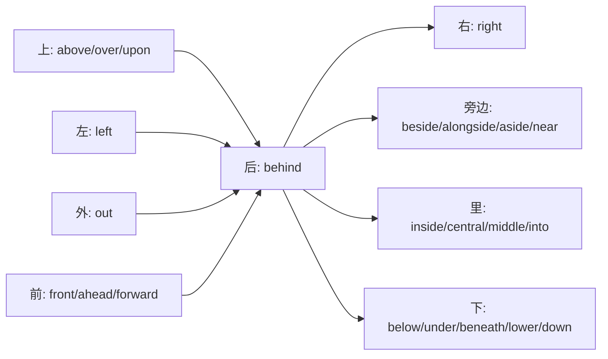
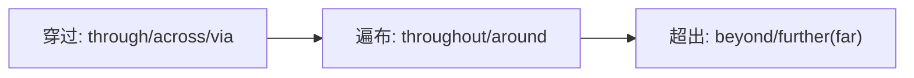

# 时间、地点、数量

## List 7 日期

n. 日期，年代；约会；v.注明……的日期；约会；鉴定年代

妙记：既表示“日期”又表示“约会”，因为约会需要约定具体的日期。

## 考点点拨

①词义:n.日期，年代

The date of her departure for London was settled.

她启程前往伦敦的日期已定下来了。

②词义：n./v.约会

I have a date with my girlfriend tonight.

我今晚和女朋友有个约会。

③词义:v.注明……的日期

She received a letter from him dated March 16, 1998.

她收到 1998 年 3 月 16 日他写的一封信。

④词义:v.鉴定年代

They dated the rock by studying the fossils in it.

他们通过研究里面的化石来确定这块岩石的年代。.

⑤常见词组：

out of date 过 期 的 , 过 时 的

to date 到目前为止

up to date 时新的，现代的

n. 月，月份

妙 记 :形似 moon (月亮),联想到“月份”。

## 考点点拨

①熟词僻义：复数 months 表示“数月、很长时间”

He had to wait for months for the visa to come through.他不得不等好几个月才领到签证。

②常见词组：

by the month 按月计算，如租金

month after month 一月又一月，强调重复

③派生词：

monthly adj./ adv. 每 月 的 ; 每 月 地

月份：

| 单词 | 音标 | 释义 | 口诀 |
| --- | --- | --- | --- |
| January | /ˈdʒænjueri/ | n. 一月 | (Jan 简) 单迎新年 |
| February | /ˈfebrueri/ | n. 二月 | (Feb 飞) 雪二月寒 |
| March | /m ɑrtʃ/ | n. 三月 | (Mar 迈) 步春天来 |
| April | /ˈeɪprəl/ | n. 四月 | (Apr 艾) 草雨纷纷 |
| May | /meɪ/ | n. 五月 | (May 美) 好五月天 |
| June | /dʒuːn/ | n. 六月 | (Jun 骄) 阳六月暑 |
| July | /dʒuˈlaɪ/ | n. 七月 | (Jul 巨) 热七月天 |
| August | /ɔːˈɡʌst/ | n. 八月 | (Aug 傲) 暑八月狂 |
| September | /sepˈtembər/ | n. 九月 | (Sep 收) 获开学季 |
| October | /ɑːkˈtəʊbər/ | n. 十月 | (Oct 奥) 妙红叶秋 |
| November | /nəʊˈvembər/ | n. 十一月 | (Nov 浓) 冬十一月 |
| December | /dɪˈsembər/ | n. 十二月 | (Dec 底) 年十二月 |

星期：

| 单词 | 音标 | 释义 | 口诀 |
| --- | --- | --- | --- |
| Monday | /ˈmʌndeɪ/ | n. 星期一 | 忙 (Mon) day，开始忙了。 |
| Tuesday | /ˈtuːzdeɪ/ | n. 星期二 | 偷懒 (Tue) sday，偷懒当二流子。 |
| Wednesday | /ˈwenzdeɪ/ | n. 星期三 | 蚊子 (Wedn) sday，嗡嗡吵死人，烦躁的中间日。 |
| Thursday | /ˈθɜːrzdeɪ/ | n. 星期四 | 和“四”(Thur) sday，发音相近。 |
| Friday | /ˈfraɪdeɪ/ | n. 星期五 | 放松 (Fri) day，周末快到了。 |
| Saturday | /ˈsætərdeɪ/ | n. 星期六 | 休息 (Sat) urday，休息日。 |
| Sunday | /ˈsʌndeɪ/ | n. 星期日 | 太阳 (Sun) day，阳光明媚。 |

## List 8 时间与频率

## 一、类目联想

情节发展：童年时光→青春奋斗→岁月积淀

## 童年时光

在小时候的 dawn (黎明) 时分，年幼的我总是满心期待新一 day (天) 的冒险。每一 week (周) 周末都是快乐的时间 interval(间隔)，摆脱了平日上学的束缚。记得某天的 morning (早晨)，我和小伙伴们约定 instant (立刻) 集合，一起去探索村子后的小山丘。那样的 moment (时刻) 无忧无虑，欢笑持续整个暑假，成为我人生之 beginning (初) 最珍贵的回忆。

## 青春奋斗

步入 modern (现代) 社会，我迎来了属于自己的 era (时代)。大学毕业后，year (年) 复一年，每天忙碌于工作，常常加班到 dusk (黄昏)。每个 hour (小时)、每一 minute (分钟) 都在为未来努力。decade (十年) 的时光转瞬即逝，在这漫长又短暂的 duration (持续时间),有过挫折，也有过成功。instance ( 例 如 ), 在 一次重要项目中，我凭借努力和坚持，为公司创造了巨大价值。

## 岁月积淀

回首往昔，虽然我无法亲历 century (世纪) 的漫长，但我所经历的这些时光，已足够让我感慨万千。Today (如今) 我明白，无论是短暂的瞬间，还是漫长的 period(一段时间),每一段 time (时光) 都有其独特意义。

## 二、词汇学习

year /jır/

n. 年；一年的时间；学年

## 考点点拨

短语搭配：

a gap year 间隔年【是指学生在完成一段重要的学业阶段后 (通常是高中毕业进入大学前，或大学毕业进入职场前)，暂停常规的学习或职业规划，用一段集中的时间 (通常为一年，也可能是几个月到两年不等) 去进行非学术性的体验和实践的经历。】

【2017 年英语 (二)】

A gap year does not hinder the success of academic pursuits.间隔年并不会阻碍学术追求的成功。

day /dei/

n. 一天；白天；工作日；时期

## 考点点拨

短语搭配：early days 前期、初期

【2021 年英语 (一)】

From the early days of broadband, advocates for consumers and web-based companies worried that.从宽带发展初期开始，消费者权益倡导者和网络公司就担心那一点。

week /wi:k/

n. 星期，一周时间

## 考点点拨

常考释义：星期

【2021 年英语 (二)】

This week, it asked the five most valuable US tech companies for information.

本周，它向美国市值最高的五家科技公司索要了信息。

today /tə'der/

n./adv. 今天；当今

## 考点点拨

常考释义：当今

【2022 年英语 (一)】

Today, 28 percent of graduates in the UK are in non-graduate roles.

当今，英国 28% 的大学毕业生从事着无须大学学历的工作。

century /'sentfəri/

n. 百年，世纪

## 考点点拨

常考释义：世纪

【2023 年英语 (二)】

In the late 18th century, William Wordsworth became famous for his poems about nature.

18 世纪晚期，威廉•华兹华斯因他的自然题材诗歌而声名鹊起。

decade /'dekeıd/

n. 十年

妙记：谐音“代课的”→代课的老师干了十年 (decade)。

natural_image

Interior of a classroom with a teacher standing at a desk, students seated at desks, and framed pictures on the wall (no visible text or symbols)

## 考点点拨

常考释义：十年

【2019 年英语 (一)】

Little more than a decade later, the share of imports was 25.8 percent.

仅仅十多年后，进口占比就达到了 25.8%。

period /'piriəd/

n. 一段时间，时期；句号；月经

妙 记 : 这 段 特 殊 月 经 (period) 时 期 ( period) 的不适，随着句号 ( period) 般的结束，让她更懂得呵护自己。

natural_image

Illustration of a woman in pink robe sitting on a bed, holding a cup (no text or symbols visible)

## 考点点拨

常考释义：时期

【2021 年英语 (一)】

What made photography develop in the Victorian period?

维多利亚时期是什么推动了摄影术的发展？

minute /'miit/ (n.)/mar'nu:t/(adj.)

n. 分钟；会议纪要；adj. 微小的

妙记：老板要求花几分钟 ( minute) 写一个微小的 (minute) 会 议 纪 要 (minute).

## 考点点拨

注意对于该词熟词僻义的考查

summarize the minutes of the meeting

总结会议纪要 (通常以复数形式出现)

A minute spark lit up the dark.

微小的火花照亮了黑暗。

era /'irə/

n. 时代，年代

妙记：联想“are” →这是一个颠倒的年代 (era)

text_image

are
era

## 考点点拨

常考释义：时代

【2020 年英语 (一)】

It was time for a new era — the Age of Reason.

这是一个新的时代——理性时代——到来的时候了。

morning /'mo:rni/

n. 早上，上午

## 考点点拨

常考释义：早上，上午

【2019 年英语 (二)】

I no longer carry the burden of a disappointing morning weigh-in.

我不再背负早晨称重结果令人失望的负担了。

dawn /do:n/

n. 黎明；开端；v. 开始

## 考点点拨

常考释义：开端

【2017 年英语 (一)】

Yet science has a cultural history, too, with robots going back to the dawn of civilization.

然而，科学也有着一段文化史，机器人的概念可以追溯到文明诞生之初。

dusk /dask/

n. 黄昏，傍晚

## 考点点拨

短语搭配：at dusk 黄昏时刻

We arrived home at dusk.

我们傍晚才到家。

hour /'avər/

n. 小时

## 考点点拨

常考释义：小时

【2021 年英语 (二)】

You can leave on a fight an hour late but still arrive on time.你可以晚一个小时登机，但仍然能准时到达。

time /tarm/

n. 时间；次数；倍数；时期；v. 为……安排时间；计时

妙 记 :安 排 时 间 (time) 完 成 任 务 的 次 数 ( time) 多 了，效 率 提 升 的 倍 数 ( time) 会 在 这 段 时 期 (time) 内逐渐显现。

## 考点点拨

注意真题中对于该词释义“倍数”的考查，当大于等于三次时，基数词+times

The new planet is about ten times the size of the earth.这个新发现的行星大约是地球的 10 倍。

interval /'mtəv(ə)l/

n. 时间间隔；幕间休息

妙 记 : inter-(在••••••之间) +val( 谐 音“卧”) →在工作时间中抽点时间躺下休息→时间间隔。

## 考点点拨

常考释义：时间间隔

The interval between major earthquakes might be 200 years.大地震之间的间隔时间可能有 200 年。

duration /du'rerfn/

n. 持续时间

妙 记 : during 的名词形式。

text_image

duration

## 考点点拨

常考得文：科绩时间

【2022 年英语 (二)】

This effect held st eady for the study\`s duration of several weeks.

这种效应在该研究持续的数周时间里保持稳定。

moment I'moomanV/

n. 时刻：瞬间

## 考点点拨

雪考得义：时刻

【2022 年英语 (二)】

The most challenging moment in life are getting married, starting a family and ultimately retiring.

人生中最具挑战性的时刻是结婚、组建家庭以及最终退休。

modern ∫ma:dəm'

adj. 现代的：新潮的

妙记：谐音“摩登”→新潮的、现代的。

## 名点点拔

常考得义：现代的

【2021 年英语 (一)】

World War II was the watershed event for higher education in modern Western societies.

第二次世界大战是现代西方社会高等教育发展的一个分水岭事件。

beginning /biginı/

n. 开头，开端

## 考点点拨

硬通锣配：at the beginning of 在 ⋯⋯ 开始

【2018 年英语 (一)】

We are still at the beginning of this revolution .

我们仍处于这场革命的开端。

instant /'mnstənt/

adj. 立即的：速食的；n. 瞬间

妙 记 : 速 食 (instant ) 带 来 立 即 的 (instant) 满足却留不住长久的瞬间 ( instant )。

natural_image

Interior scene with two people sitting at a table, no visible text or symbols

## 考点点拨

① 短 语 搭 配 : in an instant 立刻。瞬间

【2016 年英语 (一)】

It is fully capable of being restored in an instant.

它完全能够在瞬间恢复。

②派生词：

instantly adv.立 即 , 马 上

instance /'mnstəns/

n. 例子，实例

妙 记 :一 瞬 间 ( instant ) 他变成了典型的例:( instance )。

## 考点点拨

短语搭配：for instance 例 如

【2023 年英语 (二)】

Your father may never remember birthdays because your mother does, for instance.

比如，你父亲可能从不记得生日，因为这些事有感母亲操心。

## 考点点拨

常考释义：持续时间

【2022 年英语 (二)】

This effect held steady for the study's duration of several weeks.

这种效应在该研究持续的数周时间里保持稳定。

moment /'moumənt/

n. 时刻：瞬间

## 考点点拨

常考释义：时刻

【2022 年英语 (二)】

The most challenging moment in life are getting married, starting a family and ultimately retiring.

人生中最具挑战性的时刻是结婚、组建家庭以及最终退休。

modern /'ma:dərn/

adj. 现代的；新潮的

妙记：谐音“摩登”→新潮的，现代的。

## 考点点拨

常考释义：现代的

【2021 年英语 (一)】

World War II was the watershed event for higher education in modern Western societies.

第二次世界大战是现代西方社会高等教育发展的一个分水岭事件。

beginning /bi'gının/

n. 开头，开端

## 考点点拨

短语搭配：at the beginning of 在······开始

【2018 年英语 (一)】

We are still at the beginning of this revolution .

我们仍处于这场革命的开端。

instant /'instənt/

adj. 立即的；速食的；n. 瞬间

妙 记 : 速 食 (instant ) 带 来 立 即 的 (instant) 满足。却留不住长久的瞬间 (instant )。

natural_image

Interior scene with two people embracing, no visible text or symbols

## 考点点拨

①短语搭配：in an instant 立刻，瞬间

【2016 年英语 (一)】

It is fully capable of being restored in an instant.

它完全能够在瞬间恢复。

②派生词：

instantly adv.立即，马上

instance /'mnstəns/

n. 例子，实例

妙 记 :一 瞬 间 (instant ) 他变成了典型的例子 (instance )。

## 考点点拨

短语搭配：for instance 例如

【2023 年英语 (二)】

Your father may never remember birthdays because your mother does, for instance.

比如，你父亲可能从不记得生日，因为这些事有你母亲操心。

## List 9 时间

## 一、单词归类

## 过去→现在→将来

## 过 去

former( 以前的)

previous( 先前的)

prior( 在······之前的 )

before( 在······之前 )

ago( 以 前)

past( 过去的)

last( 上一次的)

ever( 曾经)

then( 那时)

## 现在

now( 现 在)

nowadays( 现 今)

recent( 近 期 的)

current (currency)( 当前的)

contemporary( 当代的)

## 将来

after( 在……之后)

latter( 后者的)

future( 未来的)

following( 接下来的)

subsequent( 随后的)

then( 然后)

## 二、词汇学习

former /'fo:rmət/

pron. 前者；adj. 以前的

妙记：form(形态、形状) +-er ( 人 / 事 物 )→ 最 初的形态→以前的、前者 (former)。

text_image

former

## 考点点拨

①常考代词形式：the former 前者

【2005 年】

The author associates the issue of global warming with that of smoking because a lesson from the latter is applicable to the former.

作者将全球气候变暖的问题与吸烟问题联系起来，

是因为从吸烟问题中吸取的教训也适用于前者 (全球变暖问题)。

【2008 年】

The former has been put down to social effects, such as a strong tradition of valuing education.

前者可归结于社会影响，例如重视教育的浓厚传统。

②词义：adj. 以前的

In former times marriages were arranged by one's parents in China.

以前在中国，婚姻得由父母安排。

previous /'pri:viəs/

adj. 以前的，先前的

妙记：谐音“呸，为我死？”→“先前的”(previous ) 对象也这么说！

## 考点点拨

①词义：adj. 以前的

【2020 年英语 (二)】

That's a big change from the previous generation.

这与上一代相比有了很大的不同。

②词组：

previous to 在 ······ 之 前

She became ill previous to her visit.

出访前她病了。

③派生词：

previously adv.以前地，先前地

prior /'praiət/

adj.先前的，事先的；优先的，更重要的

妙记：谐音“婆爱鹅”→婆婆“优先”考虑鹅。

natural_image

Elderly woman feeding chickens outdoors, with a stone structure and trees in the background (no visible text or symbols)

## 考点点拨

①词义：adj. 先前的

【2012 年英语 (一)】

Prior knowledge and interests influence what we experience, what we think our experiences mean, and the subsequent actions we take.

先前的知识和兴趣会影响我们的所见所闻，对我们所经历之事的理解以及我们随后所采取的行动。

②词义:adj. 优先的、更重要的

a prior choice 优先的选择

③辨析：former & previous & prior

former (两者中) 前者的，通常带有比较的意味；

previous 强调在时间或位置上紧接着前面；

● prior 与 previous 几乎同义，但含有比其他事物更重要的意思。

④派生词：

priority n.优先权

prioritize v.优先处理;按优先级排序

before /br'fo:r/

prep. 在……前面；当着……的面；conj. 在……之前；adv.前面，从前，早些时候

妙 记 : be( 是 / 存 在 ) +-fore( 前 ) → 是 前 . 就是“在••••••前面”( before )。

## 考点点拨

①词义：prep. 在······之前

【2020 年英语 (二)】

Some people like small talk in a meeting before digging into important matters, while others are more straightforward.

有些人会在会议开始时先进行一些闲聊，以便更好地了解情况，而另一些人则会直接切入正题。

②词义：adv. 从前

I have never seen him before.

我以前从未见过他。

③词组：

as before 如以前……

before long 不 久 , 很 快

ago /ə'gə/

adv. 以前，从前

妙记：a (一) go( 谐 音“狗”)→ 我“以 前”(ago ) 捡过一只狗。

## 考点点拨

①辨析：age & before

ago 仅 作 为 副 词 , 与 时 间 段 连 用 ( 如 ten years ago)，且只能用于过去时；

before 可作 介 词 (before 2020) 、连 词 (before I left) 或副词 (I' ve seen it before),时间范围更广 ( 过去/ 将来均可)。

②词组：

long ago 很久以前

not long ago 不久前

past /pæst/

adj. 过去的，昔日的；刚过去的；n. 过去；prep.经过；超过；adv.超过

妙记：谐 音“趴 石 头”→ 趴 在 石 头 上 回 忆“过去”(past)。

natural_image

Person lying on a stone surface in a grassy outdoor setting (no visible text or symbols)

## 考点点拨

①词义：adj. 过去的

【2022 年英语 (二)】

over the past decade 在过去的十年中

②词义：prep. 超过

【2022 年英语 (二)】

The value of work is also driving folks to continue working past retirement.

工作的价值也促使人们在退休后仍继续工作。

③词义:n. 过去

【2023 年英语 (二)】

The parks also help keep America's past alive.这些公园还有助于让美国的历史得以延续。

last /læst/

adj. 最后的；最近的，上一个的；v. 持续；维持，够用

妙记：谐音“辣死他”→他是“最后”(last ) 一个。辣死他。

## 考点点拨

①词义:adj. 最近的，上一个的

【2013 年英语 (一)】

in the last decade or so 在过去大约十年的时间里

②词义:v. 维持，够用

【2013 年英语 (一)】

These labels encourage style-conscious consumers to see clothes as disposable - meant to last only a wash or two.

这些标签促使注重时尚的消费者将衣物视为一次性用品——认为它们最多只能够洗一两次就会损坏。

③词组：at last 终于

【2010 年英语 (二)】

Changes in the competitive dynamics of this fragmented industry are at last making it feasible for wholesalers to consolidate.

这一分散行业的竞争态势终于发生变化，使得批发商的整合成为可能。

④派生词：

lasting adj.持久的，耐久的

【2011 年英语 (二)】

lasting reward 长久的回报

ever l'evar/

ndv.曾经，从来，在任何时候；总是；究竟

妙记：语音“爱玩”、“任何时候”(ever ) 都爱玩。

## 考点点拨

①词义：从此，在任何时候

【2019 年英语 (二)】

This advice is more relevant now than ever before, even as more parents want to embrace the ideas of their children. despite the current housing crunch.

这一建议在当下比以往任何时候都更具现实意义——尽管当前住房紧张。仍有越来越多的父母希望接纳子女的想法。

②词组：for ever 永远

③派生词：

however adv/ conj.无论如何

whenever conj.无论何时

wherever conj.无论何地

then /δcn/

adv.（指过去）当时.(指将来）到那时；然后，接下来：另外，还有

妙 记 : then ( 当时) 我在 tent( 帐 篷 ) 里。

## 考点点拨

①词义：到那时

【2021 年英语 (二)】

The discussion will then become more like a chess game than a boxing match.

到那时，这场讨论将更像一场棋局博弈，而非拳台较量。

②词义：另外

And then there are other things to be taken into account.另外还有其他事情需要考虑。

③词组：

from then on 从那时起

since then 从那时起

but then 不过

now and then 时而，不时

and then 而且，其次

now /nau/

adv.此刻，现在；既然，由于

妙记:“闹钟”,now (谐音“闹”)→“现在”(now )

## 立刻起床！

## 考点点拨

①词义：此刻，现在

【2014 年英语 (一)】

You are now not wanted; you are now excluded from the work environment that offers purpose and structure in your life.

此刻，你已不被需要；此刻，你被排除在为你提供人生目标与秩序的工作环境之外。

②逻辑副词 now that = since 既然由于

Now that the data is available, researchers can draw conclusions.

既然数据已获取，研究人员可以得出结论。

③词组：

by now 到 现 在 为 止

from now on 从 今 以 后

up to now 迄 今 为 止

just now 刚 才

nowadays /'nauədeiz/

adv. 现在，如今

妙 记 : now ( 现 在 ) + a day( 一 天 ) +s→现在的日子 → 现 在 , 如 今 ( nowadays )。

## 考点点拨

①词义：如今，现在

【2015 年英语 (一)】

I think that, for the majority of scientific papers nowadays, statistical review is more essential than expert review.

我认为，对于当今大多数的科学论文而言，统计学审查比专家审查更为重要。

② 辨 析 : now & nowadays

now 的含义更广，既可以指说话的此刻，也可以指目前；

nowadays 不包含此刻的意思，它常用于旧时习俗、习惯等的对比中，说话者常带有感情色彩，可用 nowadays 的句子就可用 now, 反之则不然。

recent /'ri:snt/

adj. 最近的，最新的

妙 记 : re- ( 反 复 )+cent ( 一 分 钱 ) →“最近”(recent

运气好，总是捡到一分钱。

## 考点点拨

①词义：最近的，最新的

【2021 年英语 (二)】

Brexit is seen by some as an opportunity to reverse a recent trend towards the UK importing food.

对于一些人而言，英国脱欧被视为扭转近期英国进口食品这一趋势的契机。

②词组：

in recent years 近年来

recent research/ studies 最新研究

③派生词：

recently adv.最近

current /'kɜːrәnt/

adj. 流通的，流行的；当前的；最近的；n.电流

妙记：cur( 谐 音“可”)+rent( 出 租 ) →可出租的，就是“流通的”(current)。

## 考点点拨

①词义:adj.流通的，流行的

Rumors about the merger are widely current in the business community.

关于合并的传言在商界广泛流传。

②词义：adj. 当前的

【2021 年英语 (二)】

That is before we look for the space to grow the grains, sugars, seeds and oils that provide us with the vast bulk of our current ca lorie intake.

在此之前，我们还需寻找空间来种植那些能为我们提供大部分当前所需热量的谷物、糖类、种子和油类作物。

③词义:n.电流

The electric current flows from the positive to the negative terminal.

电流从正极流向负极。

④词组：

current affairs 时 事

direct current 直流电

alternating current 交流电

⑤派生词：

currently adv.目前，现在

currency /'kɜːrәnsi/

n.通用，流行；通货，货币

妙 记 : curren(current, 流 通 的 )+-cy ( 名 词 后 缀 ) →流通中的事物，即为“货币”(currency)。

## 考点点拨

①词义：通货，货币

Tourists need to exchange their currency before traveling abroad.

游客出国前需要兑换货币。

②词义：通用，流行

The slang term“GOAT”gained currency on social media.俚语“GOAT”在社交媒体上流行起来。

contemporary /kən'tempəreri/

adj.当代的，现代的；同时期的，同时代的

妙 记 : con( 共 同 )+tempor( 时 间 ) +-ary( 形 容 词后 缀 )→ 同 时 代 的 (contemporary) 。

## 考点点拨

①词义：同时期的，同时代的

The event was contemporary with the first.

这次事件与第一次是同一时代发生的。

②词义：现代的，当代的

contemporary art (literature, music, dance)

当代艺术 (文学，音乐，舞蹈)

③ 辨 析 : contemporary & modern

contemporary 意为“当代的或同时代的”,可表示不同的人或物存在于同一时代；

modern 意为“现代的、近代的”，时期可长可短，也 可 指 新 式 的，有 别 于 传 统 的。它 与 ancient，medievual 意义相对。

after /'æftər/

prep./conj. 在……之后；adv.以后，后来

妙 记 :a(鹅) fter(谐音“福特儿”)→鹅在“后面追福特车。

natural_image

Illustration of a cartoon character with a large 'A' sign, standing beside a blurred car (no text or symbols on the character or background)

## 考点点拨

①词义：conj.在······之后

【2021 年英语 (二)】

Both apps, however, were later scrapped after Microsoft said it had used their best features in its own products.

然而，这两款应用后来都被弃用了，因为微软称已经将它们的最佳功能用到了自己的产品中。

②词组：

soon/ shortly after 不 久 之 后

after all 毕 竟 ( 让 步 逻 辑 , 阅 读/完形高频)

be after 追 求 , 寻 找

adj.(两者之中的）后者的；末期的；n.（两者之间的）后者

妙 记 : 谐 音“拉 他”→ 他 是“后 者”(latter), 拉他一把。

text_image

LASTER
2
后者

## 考点点拨

①词义:adj.(两者之中的) 后者的

【2022 年英语 (二)】

The latter group made no effort to recall the information when quizzed on it later.

后一组人在后来被问及这些信息时，并没有试图回忆起相关内容。

②词义：n.(两者之间的 ) 后者

This white rose and that red rose are pretty. But I

prefer the latter.

这朵白玫瑰和那朵红玫瑰都很漂亮，但我比较喜欢后者。

n. 未来，将来；前途，前景；n. 期货

妙 记 :谐音“飞车”→飞车，属于“未来”(future)。

text_image

飞车→
这是未来!
FU·TUR2
飞车

## 考点点拨

①辨析：in the future & in future

in the future :指“在未来的某个时间点或时间段”，强调时间跨度 (可近可远)；

in future: 从今以后，今后 (= from now on),强调从现在开始的改变。

②常见搭配：

in the near/ distant future 在不久/ 遥远的将来

future prospects 未来前景

③熟词辟义:n.期货

commodity futures 商品期货

adj. 接下来的，下述的；prep. 在……之后；n 追随者

妙 记 : follow( 跟 随 ) +-ing( 形 容 词 后 缀 ) → 跟随而 来 的，就 是“接 下 来 的”或“追随者” (following).

## 考点点拨

①词义:adj.接下来的，下述的

Please complete the following tasks.

请完成下述任务。

②词义：prep.在······之后 (= after)

【2025 年英语 (二)】

Following the British assumption of control in New York, the street was renamed Broadway.

在英国人接管纽约之后，这条街道便被更名为“百老汇”。

③常见搭配：

the following day/ year ( 次 日/ 次 年) as follows ( 如 下)

④派生词：

follow v.跟 随 ; 接 着 ; 领 会 ; 沿 着 ⋯⋯ 前 进 ; 遵循结果是……

常用搭配：followed by

A middle aged woman come over, follow by a group of children.

一位中年妇女走进来，后面跟着一群孩子。

## subsequent /'sabsikwənt/

## adj.随后的，接着的

妙记：sub-( 在 …… 下 )+sequ-( 跟 随 )+-ent( 形容词后缀)→ 随 后 的 , 接 下 来 的 (subsequent) 。

## 考点点拨

①词义：随后的，接着的

【2019 年英语 (一)】

We see students achieve more success because they

retake a course and do better in subsequent courses.

我们发现，学生通过重修课程，在后续课程中表现更出色，进而取得了更大的成功。

②常见搭配：

subsequent events 后续事件

subsequent generations 后 代

③辨析：subsequent & consequent

subsequent: 时间上随后;

consequent: 因果上随之而来。

## List 10 频次

## 一、频 次 分 类

| 100% | always(总是) |
| --- | --- |
| 80%—90% | regular(规律的) |
| 70%—60% | usually(通常)often / oftentimes(经常) |
| 50% | sometimes(有时) |
| 10% | seldom(很少)rarely(罕见地) |
| 0% | never(从不) |

| 1 天周期 | daily(每日) |
| --- | --- |
| 7 天周期 | weekly(每周) |
| 1 年周期 | annual(每年) |

## 二、词汇学习

always /'o:lweiz/

adv.总是，每次都是；一直，长久以来

妙 记 : al( 联 想“all”, 完 全 , 全 部 ) +way ( 道 路 )+ s→一路上全都是→引申为“总是”(always)。

natural_image

Person walking on a dirt path with footprints, surrounded by trees and grass (no text or symbols visible)

## 考点点拨

①现在完成时，强调“一贯持续”

【2020 年英语 (二)】

And beyond this, major CEOs still have to do all the day-to-day work they have always done.

除此之外，这些大型企业的首席执行官们仍需承担他们一直以来所从事的所有日常工作。

②进行时，表反复动作 (常含感情色彩)

You' re always interrupting me!

你老是打断我说话！(表抱怨)

③常见搭配：

almost always 几乎总是

not always 并 非 总 是 ( 部 分 否 定 )

always the case 一贯如此

regular /'regjələr/

adj.定期的，规律的；整齐的，匀称的

妙记：谐音“热固啦”→天气热是每年固定的啦，是规律的 (regular)。

## 考点点拨

①常考释义:adj. 有规律的

【2023 年英语 (二)】

go to the national parks on a regular basis 定期去国家公园游玩

②作为形容词，还表示“整齐的，匀称的”

The girl has a regular figure.

这女孩身材匀称。

③常见搭配：

regular customer 常 客

regular schedule 固定日程

④派生词：

regularly adv.有规律地

irregular adj.不规则的

usually /' ju:ʒuәli/

adv.通常地，经常地

妙记：usua( 形 似 USA 美 国 )+lly ( 音 似“理”)→美国通常 (usually) 都不会理会其他国家的压力→通常。

## 考点点拨

## 写作加分句型：

It is usually the case that… 通常情况是……

It is usually the case that early claims are contested.

通常情况下，早期的索赔都会遭到质疑。

usually,but not always 通 常 ( 但 并 非 总 是 ), 可 替换 generally。

The weather here is usually, but not always, sunny in the summer.

这里的夏天通常 (但不总是) 晴朗。

unusual /an'ju:zuəl/

adj.不寻常的，罕见的；与众不同的

妙 记 : un-( 不 ) + usual ( 通 常 的 ) → 不 寻 常的 (unusual )。

## 考点点拨

①常考释义:adj. 不寻常的，罕见的

【2019 年英语 (一)】

Financial regulators in Britain have imposed a rather unusual rule on the bosses of big banks.

英国的金融监管机构对大型银行的高管们实施了一项颇为特殊的规定。

②词组 not unusual“相对常见”的委婉说法

Delays are not unusual in this process.

在这个过程中出现延误是常有的事。

③常见搭配：

unusual phenomenon 异常现象

unusual behavior 反常行为

often /'o:fn/

adv. 常常，时常

妙 记 : of(…… 的 ; 对 于 )+ten ( 十 ) → 对 于 他

来说，每次吃十碗饭是经常的事→常常 (often)。

text_image

I do this
OF TEN!

## 常见搭配：

more often than not 通常情况下

More often than not, media coverage exaggerates scientific findings.

通常情况下，媒体的报道会夸大科学发现的影响力。

● every so often 偶 尔 , 有 时

He visits his hometown every so often to check on his parents.

他偶尔回家乡看望父母。

oftentimes /'o:fntaimz/

adv.时常地，经常地

妙 记 : often( 经 常 ) + times ( 次 数 ) →oftentimes 与 often 同义，但属古旧/方言用法。

## 考点点拨

学术写作/正式文体中避免使用，仅用于口语、文学或刻意复古的语境。

Oftentimes, I wouldn' t even return the calls.

我甚至经常不回电话。

sometimes /'samtaimz/

adv.有时，间或

妙 记 : some ( 一 些 ) + times ( 次 数 )→ 发 生 过 一 些次 → 有 时 (sometimes )。

## 考点点拨

①特殊句型：

sometimes.. ., other times... 对比不同情况

Sometimes the data spikes, other times it plateaus.有时数据会突然飙升，而其他时候则会保持平稳。

even sometimes 强调意外性

Experts, even sometimes pioneers, make mistakes.专家们，即便是那些所谓的“先驱者”，也会犯错。

②辨析：sometime & some time

sometime 某 时

Let's meet sometime next week.

我们下周找个时间见面吧。

some time 一段时间

It took some time to solve.

这花了些时间才得以解决。

seldom /'seldəm/

adv.很少、不常

妙 记 : sel( 近 似 sell, 卖 )+done( 完 了 )→ 几 乎 卖完了→很少 (seldom)。

natural_image

Interior view of a storage shelf with colorful shelves and a small computer monitor on the shelf (no visible text or symbols)

## 考点点拨

常见搭配：

seldom or never 极少甚至从不

She seldom or never eats fast food.

她极少甚至从不吃快餐。

seldom seen 罕见的

This kind of bird is seldom seen in urban areas.

这种鸟类在城市中很少见。

rarely /'rerli/

adv.罕有，很少

妙记：rare( 稀 少 的 )+-ly( 表 副 词 )→ 罕 见 (rarely)

## 考点点拨

①常考释义：罕有，很少

【2022 年英语 (二)】

Although we try our best, sometimes our paintings rarely turn out as originally planned.

尽管我们竭尽全力，但有时我们的画作却很难达到最初预期的效果。

②辨析：rarely & seldom

seldom 很少 (强调不常发生)，较口语化；

He seldom goes to the cinema.

他很少去电影院。(不常去，但并非绝对没有)

rarely 几 乎 不 ( 强 调 稀 少 性 ), 比 seldom 更 低 频 ,更正式。

She rarely attends parties.

她几乎不参加聚会。(几乎从不，强调“极少例外”)

never /'nevər/

adv. 决不，永不

妙 记 : n(e)( 不 )+ever( 永 远 )→ 永 远 不 (never)

## 考点点拨

①常见搭配：

never ever 绝 对 不 ( 强 调 )

I will never ever trust him again.

我再也不会相信他了。

never before 从 未 有 过

Never before has technology advanced so rapidly.以前从未有过技术发展得如此迅速的情况。

never again 不 再

After the accident, he never again drove drunk.

事故发生后，他再也不敢酒后驾车了。

②写作应用：强调否定时 ,under no circumstances 可替换 never, 当 under no circumstances 位于句首时。句子需采用部分倒装结构。

Under no circumstances will we compromise.(= We will never compromise.)

我们绝不妥协。

daily /'derli/

adj. 每日的，日常的；adv.每日，天天；n. 日报

妙 记 : day( 一 日 , 一 天 )+-ly( 有 …… 特 征 的 )→每 日 , 天 天 (daily) 。

## 考点点拨

①常考释义:adj. 每日的，日常的

【2022 年英语 (二)】

Creative problem-solving skills are incredibly useful in daily life.

创造性解决问题的能力在日常生活中非常有用。

②常考释义:adv. 每日，天天

【2019 年英语 (二)】

I also found that weighing myself daily did not provide an accurate depiction of the hard work and progress l was making in the gym.

我还发现，每天称体重并不能真实反映我在健身房所付出的努力以及取得的进步情况。

③作为名词、表示“日报”

The Times is Britain's oldest national daily.

《泰晤士报》是英国历史最悠久的全国性日报。

weekly /' wi: kli/

adj.每周的，一周一次的；adv.每周；n.周报，周刊

妙记：week ( 一 周 ) +- ly ( 有 …… 特 征 的 ) → 每周 (weekly )。

## 考点点拨

①常考释义:adj. 每周的，一周一次的

【2024 年英语 (二)】

Farmers’ markets are usually weekly or monthly events, most often with outdoor stalls.

农民市场通常是每周或每月举办一次活动，通常会设有户外摊位。

②常考释义：adv. 每周

【2014 年英语 (一)】

They should report weekly rather than fortnightly.

他们应该每周汇报一次，而不是每两周汇报一次。

③作为名词，表示“周报，周刊”

【2011 年英语 (一)】

Us Weekly《美国周刊》

annual /'ænjuəl/

adj.一年一度的，每年的；n.一年生植物，年刊

妙记：an + nu ( 谐 音“new”)+- al (形容词后缀) → a new year →每年的 ( annual ) 新 年 你 都 会 订 阅 年报 (annual)。

## 考点点拨

①常考释义:adj. 每年的

【2023 年英语 (二)】

Meanwhile, the number of annual visitors has increased by more than 50% since 1980.

与此同时，自 1980 年以来，每年的游客数量增长了超过 50%。

②常考释义:adj. 一年一度的

【2023 年英语 (二)】

annual show 年度展览

③作为名词，可表示“年刊，年报”

a college annual 大 学 年 刊

④作为名词，表示“一年生植物”

Corn and beans are annuals.

玉米和豆类都是一年生植物。

early I'3:rli/

adj. 提前的，初期的；adv.在早期，在初期；提早，提前

妙 记 :谐音“饿哩”→所以要“提前”(early ) 吃饭。

## 考点点拨

①常考释义:adj. 提前的

I'm always early.

我总是提早。

②常考释义:adj. 初期的

【2025 年英语 (二)】

in the early 2010s 在 2010 年 代 初 期 ( 指 2010 年至 2013 或 2014 年左右)

③常见搭配：

early on 在 早 期 , 早 先

earlier than expected 比预期早

in the early stages of 在……的早期阶段

soon /su:n/

adv.早，快；不久，即刻

妙 记 : 谐音“速”→有速度，就“快”(soon )。

text_image

NOW-
FUTURE
SOON

## 考点点拨

①常考释义：adv. 早，快

【2022 年英语 (二)】

Too much too soon either results in injury or burnout.过快地做太多的事情，要么会导致受伤，要么会造成过度疲劳。

②辨析：soon & early

●soon 是 从“现在”算起的“短时间后”；

The meeting will begin soon.会议即将开始。

●early 与“既定时间”相比“提前”。

He arrived early for the interview.

他比约定时间早到面试现场。

③常见搭配：

as soon as 一……就……

sooner or later 迟早

later /'leitər/

adv.后来；其后 adj. 后来的

妙 记 : late( 晚 的 )+-cr( 比 较 级 , 表 示 更 )→ 更 晚的、就是“后来的”(later)。

## 考点点拨

①常考释义：adv. 后来

【2019 年英语二】

Unlike so-called basic emotions such as sadness, fear, and anger, guilt emerges a little later, in onjunction with a child's growing grasp of social and horal norms.

与诸如悲伤、恐惧和愤怒这类所谓的基本情绪不同 .内疚感的出现要稍晚一些，它是在孩子逐渐理解社会和道德规范的过程中产生的。

2 常见搭配：later on 稍后，以后

no later than 不迟于 (截止时间，正式用语)

eventually /i'ventfuəli/

adv. 最终，结果

妙 记 : event( 事 件 )+-ual( 形 容 词 后 缀 )+-ly( 副词后缀)→需要一系列事件后才能发生的→最终 (eventually )。

natural_image

Abstract 3D illustration of colorful blocks arranged in a curved path with a gold card symbol (no text or symbols present)

## 考点点拨

①常考释义:adv. 最终，结果

【2022 年英语 (二)】

John Kelly, a construction lawyer at Freeths law firm, believes prices will eventually come down.

弗雷思律师事务所的建筑律师约翰•凯利认为，房价最终会有所下降。

②辨析：eventually & finally

eventually: 强调“经过波折后的最终结果”;

After getting lost twice, we eventually found the hotel.在迷路两次后，我们最终找到了酒店。

finally: 强调“顺序上的最后一步”。

First, add flour; next, pour milk; finally, mix them well.首先加面粉，接着倒牛奶，最后搅拌均匀。

already /ɔ:l ' redi /

adv. 已 经 , 早 已

妙 记 : al( 音 似 all, 全 部 )+ready( 准 备 )→ 全准 备 好 →“已 经”(already) 完成。

## 考点点拨

①常考释义 : adv. 已经

【2023 年英语 (二)】

Materials prices are already up 25% in the last two years.

过去两年里，原材料价格已经上涨了 25%。

②当用于疑问句或否定句时，常暗含说话者的惊讶或不耐烦。

Have you already finished the book? It's only been two days! 你已经看完这本书了？才两天啊！

forever /fər'evər/

adv.永远；完全地，永恒地

妙 记 : for( 为 了 ) +ever( 曾 经 )→ 为 了 曾 经 的 承诺 , 我 们 要 永 远 (forever) 努力→永远。

## 考点点拨

①熟词僻义：表示“极长时间”或“频繁发生”

She is forever losing her keys.

她老是丢钥匙。(含抱怨语气)

②常见短语：

last forever 持 续 永 远

wait forever 等 待 漫 长

initial /i'nıl/

adj. 最初的，开头的；n.（名字的）首字母

妙记：谐音“以你首”→以你为首→最初，开头 (initial)。

text_image

Initial
以你爱

## 考点点拨

①常考释义：最初的

【2010 年英语 (一)】

If people in the network just two degrees removed from the initial influential prove resistant, for example, the cascade of change won't propagate very far or affect many people.

如果网络中与最初有影响力的人相隔两级的个体表现出抵制态度，那么改变的传播链就不会延伸太远，也不会影响太多人。

②作为名词，表示“(名字的) 首字母”

The general manager wrote his initials on the contract.总经理在合同上签了自己名字的首字母。

③派生词：

initially adv.开 始 , 最 初

once /wans/

adv.一次，一回；曾经，一度；conj.一……就，一旦

妙 记 : 一 旦 (once ) 发 生 过 一 次 (once), 就 代 表 是曾 经 (once )。

## 考点点拨

①常考释义：adv. 曾经

【2023 年英语 (二)】

At the same time, once cheerful and compliant children become rebellious teenage risk-takers.

与此同时，那些曾经活泼听话的孩子在长大后会变成叛逆的青少年，开始冒险行事。

②常考释义：conj. 一……就，一旦

【2010 年英语 (一)】

Rage Against the Haze failed once state funding was cut.一旦州政府切断资金支持，“怒对雾霾”运动便宣告失败。

③常见搭配：

at once 立 刻 ; 同 时

once upon a time 从 前 (故事开头)

once in a while 偶尔

sudden /'sʌdn/

adj. 突然的，意外的；n. 突然发生的事

妙记：谐音“傻等”→正在傻等，他“突然”就来了。

①常考释义:adj. 突然的，意外的

【2024 年英语 (二)】

And he's become a sudden hit in the new world of textto-image AI generation.

而他却在全新的“文字生成图像”人工智能领域迅速走红。

②常见短语：

all of a sudden 突 然

sudden change 骤 变

sudden death 猝 死

③派生词：

suddenly adv.突然地，出乎意料地

suddenness n.突然性

still /strl/

adv.还，依旧；静止地；adj.静止的；n.(电影或录像的）定格画面

妙记：一个事物仍旧 ( still) 不变，说明是静止的 (still).

## 考点点拨

①常考释义：adv. 还，依旧

【2019 年英语 (二)】

In the popular imagination, of course, guilt still gets a bad rap.

当然，在大众的观念里，内疚仍然背负着恶名。

②作为形容词，表示“静止的”

【2013 年英语 (一)】

still point of the turning world 旋转世界的静止点

③常见搭配：

still less 更 不 用 说/ still more 更 加

stand still 静 止 不 动

hitherto /ˌhɪðәr' tu:/

adv. 迄 今 , 至 今

妙 记 : 谐 音“黑 的 图”→ 迄 今 为 止 (hitherto), 也没找到那张黑色的宝藏图→迄今，至今。

text_image

迄今

## 考点点拨

①常考释义:adv.迄今，至今

【2011 年英语 (一)】

As a description of the next music director of an orchestra that has hitherto been led by musicians like Gustav Mahler and Pierre Boulez.

这是对一位即将接任某交响乐团指挥一职的人的描述，而该乐团此前一直由诸如古斯塔夫•马勒和皮埃尔•布列兹这样的音乐家担任指挥。

②常见搭配：

hitherto unknown 迄今未知的

hitherto prevailing 迄今为止盛行的

【2014 年英语 (一)】

He freed music from hitherto prevailing conventions of

harmony and structure.

他使音乐摆脱了此前一直盛行的和声与结构方面的固有模式。

again /ə'gen/

adv. 再一次

妙 记 : a( 一 会 ) gain( 谐音“该你”) →一会儿诱了，“再一次”(again) 轮到你。

## 考点点拨

常见搭配：

here again 同 样 地 ; 此 处 又 一 次

【2010 年英语 (一)】

Here again, the evidence had to be economic in order to be valid.

同样地，这里的证据也必须是经济相关的才能成立。

now and again 偶 尔

over and over again 一 再 地

## List 11 数字

number /'nambər/

n. 数字；编号；v. 标号、编号；列入（某类）

妙记：音似“难不”，number (数字) 这么多，你说难不？

text_image

难不？！
123

## 考点点拨

①词义:v.标号，编号

The pages are numbered.

页码已标好。

②熟词僻义:v.列入

He numbers among the best writers.

他位列最优秀作家之一。

③常见词组：

a number of 大 量 , 许 多

the number of …… 的 数 量

常见数字及其序数词：

in number 数 量 上

by numbers 按步骤机械地

dozen /'dʌzn/

n.一打，十二个；大量，许多

妙 记 :音似“打针”，夜班才刚开始。已经有十二个 (dozen ) 人在排队打针→十二个，一打。

text_image

12
12

## 考点点拨

①词义:n.一打，十二个

two dozen eggs 两 打 鸡 蛋

② 常 见 词 组 : dozens of+ 名词，表示“许多”

Dozens of students attended the lecture.

数十名学生参加了这次讲座。

| 单词 | 音标 | 释义 | 序数词 | 音标 |
| --- | --- | --- | --- | --- |
| one | /wʌn/ | 一 | first | /fɜːrst/ |
| two | /tuː/ | 二 | second | /ˈsekənd/ |
| three | /θriː/ | 三 | third | /θɜːrd/ |
| four | /fɔːr/ | 四 | fourth | /fɔːrθ/ |
| five | /faɪv/ | 五 | fifth | /fɪfθ/ |
| six | /sɪks/ | 六 | sixth | /sɪksθ/ |
| seven | /ˈsevn/ | 七 | seventh | /ˈsevnθ/ |
| eight | /eɪt/ | 八 | eighth | /eɪtθ/ |
| nine | /naɪn/ | 九 | ninth | /naɪnθ/ |
| ten | /ten/ | 十 | tenth | /tenθ/ |
| eleven | /ɪˈlevn/ | 十一 | eleventh | /ɪˈlevnθ/ |
| twelve | /twelv/ | 十二 | twelfth | /twelfθ/ |
| thirteen | /ˌθɜːrˈtiːn/ | 十三 | thirteenth | /ˌθɜːrˈtiːnθ/ |
| fourteen | /ˌfɔːrˈtiːn/ | 十四 | fourteenth | /ˌfɔːrˈtiːnθ/ |
| fifteen | /ˌfɪfˈtiːn/ | 十五 | fifteenth | /ˌfɪfˈtiːnθ/ |
| sixteen | /ˌsɪksˈtiːn/ | 十六 | sixteenth | /ˌsɪksˈtiːnθ/ |
| seventeen | /ˌsevn' tiːn/ | 十七 | seventeenth | /ˌsevn' tiːnθ/ |
| eighteen | /ˌeɪ' tiːn/ | 十八 | eighteenth | /ˌeɪ' tiːnθ/ |
| nineteen | /ˌnaɪn' tiːn/ | 十九 | nineteenth | /ˌnaɪn' tiːnθ/ |
| twenty | /'twentieth/ | 二十 | twentieth | /'twentieth/ |
| thirty | /'θɜːrti/ | 三十 | thirtieth | /'θɜːrtiəθ/ |
| forty | /'fɔːrti/ | 四十 | fortieth | /'fɔːrtiəθ/ |
| fifty | /'fɪfti/ | 五十 | fiftieth | /'fɪftiəθ/ |
| sixty | /'sɪksti/ | 六十 | sixtieth | /'sɪkstiəθ/ |
| seventy | /'sevnti/ | 七十 | seventieth | /'sevntiəθ/ |
| eighty | /'eɪti/ | 八十 | eightieth | /'eɪtiəθ/ |
| ninety | /'naɪnti/ | 九十 | ninetieth | /'naɪntiəθ/ |

| 单词 | 音标 | 释义 | 妙记 | 考点 |
| --- | --- | --- | --- | --- |
| hundred | /ˈhʌndrəd/ | 一百 | hund(red) 一百元是红色的 | 词组:hundreds of 数百的;成百上千的 |
| thousand | /ˈθaʊznd/ | 一千 | thou(手)sand(沙),千粒金沙握在手。 | 词组:thousands of 数千的;成千上万的 one in a thousand 不可多得 |
| million | /ˈmɪljən/ | 一百万 | 音似“迷恋”→对一百万非常迷恋。 | 词组:millions of 数百万 |
| billion | /ˈbɪljən/ | 十亿 | 音似“币利翁”→有十亿的人，光是靠现有的钱吃利息就能高枕无忧的老翁→十亿 | 词组:billions of 数十亿 |

# List 12 数量与单位

## 一、词汇学习

major /'meɪ dʒәr/

adj.主要的；n.主修科目，专业；v.主修，专攻

妙记：谐音“没辙”→这么大的事情，我也没辙啊→主要的、重大的 (major)。

## 考点点拨

①词义：adj. 主要的

【2020 年英语 (二)】

Plus, virtually all major American companies are becoming tech companies, often with their own research and development.

此外，几乎所有的美国大型企业都在向科技公司转型，而且很多企业还自行开展研发工作。

②作名词，表示“主修科目，专业”

【2020 年英语 (二)】

One survey from Accenture found that 88 percent of graduating seniors this year chose their major with a job in mind.

埃森哲公司的一项调查发现，今年毕业的高年级学生中有 88% 是在考虑就业前景的情况下选择所学专业的。

③派生词：

majority n.大多数，多数派

majority /mә'dʒɔːrәti/

n.大多数；<英> 多数票；成年的法定年龄

妙记：major( 主 要 的 )+-ity( 表 示 状 态 )→ 大多数，大部分 ( majority).

## 考点点拨

①词义:n.大多数

【2019 年英语 (二)】

Like the majority of authors, he had to suffer many disappointments and rejections along the way.

和大多数作家一样，他在创作过程中也遭遇了诸多的挫折和拒绝。

②语法点:“the majority of+ 名词”作主语时 ,谓语动词的单复数由名词决定：

The majority of the work is tedious.

工作大部分是枯燥的。

The majority of students are from Asia.大多数学生来自亚洲。

③反义词：minority n.少 数 ; 少 数 派

minimal /'mmiml/

adj.极小的，极少的；极简的

妙 记 : mini (迷你)+m +-al (与••••••相关的)→极 小 的 (minimal)。

## 考点点拨

①词义：adj. 极少的

【2020 年英语 (二)】

It requires minimal effort and goes a long way.

这需要付出极少的努力，却能带来极大的成效。

②词义：adj. 极简的

【2020 年英语 (二)】

The readiness of the rats to befriend the social robot was surprising given its minimal design.

考虑到这款社交机器人的设计极为简单、老鼠们竟然愿意与它交朋友，这着实令人惊讶。

③派生词：

minimize v.使减少到最低限度;贬低

minimalist n.温和政治改良主义者；极简抽象派艺术家

amount /ə'maont/

n. 数量，总额；v. 达到……之多

妙 记 : a-( 朝 向 ) + mount( 山 ) → 都 到 山 顶 → 引申为总计、达到 (amount)。

text_image

a + mount = amount

## 考点点拨

①amount(s) of 修饰不可数名词

【2024 年英语 (二)】

pay a significant amount of money 支付一笔相当大

的金额

【2023 年英语 (二)】

considerable amounts of water 大量的水

②动词短语：amount to.. 达到······之多

The spokesman stressed that the measures did not amount to an overall ban.

发言人强调说，这些措施并不等于全面禁止。

average /'ævəridz/

adj. 平均的；普通的；n. 平均数；v. 平均为

妙记：谐音“every 值”→把每个值都加起来平均，就得到平均值 (average)。

## 考点点拨

①词义:n.平均数

【2021 年英语 (二)】

spend an average of only \$3.4 billion 平均花费仅为 34 亿美元

②词义：adj.普通的

【2020 年英语 (一)】

It is difficult to the point of impossibility for the average reader under the age of forty to imagine a time when high-quality arts criticism could be found in most big-city newspapers.

对于年龄在 40 岁以下的普通读者来说，要想象曾经有那么一个时期，在大多数大城市的主要报纸上都能看到高质量的艺术评论，这简直是不可能的事了。

③常见词组：

above(the) average 在平均水准之上

below(the) average 在平均水准之下

on(the) average 按平均值，通常情况下的

part /pa:rt/

n. 部分；地区；参加；v. 离开；分散

妙记：基础含义是“部分 (part)”→分出空间成“地区 (part)”,分担角色即“参加 (part) ”,分开整体则“离开/ 分 散 (part) ”。

## 考点点拨

①词义:n.部分

Parts of the book are interesting.

这本书的有些部分很有趣。

②词义：n.参加

She had no part in the picnic.

她没有参加野营。

③词义：n.地区

Which part of Europe have you visited?

你都游览了欧洲的哪些地方？

④词义：v.离开

We parted at the subway station and promised to meet again soon.

我们在地铁站分开，约定很快再见。

⑤派生词：

depart v.离 开 ; 出 发

partition n. 分 割 ; 隔 开

quarter /'kwo:rtər/

n. 四分之一；季度；地区

妙 记 : 谐 音“扩 它”→ 四 分 之 一 (quarter) 太少。要扩大它。

text_image

扩它!
1

## 考点点拨

①词义：n.四分之一

【2021 年英语 (二)】

The country produces only about 60 percent of the food it eats, down from almost three-quarters in the late 1980s .

该国所消耗的食物中，仅有约 60% 是本国自产的，而 这 一 比 例 在 20 世 纪 80 年代末时还高达近 75%。

②词义：n.季度

【2021 年英语 (二)】

I know we seem to be moving toward a first-quarter commitment here.

我知道我们似乎正朝着第一季度的计划方向迈进。

③词义：n.地区

People gathered from all quarters.

人们从四面八方会聚在一起。

prep. 每，每个；经，由

妙记：谐音“破”→“每件”(per) 快递都要小心。别摔破。

text_image

每 (per)
件都要小心，
别摔破！
per 件

## 考点点拨

①词义：prep. 每 ,每个

He earns \$1,200 per week.

他每周挣 1200 美元。

②词义：prep. 经，由

They have increased wealth per medium of expanded production.

他们用扩大生产的方法来增加财富。

③常见词组：

as per sth. 依 照 , 依 据

as per usual 照 常 , 按 惯 例

n. 百分比，百分率

妙记：per ( 每 )+cent- ( 百 , 如 century)+-age (名词后缀)→每一百的比率→百分比 (percentage)。

## 考点点拨

①词义:n. 百分比，百分率

【2022 年英语 (二)】

The percentage of retirement-age people in the labor force has doubled over the past three decades.

在过去三十年里，处于退休年龄的人群在劳动力中的占比翻了一番。

②写作替换词 proportion n.比例

The percentage ( = proportion) of people working remotely has doubled.

远程工作人数比例翻倍。

v.加，增加；补充说

妙记：谐音“爱的”→爱就“加入”。

## 考点点拨

①词义:v. 加，增加

【2010 年英语 (一)】

Later, more established companies raced to add such patents to their files.

随后，一些更成熟的公司也纷纷将此类专利纳入自己的档案之中。

②词义:v. 补充说

He added that he was fed up with his work.

他补充说，他厌倦他的工作。

③常见词组：

add up to 合 计 达 ; 意 味 着

add fuel to the flames 火上浇油

adj.（在数字后）多，余；conj. 此外，另外

妙 记 : iPhone 16 plus→ iPhone 16 加大版→多，余。

## 考点点拨

①词义：adj. (在数字后) 多 , 余

【2013 年英语 (一)】

2,300 -plus stores around the world 全 球 超 过 2300 家门店

②词义：conj. 此外，另外

【2020 年英语 (二)】

Plus, virtually all major American companies are becoming tech companies, often with their own research and development.

此外，几乎所有的美国大型企业都在向科技公司转型，而且通常还会自行开展研发工作。

n. 比分，成绩；v. 得分，记分

妙记：谐音“思过”→多思考就能通过，拿到高比 分 (score )→比分。

## 考点点拨

①词义:n. 比分，成绩

At the end of the first half, there is no score.

上半场结束时，双方均未得分。

②词义:v. 得分，记分

【2010 年英语 (一)】

A more direct finding is that people who scored high for negative emotions like anxiety looked at others for shorter periods of time.

一个更为直接的发现是：那些在负面情绪 (如焦虑) 方面得分较高的人，会更短暂地注视他人。

quota /'kwəutə/

n. 定额，配额，(人或事物的）最高限额

妙记：谐音“阔他”→土豪 (阔) 霸占配额“这配 额 (quota) 我全包了”。

text_image

这代我
啊！我全书！

## 考点点拨

①词义:n.定额，配额

【2020 年英语 (一)】

That is exactly what happened when Norway adopted a nationwide corporate gender quota.

而当挪威在全国范围内推行企业性别配额制度时，情况也正是如此。

②常见搭配：

meet/ reach/ exceed the quota 达 到/ 超出配额 set/ abolish a quota 设 定/ 取消配额

proportion /prə'po:rfn/

n. 比例；部分，份儿；正确的比例，均衡

妙 记 : pro-( 向 前 , 公 开 )+port-( 部 分 )+-ion( 名 词后缀)→明确划分的部分→比例/ 份 额 (proportion).

natural_image

Illustration of a pizza slice with visible toppings and a label 'proportion' (no additional text or symbols)

## 考点点拨

① 词 义 : n. 比 例 (= percentage)

The proportion of imports to exports is worrying the government.

进口与出口的比例令政府担忧。

②词义:n.部分，份儿

There is a high proportion of sugar in this cereal.

这种谷物含糖量高。

③词义:n.均衡

My face is swollen out of all proportion because of my toothache.

由于牙疼，我的脸肿得不像样子了。

④常见词组：

in proportion to 与……成比例的

out of proportion(to) 与……不成比例的，与……不相称

degree /di'gri:/

n. 程度；度数；学位；等级

妙 记 : de (谐音“得”) +gree( 联 想 grade 等 级 )→他通过了高“等级”(degree) 的考试，获得了“学位” (degree).

text_image

“得”到更真“等位”!
de!
得
Grade 1

## 考点点拨

①词义:n.程度

【2021 年英语 (二)】

Then they rated the degree to which they had used intuition (“gut feelings”“hunches”“my heart”).

然后，他们对自身运用直觉的程度进行了评估 (包括“直觉感受”、“预感”以及“我的内心感受”)。

②词义:n.学位

【2011 年英语 (一)】

get a doctoral degree 获得博士学位

③常见词组：

by degrees 逐渐地，一点一点地

to a/ some degree 部分地;在某种程度

rate /reit/

n. 比率；速度，速率；费率；价格；等级；v.评估：顶级

妙 记 : rate ( 联 想 rat, 老 鼠 ) →老鼠跑的“速度” (rate) 好快。

## 考点点拨

①词义:n.比率

【2025 年英语 (二)】

infant mortality rate 婴 儿 死 亡 率

②词义:n.速度，速率

【2021 年英语 (一)】

For example, a high growth rate placed great strains on the existing structures of governance, of administration, and above all of socialization.

例如，如此高的增长率给现有的治理结构、行政体系以及社会结构带来了巨大的压力。

③词义:v.评估

【2021 年英语 (二)】

rate the instructor's overall effectiveness 评 估 该 教师的整体教学效果

④常见词组：

at any rate 无 论 如 何 , 不 管 怎 么 说

first-rate 一 流 的

counter /'kauntər/

n. 柜台；adj. 相反的；adv. 相反地；v. 反对

妙 记 : counter ( 联 想 count, 计 算 )→ 在“柜台” ( counter) 计 算 (count ) 金 额 → 柜 台“面 对 面”→相反。

text_image

100 两!

## 考点点拨

①词义:adj. 相反的，违反的

The new rules are counter to tradition.

这些新规定与传统相悖。

②动词词组：counter with... 用······反驳

## 【2019 年英语 (一)】

Then I counter with another reasonable argument: that a higher minimum wage will force businesses to employ fewer people for less time.

然后我给出了另一个合理的反驳观点：较高的最低工资标准会迫使企业减少雇佣人数，并缩短员工的工作时间。

③常见词组：

over the counter ( 指 药 品 ) 无处方

under the counter 暗 中 交 易 ; 私 下 里

chart / tʃɑːrt/

n. 图表；v.记录；制订 (行动计划)

妙 记 :谐 音“查 它”→ 图 表 (chart) 的 功 能 就 是用来查询它→图表。

text_image

数据太乱？
“查它”(chart) 就明白!

## 考点点拨

①词义:n.图表

a duty chart 工 作 时 间 表

②词义:v.记录

Scientists have been charting temperature changes in the oceans.

科学家们一直在监测海洋的温度变化情况。

③词义:v.制订 (行动计划)

chart a course of action 制订行动方案

## List 13 数量程度（1）

## 一、类目联想

情节发展：程度描述→部分与整体→数量范围

## 程度描述

考古队发现一座古城遗址，挖掘工作 nearly (几乎) 完成时，发现文物 mostly ( 大部分) 保存完好，但都 merely /mere (仅仅) 是普通生活用品。

natural_image

Group of workers in hard hats working in a trench with ancient stone structures in the background (no visible text or symbols)

## 部分与整体

进一步研究显示，损坏 partly (部分) 由自然侵蚀造成，但 total ( 总 的 ) 损 失 中有 bit (少量) 是人为破坏。令人惊讶的是，entire (整个) 宫殿结构仍清晰可辨。

natural_image

Group of workers in hard hats gathered around a table outdoors near a traditional Chinese building (no visible text or symbols)

## 数量范围

Overall (总体而言),遗址包含 several ( 数 个 ) 功 能 区 , 从 whole ( 完 整 的 ) 排 水系统到 single (单个) 祭祀台，展现了古代文明的智慧。团队 wholly ( 完 全 ) 确认该遗址属于青铜时代，并决定将其完整保护。

natural_image

Archaeological excavation site with trenches and two workers in hard hats (no visible text or symbols)

## 二、词汇学习

nearly /'nirli/

adv.几乎，差不多；密切地，亲密地

妙记：near ( 在 附 近 )+-ly ( 副 词 ) → nearly( 差 不 多 ) 表示程度接近，nearly(密切地) 表示关系接近。

## 考点点拨

①词义：adv. 几乎，差不多

Nearly everyone knows it.几乎每个人都知道这个。

②词义:adv. 密切地，亲密地

The matter concerns me nearly.这事件与我有密切关系。

③固定短语：

not nearly 远远不够 nearly there 快 成 功 了/ 快到了 mostly /'məustli/

adv.多半，主要地；几乎全部，几乎所有

妙 记 : most ( 大 部 分 的 ) +-ly ( 副 词 ) → 大部分 ( mostly )。

## 考点点拨

①词义:adv. 几乎全部，几乎所有

Air is mostly nitrogen.空气中大部分是氮。

② 辨 析 : mostly & nearly

mostly 静态描述主体构成；The diet consists mostly of vegetables.饮食主要是蔬菜。

nearly 动态接近某状态。

He nearly fell off the ladder.他差点从梯子上摔下。

adj、仅仅的，只不过；只凭……就足以

妙记：谐音“米儿”→仅仅 (mere) 有米儿的大小。

## 考点点拨

①词义:adj.仅仅的，只不过

She lost the election by a mere 2 votes.

她仅以两票之差在选举中失败。

②词义：adj. 只凭……就足以

The mere fact that they were prepared to talk was encouraging.

他们愿意商谈，单是这一点就足以令人鼓舞。

adv.仅，只，不过

妙 记 : mere( 仅 仅 的 ) +-ly( 副 词 )→ 仅 , 只 , 不 过 (merely).

## 考点点拨

① 词 义 : adv. 仅 , 只 , 不 过

This is mearly the beginning.

这仅仅是个开头。

②常见搭配：

not merely... but (also)... 不 仅 是 …… 而 且 ……

The app is not merely useful but also user-friendly.

这个应用不仅有用，而且界面友好。

③辨析：merely & simply & only

merely 指仅此而已，并非其他；

simply 指就是这样、只是如此，强调单一性；

only 指只有这些、不超过或只有这，强调不多于。

adv. 部分地，不完全地

妙 记 : part( 部 分 ) +-ly( 副 词 )→ 部 分 地 , 不 完 全地 (partly) 。

## 考点点拨

词义:adv.部分地，不完全地

【2022 年英语 (二)】

Retirement patterns are changing partly due to longer life expectancy.

退休模式正在发生变化，部分原因在于人们的预期寿命延长了。

n. 总数，总计；adj. 总的，全部的；v. 总计，合计

妙记：谐音“偷桃”→把桃全部偷走了→全部的。

text_image

偷桃
total!

## 考点点拨

①词义:n.总数，总计

England scored a total of 436 points.

英格兰球队获总分 436 分。

②词义：adj.总的，全部的

【2021 年英语 (二)】

the country's total land area 该 国 的 总 面 积

③词义:v.总计，合计

Please total these numbers.

请把这些数字加起来。

n. 一点，一片，一些

妙 记 : bit( 形 似 bite 咬 )→ 咬 下 来 一 小 部 分→bit( 一 点 ) 。

text_image

just a
bit!
whole bit =

## 考点点拨

①词义:n.一点，一片，一些

She cut the apple into small bits.

她把苹果切成小片。

②词组：

a bit of 一 点

do one’s bit 尽一点力

every bit 完 全 ( 一 样 )

bit by bit 一 点 点 地

③派生词：

bitty adj.拼 凑 的 ; 零 碎 的

adj. 整体的，全部的，完整的

妙记：谐音“因太饿”→因为太饿把冰箱里的全部 (entire ) 东西都吃光了→全部的。整体的。

text_image

防火锁→
entire 猫空!

## 考点点拨

①词义:adj. 整体的，全部的、完整的

He made careful notes on the entire proceeding.他对整个过程作了详细记录。

②派生词：

entirely adv.完全地

entirety n.完全

adj. 全面的，综合的，总体的；adv. 总体上；n.（套头）工作服，工装裤

妙 记 : over ( 在 …… 之 上 )+all ( 全 部 的 )→ 全 面的 , 综 合 的 (overall )。

## 考点点拨

①词义:adj. 全面的，综合的，总体的

Overall industrial production was up compared with last year.

与去年相比，整个工业产值上升了很多。

②词义：adv. 总体上

【2023 年英语 (二)】

I'd have to imagine that overall the benefits are going to outweigh those costs.

我推测，总体而言，收益将会超过那些成本。

③词义:n. (套头) 工作服，工装裤

The workers are in overalls.

工人们穿着工作服。

pron. 几个，数个；adj.不同的，各自的

妙记：sever ( 分 割 )+-al (形容词后缀)→一个物体被分割了，就会形成几个 (several) 部分→几个的。

natural_image

Close-up of a pale pink flower with a central stem, surrounded by floating numbers (no text or symbols on the flower itself)

## 考点点拨

① 词 义 : pron. 几 个 , 数 个

He's written several books about India.他写过几本关于印度的书。

②词义:adj. 不同的，各自的

They said goodbye and went their several ways.他们道别后，便各自走了。

adj. 全部的，整体的；n. 全部，完全，整体

妙 记 : who (谐音“和”)+le(谐音“了”)→三把 麻 将，全 部 和 了 → 全 部 的 (whole )。

text_image

赢
who 和 le 了!
事发

## 考点点拨

①词义:adj. 全部的，整体的

The whole town was destroyed by the earthquake.整个小镇已遭到地震摧毁。

②词义:n. 全部，完全，整体

Four quarters make a whole.

四个四分之一构成一个整体。

③ 词 组 : on the whole 总的来说

adv.全部地；完全地；一概

妙 记 : whole ( 全 部 的 )+-ly ( 副 词 )→ 全 部 地 ( wholly )。

## 考点点拨

①词义:adv. 全部地；完全地；一概

The government is not wholly to blame for the recession.

这次衰退不能完全怨政府。

②常见搭配：not wholly but partly 并非全部，而是部分 The theory is not wholly but partly accepted.该理论未被完全接受，只是得到部分认可。

single /'singl/

adj.单一的、单个的；单人的，未婚的，独身的

妙 记 : sin ( 罪 ) +gle ( 谐 音“狗”) → 单 身 狗 总 觉得 自 己 单 人 的 (single) 生 活 仿 佛 是 种 sin( 罪 ) 。

①词义:adj.单一的，单个的

All these jobs can now be done by one single machine.所有这些工作现在只用一台机器就可以完成。

②词义:adj.单人的，未婚的，独身的

The apartments are ideal for single people living alone.这些公寓供单身者独自居住最为理想。

## List 14 数量程度（2）

## 一、类目联想

## 情节发展：资源危机→矛盾激化→政策调整

## 资源危机

某地区因 enormous/ massive/ huge (庞大的) 人口压力，水资源严重 lack (匮乏)。官方 statistics ( 统 计 ) 显示，尽管资源 value ( 价 值 ) 被 highly ( 高 度 ) 认 可 , 但人均可用量 low (低),仅存在 slight (细微的) 区域差异。

natural_image

Group of people standing on sandy beach near a riverbank under clear sky (no visible text or symbols)

## 矛盾激化

居民要求 extra (额外的) 供应，但不同群体诉求 various (各异)，部分人坚持 equal/ equivalent/ similar( 平 等/ 等同的) 分配标准，导致矛盾升级。

natural_image

Group of people gathered in a narrow alleyway between old buildings under bright sunlight (no visible text or symbols)

## 政策调整

政府推出 inclusive (包容性的) 方案：建立统一供水系统，优先满足基础需求，缓解资源压力。最终社会矛盾大幅减少。

natural_image

Exterior view of a modern office building (no signage)

enormous /i'no:rməs/

## adj.巨大的，庞大的

妙 记 :e-( 从 …… 出 )+norm( 规 范 )+-ous( 有 ……的)→超出规范的→引申为“巨大的”。

## 考点点拨

词义：巨大的，庞大的

【2021 年英语 (一)】

There's no doubt that our peer groups exert enormous influence on our behavior.

毫无疑问，我们的同龄人群体对我们的行为有着巨大的影响。

lack /læk/

n. 缺乏，不足；v.缺乏，不足

妙记：谐音“来颗”→“缺乏”精神，来颗士力架。

## 考点点拨

①词义:n.缺乏，不足

【2019 年英语 (二)】

the lack of experienced laborers 缺乏有经验的劳动力

②词义:v.缺乏，不足

Your statements lack detail.

你的叙述不够详尽。

③词组：

be lacking in 缺 乏 (某种品质、特点等)

lack for 缺 少 , 缺 乏 ( 多 用 于 否 定 句 )

extra /'ekstrə/

adj. 额外的，附加的；n. 附加物；adv. 特别地，非常

妙记：ex(前任)+tr(音似“踹”)→把前任踹了，Ta 是 多 余 的 →extra( 多 余 的 ) 。

## 考点点拨

①词义:adj. 额外的，附加的

Breakfast is provided at no extra charge.

供应早餐，不另收费。

②词义:n. 附加物

The monthly fe e is fixed and there are no hidden extras.月费是固定的，没有未言明的额外开支。

③词义：adv. 特别地 ,非常

You need to be extra careful not to make any mistakes.你要格外小心，别犯错误。

various /'veriəs/

adj.各种各样的，不同的

妙 记 : vari( 音 似 very, 非 常 )+ous ( 音 似 us，我 们 )→ 我 们 每 个 人 都 非 常 不 一 样 → 各 种 各 样的，不同的。

text_image

VERY-US
=VARIOUS!

## 考点点拨

①词义:adj. 各种各样的，不同的

【2025 年英语 (二)】

In addition, you need to be prepared to explain your innovation in different ways for various audiences.

此外，你还需要做好准备，能够以不同的方式向不同的受众阐释你的创新理念。

②辨析：varied & various

varied 既 可 以 包 含 不 同 方 面 的 同 一 事 物 ( 因 此 后面的名词可用单数)，也可指同一事物的不同方面 (因此后面的名词可用复数)。例如：The store has a varied selection of merchandise.

那个商店备有各色货物。

various 指各种不同的人或事物，也可表示“好几个”“许多”，因此后面的名词总是用复数。例如：

She traveled in various parts of Italy.

她在意大利各地旅游。

inclusive /In' klu:sIv/

adj.包括的，包含的；范围广的，包容性强的妙 记 : in-( 里 面 ) + plus (音似“哭死”) +- ive (形容词后缀)→把众多敌军“包围”在里面，让他们哭死→包含的，包括的。

## 考点点拨

①词义:adj. 包括的，包含的

The outpatient programme costs \$105 per day, all inclusive.

门诊病人方案收费每天 105 美元，一切费用包括在内。

②词义:adj. 范围广的，包容性强的

The academy is far more inclusive now than it used to be.

该学院如今比过去更为兼收并蓄。

slight /slaIt /

adj. 纤细的，瘦弱的；轻微的，微小的

妙 记 : s( 一 丝 ) + light ( 灯 光 )→ 只 有 一 丝 光 →轻微的。

## 考点点拨

①词义:adj. 纤细的，瘦弱的

She is a slight girl.

她是个瘦弱的女孩。

②词义:adj. 轻微的，微小的

She had a slight fever.

她稍微有点发烧。

③派生词：

slightly adv.轻 微 地 ; 纤 弱 地

massive /'mæsiv/

adj.大而重的，厚实的，粗大的；大规模的，大量的

妙记：谐音“美食屋”→美食屋里有大量的美食→大量的。

natural_image

Illustration of a fast food scene with cartoon characters, a giant burger, and a storefront (no readable text or symbols)

## 考点点拨

①词义:adj. 大而重的，厚实的，粗大的 a massive rock 一块巨大的岩石

②词义：大规模的

【2021 年英语 (二)】

AT&T is often given as the gold standard of a company that decided to do a massive reskilling program rather than go with a fire-and-hire strategy.

AT&T 通常被视为那种决定实施大规模再培训计划而非采用裁员策略的公司的典范。

highly /'haili/

adv.高度地，很，非常；赞许地

妙 记 : high( 高 的 ) +-ly( 副 词 )→ 高 度 地 , 很。

## 考点点拨

①词义：adv. 高度地，很，非常

【2023 年英语 (二)】

Any new windows or doors must be highly insulated.任何新的窗户或门都必须具备良好的隔热性能。

②词义：adv. 赞许地

They spoke highly of her.他们高度赞扬她。

huge /hju:dz/

adj.巨大的，庞大的

妙记:huge 与“虎哥”的拼音一致→他的粉丝量庞大→巨大的，庞大的。

## 考点点拨

词义:adj. 巨大的，庞大的

【2024 年英语 (二)】

They may incur huge expenditure.他们可能会产生巨额费用。

low /ləu/

adj.低的，矮的；低于通常（或平均）数量（水平价值）的；低下的，次要的；虚弱的；沮丧的

妙记:“低”可引申为→ 数量低、水平低、价值低、心情低落。

## 考点点拨

①词义：adj. 低的，矮的

flying at low altitude 低空飞行

②词义:adj.低于通常 (或平均) 数量 (水平、价值) 的 low prices 低 价

③词义:adj. 虚弱的；沮丧的

He was in low spirits.

他精神不振。

equal /'i:kwəl/

adj. 相等的；平等的；能胜任的，相当的；v. 等于妙记：谐音“一块儿哦”→我们能在一块儿玩哦。说明我们是平等的→equal(平等的)。

text_image

一味
EQUAL!

## 考点点拨

①词义:adj. 相等的；平等的

She cut the cake into eight equal pieces.她把蛋糕切成八等份。

②词义:adj.能胜任的，相当的

She doesn't seem equal to meeting our demands.她似乎不太符合我们的要求。

③词义:v.等于

Five plus five equals ten.

5 加 5 等 于 10。

④派生词：

unequal adj.不平等的

equivalent /i'kwivələnt/

adj. 相等的，相同的；n. 相等物、等价物

妙记：equi -(平等的)+val -(价值)+-ent (表示状态)→价值相当即为平等→equivalent (相等的)。

## 考点点拨

①词义:adj. 相等的，相同的

Eight kilometres is roughly equivalent to five miles.八公里约等于五英里。

②词义:n.相等物，等价物

【2019 年英语 (二)】

It is deeply uncomfortable— it's the emotional equivalent of wearing a jacket weighted with stones.

这让人感到极度不适：这就好比穿着一件重重缀满石块的外套一样，让人情绪低落。

similar /'sImәlәr/

adj.相似的，类似的

妙记：谐音“谁美了”→双胞胎长得极其相似，分不出谁美了→相似的。

text_image

€248.80
我来了？

## 考点点拨

①词义:adj.相似的，类似的

He cited a similar case.

他引用了一个类似的例子。

②派生词：

similarity n.类 似 , 相 似 , 类 似 点

statistics /stə'tistiks/

## n. 统计数字，统计数据，统计资料；统计学

妙 记 : sta( 音 似“是 他”)+tis( 音 似“踢 死”)+ tic( 音 似“几 个”)+s→ 是 他 踢 死 几 个 ? 统 计 一下→统计数字。

text_image

STA-TIS
=TICS=
$5.41
4233

## 考点点拨

①词义:n.统计数字，统计数据，统计资料

【2021 年英语 (一)】

Machine learning often provides a more reliable form of statistics, which makes data more valuable.

机器学习通常能提供一种更可靠的统计方法，从而

使数据更具价值。

②词义:n.统计学

Statistics is a branch of mathematics.

统计学属于数学的一个分支。

③派生词：

statistical adj.统计的，统计学的

value /'vælju:/

n.价值；价格；重要性，益处；价值观，标准；

v. 估价，评估；尊重，重视

妙记：谐音“挽留”→有价值的东西才挽留→价值。

## 考点点拨

①词义：价值

go up/ rise/ increase in value 升 / 增 值

②词义:n.价格

The value of the coat is 50 dollars.

外衣的价格是 50 美元。

③词义:n.重要性，益处

The value of this work experience should not be underestimated.

这项工作经验的重要性不应该被低估。

④词义:n.价值观，标准

The young have a completely different set of values and expectations.

年轻人有一整套截然不同的价值观和期望。

⑤词义:v.估价，评估

The property has been valued at over \$2 million.

这处房地产估价为 200 多万美元。

⑥词义:v.尊重，重视

【2020 年英语 (二)】

In fact, rushing to get your own ideas out there can cause colleagues to feel you don't value their opinions.事实上，急于将自己的想法表达出来可能会让同事觉得你并不重视他们的意见。

## List 15 抽象地点

## 一、类目联想

text_image

top
顶部
surroundings
环境
wide
水力
范围
intem/inner
内部
广阔的
passage
通道
bott
external/outside
外面
extent
延伸
direction
方向
along
沿着
how
划船
way
路
back
背部
side
周围
range
一系列
site/place
位置/地方
gap

## 二、词汇学习

place /pleis/

n. 地方；vt.放置；使（人）处于某位置；下赌注

妙 记 : 谐音“铺累死”,铺 (p ) 得累死 ( lace ) 了，就 放 置 (place ) 在这儿好了。

## 考点点拨

①常考释义：使 (人 ) 处于某位置 /状态

【2022 年英语 (一)】

Consequently-and paradoxically - laws introduced to protect the jobs of ordinary workers may be placing those jobs at risk.

因此，自相矛盾的是，为保护普通工人的工作而出台的法律可能会将这些工作置于危险之中。

②熟词僻义：下赌注

place big bets on 就……进行一次“豪赌”

③固定搭配：

in place 在正确位置;准备就绪

in place of sb./ sth./ in sb.'s/ sth.'s place 代 替 ,顶替 in the first place 起 初

take place (尤指根据安排或计划) 发生，进行

④派生词：

placement n.( 对 物 件 的 ) 安 置 ;( 对 人 的 ) 安排

direction /də'rek∫n/

n. 方向；趋势；方面；(pl.) 用法说明；指导

妙记：谐音“得来个神”，得来个神，给我指导

( direction ), 给我方向 ( direction )。

## 考点点拨

①常见释义：趋势

【2015 年英语 (二)】

There was an increase in involuntary part - time in June, but the general direction has been down.

非自愿性的兼职工作曾在 6 月出现了增长，但是整体的趋势是下降的。

②熟词僻义：directions  导语

③固定搭配：

in the direction of 朝 …… 方 向

He was going in the direction of the bedroom.他正朝卧室的方向走去。

④派生词：

direct adj.直接的

directly adv.直 接 地 ; 正 好

director n.经 理 ; 导 演

extent /ik'stent/

n. 程度；范围，长度

妙 记 : ex‐ ( 向 外 ) + tent ( 帐 篷 ) →帐篷向外张开的地方就是它覆盖的范围 (extent ) 和 程 度 (extent)。

text_image

面积：XXX 平方米

## 考点点拨

①常见释义：程度

The damage caused by the storm was greater in extent than we had anticipated.

风暴造成的破坏程度比我们预期的更严重。

②固定搭配：

to a certain/ some extent 部分地，在某种程度上

【2014 年英语 (二)】

To some extent the housing sector must shoulder the

blame.

在某种程度上，房地产行业必须承担部分责任。

③派生词：

extension n.延伸，扩展

extend v.延 伸 ; 扩 大

range /reIndʒ/

n.范围;(同类事物的) 一系列;vi.(在••••••内) 变动

妙 记 :(orange) 橘 子 这 一 系 列 (range) 水 果 都 是圆的。

natural_image

Close-up of a pot with several round fruits and green stems, no visible text or symbols

## 考点点拨

①常见释义：范围

【2014 年英语 (二)】

But just some 22000 birds remain today, occupying about 16% of the species’ historic range.

但如今仅存约 22000 只这种鸟类，它们的栖息地面积仅占该物种原有栖息地范围的约 16%。

②固定搭配：

· a range of 一系列

【2014 年英语 (二)】

A range of new forms, including Body Art, Performance Art and Action Art, pushed art beyond the traditional confines of the studio and gallery.

一系列新的艺术形式，包括身体艺术、行为艺术和行动艺术，推动艺术超越了工作室和画廊的传统界限。

range from A to B 范围从 A 到 B

The prices of these laptops range from 500 to 2000, depending on the specifications.

这些笔记本电脑的价格从 500 美 元 到 2000 美元不等，具体取决于配置。

zone /zoun/

n. 地带，分布带；地区，区域

妙记：谐音“走”，他走过许多地区 (zone)。

natural_image

Illustration of a child walking on a map with a path marked by arrows, no text or symbols present

## 考点点拨

①常见释义：区域

【2010 年英语 (二)】

In zones of increased turbulence, the planes’wakes will decay more quickly and the effect will diminish.在气流紊乱加剧的区域，飞机的尾流会消散得更快，其影响也会随之减弱。

②固定搭配：

comfort zone 舒适圈

duty-free zone 免税区

economic development zone 经济开发区

site /sart/

n. 位置，场所；遗址；vt. 使坐落在；设置

妙 记 : sit ( 坐 着 ) +e ( 鹅 )→ 这 个 位 置 (site) 坐 着一只鹅。

natural_image

White duckling dressed on a sofa, seated indoors with window background (no text or symbols visible)

## 考点点拨

①常见释义：地点

In December of 1869, Congress appointed a commission to select a site and prepare plans and cost estimates for a new State Department Building.

1869 年 12 月，国会任命了一个委员会为新的国务院大楼选择地点、制订计划并预算成本。

②熟词僻义：遗址

【2014 年英语 (一)】

Most archaeological sites have been located by means of careful searching.

大多数考古遗址都是通过仔细搜寻的方式被发现的。

n. 地点；点，污点；排名位置；v. 看见、注意到

妙记：运 动 (sport ) 结 束 后 人 (r ) 走了，衣服上留下 许 多 污 点 (spot )。

natural_image

Back view of a person holding a basketball, outdoors with blurred background (no visible text or symbols)

## 考点点拨

①常见释义：地点

We found a great picnic spot under the shade of a big oak tree.

我们在一棵大橡树的树荫下找到了一个很棒的野餐地点。

②固定搭配：on the spot 当场 ,在现场 ;立即 ,马上 The journalist interviewed the witness on the spot after the accident.

事故发生后，记者当场采访了目击者。

n. 方法，手段；道路；adv. 大大地，远远地

妙记：谐音“喂”，喂，用什么方法 (way ) 才 能 走到 那 条 道 路 (way ) 上 ?

text_image

嗯，用什么方法才能把河桥承压上吧？

## 考点点拨

①常见释义：方式

【2009 年】

Humans are born with the capacity to approach challenges in four primary ways.

人类生来就有四种主要的方式来应对挑战的能力。

②固定搭配：a/ the way to do sth.做某事的一种方式

【2018 年英语 (二)】

Competition law appears to be the only way to address these imbalances of power.

竞争法似乎是应对这些权力不平衡的唯一方法。

n. 过道；段落，章节；经过，穿过

妙 记 : pass( 通 过 )+age (年龄) 通过年龄的道路 ( passage ), 书 写 人 生 的 新 篇 章 (passage )。

## 考点点拨

①常见释义：通道

Heavy snow blocked the mountain passage, forcing travelers to take a detour.

大雪封堵了山间通道，迫使旅行者绕道而行。

②固定搭配：birds of passage 候鸟

【2013 年英语 (二)】

To start, we can recognize the new birds of passage, those living and thriving in the gray areas.

首先，我们可以识别出那些在灰色地带生存繁衍的新“候鸟”。

n. 缝隙，缺口；隔阂；差距

妙记：谐音“该补”，衣服有缺口 (gap ) 了，该补一补。

## 考点点拨

①常见释义：缝隙

There's a small gap between the door and the floor where cold air keeps coming in.

门和地板之间有一条小缝隙，冷风不断从那里灌进来。

②常见释义：差异

There is a significant gap between the salaries of men and women in this industry.

这个行业的男女薪资存在显著差异。

n.地区，区域；场地，地方；领域；面积；部位：罚球区

妙记：谐音“爱瑞呀”，我爱瑞士这个地方 (area) 呀！

## 考点点拨

①常见释义：地方

【2019 年英语 (一)】

You' re lost in an area humans tend to frequent.

你在人们经常去的地方迷路了。

②近义词辨析：area & zone & region

area:泛指某一范围或空间，可以是具体的物理区域、也可以是抽象的概念范围；

常见：residential area(住宅区)、parking area(停车区)、gray area (灰色地带)

zone:强调特定用途、功能或边界明确的区域，常带有行政、法律或科学划分的意味；

常见：time zone(时区)、danger zone(危险区)、economic zone(经济特区)

•region:指地理或行政上较大的范围 (如国家、大洲内的部分)，通常有自然或文化共性。

常见：tropical region ( 热 带 地 区 ) 、autonomous region(自治区)

back /bæk/

n. 背；adv. 向后；adj. 后面的；v. 倒退；支持；返回

妙记：核心意思是“后面”，背部 (back ) 在 人 的 后面，支持 (back ) 是一种背后的行为。

## 考点点拨

①常见释义：返回

【2021 年英语 (二)】

A move back to self-sufficiency, the argument goes, would boost the farming industry, political sovereignty and even the nation's health.

这种观点认为，回归自给自足将促进农业、政治主权，甚至国家健康。

②固定搭配：back up 支 持

The team needs to back up their claims with solid evidence.

团队需要用确凿的证据来支持他们的说法。

top /ta:p/

n. 顶部；adj. 顶尖的

妙记：谐音“踏步”，踏步走向山的巅峰 (top )。

natural_image

Silhouette of a mountain under a bright sun, with no visible text or symbols

①常见释义：顶尖的

【2020 年英语 (二)】

The typical CEO of a top American corporation now makes about \$18.9 million a year.

如今，美国顶尖企业的首席执行官平均年薪约 1890 万美元。

②固定搭配：on top of 除此之外

【2014 年英语 (一)】

This leaves today's average law-school graduate with \$100000 of debt on top of undergraduate debts.

这就使得如今的法学院毕业生不仅要背负着本科阶段的债务，还要再额外背负 10 万美元的债务。

③固定搭配：at the top of... 在······的顶端

I'm waiting for her at the top of the stairs.

我在楼梯顶端等她。

inner /'mər/

adj. 内部的；心灵的

妙记：inn 音似“in”+- er 形容词根→犯人在监狱里面内心很不安→内心的，精神的。

natural_image

Person sitting in a dimly lit room with smoke and metal gates (no visible text or symbols)

## 考点点拨

常见释义：内心的

【2016 年英语 (一)】

Mental health has commonly been called conscience, instinct, wisdom, common sense, or the inner voice.心理健康通常被称为良知、本能、智慧、常识或者内心的声音。

outside /,aut'said/

n. 外部；adj. 外部的；prep. 在……外

妙 记 : out ( 外 ) + side (边)→在外边。

## 考点点拨

①常见释义：外部的

【2011 年英语 (一)】

It also sent a clear message to the outside world about his aspirations.

这也向外界清晰地传达了他的渴求。

②派生词：

outsider n.局外人

external /ik'st3:ml/

adj. 外部的；对外的

妙 记 : cx-( 外 ) +ternal( 谐 音“特 闹”) 外 边 (external) 进来的人总是特别闹。

## 考点点拨

①常见释义：外部的

【2015 年英语 (一)】

The SBoRE panel will then find external statisticians to review these manuscripts.

随后，SBoRE 专家组将寻找外部统计学家来审阅这些稿件。

②派生词：

externalize v.使外部化

internal /m't3:rnl/

adj. 内部的；国内的

妙记：谐音“因他 know(知道)”→因为他是内部 (internal) 人员，所以他知道。

## 考点点拨

①常见释义：内部的

Only internal staff have access to the confidential database.

只有内部员工可以访问这个机密数据库。

②固定搭配：

internal factor 内部因素

internal affairs 内政

internal pressure 内部压力

③派生词：

internalize v. 内化

wide /waid/

adj.宽的，宽广的；广泛的

妙记：谐音“外的”，外面的世界是宽广的 (wide)

natural_image

Person standing by a window overlooking a grassy field under a clear sky (no text or symbols visible)

## 考点点拨

①常见释义：广泛的 真题常考其比较级“wider”

【2015 年英语 (一)】

As the hacking trial concludes, the wider issue of dearth of integrity still stands.

随着黑客审判的结束，诚信缺乏的更广泛的问题仍然存在。

②派生词：

widen v.拓 宽

along /ə'lo:/

prep. 沿着；adv. 向前

妙 记 : 一 条 (a) 龙 (long) 向 前 (along) 沿着 (along) 路走。

natural_image

Traditional ink wash painting of a misty mountain landscape with a winding river and pine trees (no text or symbols)

## 考点点拨

①常见释义：沿着

The road runs along the coast, offering st unning ocean views.

这条路沿着海岸延伸，可以看到壮观的海景。

②固定搭配：along with 连 同 , 一 起

She brought her laptop along with some snacks for the trip.她带了笔记本电脑，还有一些零食，准备路上用。

③派生词：

alongside prep.在••••••旁边

side /said/

n. 侧面；方面

妙记：谐音“晒得”，夏天晒得手臂侧面 (side) 部黑了。

natural_image

Close-up of a human arm with a visible hand raised, set against a clear blue sky (no text or symbols)

## 考点点拨

①常见释义：方面

Every coin has two sides.

事物都有两面性。

②固定搭配：

side effect( 副 作 用) 、on the other side(另一方面)、side by side( 一 起)

## surroundings /sə'raundınz/

## n. 环境

妙记：surround 谐音“是绕的”,即包围。+ing (名词 形 式 )→ 环 境 (surroundings ) 是 包 围 (surround) 我们的事物。

## 考点点拨

①常见释义：环境

She felt relaxed in the peaceful surroundings of the countryside.

她在宁静的乡村环境中感到放松。

②派生词：

surround v.包围

固定搭配：be surrounded by… 被 …… 围 绕

【2006 年】

People in earlier eras were surrounded by reminders of misery.

在过去的时代里，人们身边总是充斥着种种痛苦的迹象。

## bottom /'ba:təm/

## n. 底部；adj. 最低的

妙记：瓶子 (bottle) 的 底 部 (bottom) 。

## 考点点拨

①常见释义：底部

She scraped the bottom of the pan to get every last bit of sauce.

她刮了锅底，把最后一点酱汁都弄出来了。

②固定搭配：

at bottom 实 际 上

At bottom, all humans desire love and acceptance.本质上，所有人都渴望爱与接纳。

● at the bottom of... 在••••••的底部

She signed her name at the bottom of the contract.她在合同的底部签了名。

③派生词：

bottomless adj.无底的

## row /rou/ n. 排；v. 划船

妙记：谐音“肉”，肉铺老板把肉排成整齐的一排排 (row ) 来吸引顾客。

natural_image

Interior scene of a traditional Chinese market stall with vendors and customers (no visible text or signage)

## 考点点拨

①常见释义：划船

Rowing against the strong current was exhausting but rewarding.

逆着急流划船很累，但也很有成就感。

② 固 定 搭 配 :in a row 成 一 排 ; 连 续

【2006 年】

The theatre has broken attendance records for three years in a row.

这家剧院的上座率已经连续三年打破了纪录。

③派生词：

rower n.划船者

## List 16 具体地点

## 一、类目联想

text_image

lane/route
小路/路线
campive
学校
widespread/worldwide
urban
junction
龙道口
square
广场
Horton
地平线
frontion
frontion
bar
bar
square

## 二、词汇学习

campus /'kæmpəs/

n. 校园，校区

妙 记 : camp( 营 地 )+us( 我 们 )→ 我 们 (us) 的营 地 (camp) 是 校 园 (campus) 。

natural_image

Group of people sitting outdoors under a tree canopy, no visible text or symbols

## 考点点拨

考研常见：on campus 在校园内

【2022 年英语 (一)】

Education, and not just knowledge gained on campus, will be a core part of Generation Z's career trajectory.教育，不仅是校园里获取的知识，也将成为 Z 世代职业发展轨迹的核心部分。

bar /ba:r/

n. 酒吧；块，棒；（金属）条；障碍；v.封，堵，阻止

妙 记 :爸 爸 拿 着 棒 子 (bar) ，阻 止 ( bar) 我 去 酒吧 (bar)

①熟词僻义：律师

【2014 年英语 (一)】

If the bar exam is truly a stern enough test for a would. be lawyer, those who can sit it earlier should be allowed to do so.

如果律师资格考试对于那些有意从事律师职业的人来说确实是一场相当严格的考验，那么那些能够提前参加考试的人就应该被允许这样做。

②固定搭配：

bar sb. from doing sth. 禁 止/ 不准某人做某事 The judge barred him from contacting the victim.法官禁止他接触受害者。

behind bars 在 狱 中 , 坐 牢

district /'dıstrıkt/

n. 地区，区域；行政区

妙 记 : 我 们 居 住 的 地 (di) 区 ( district) 是严格 (strict) 划分的，否则快递就不好找了。

## 考点点拨

常见释义：地区

【2012 年英语 (二)】

School district across the country, most recently Los Angeles Unified, are revising their thinking on this educational ritual.

全美各地的学区，包括洛杉矶联合学区在内，都在重新审视这一教育活动的意义。

lane /lem/

n. 小路；车道；道；球道

妙 记 : lane( 谐 音“累”) → 小 路 ( lane) 很窄，走得很累。

## 考点点拨

常见释义：通道

【2017 年英语 (一)】

Part of the issue is that airports have only so much room for screening lanes.

问题的一部分在于，机场的安检通道空间是有限的。

square /skwer/

n. 正方形；广场；平方 adj. 正方形的；v. 使成方形，(使) 协调一致

妙记：广 场 (square ) 人好多啊，社恐人感觉要死 (s) 去 (qu) 啊 (are )。

## 考点点拨

①常见释义：平方

【2023 年英语 (二)】

About eight million square meters of plastic grass is sold each year but opposition has now spread to the highest gardening circles.

每年约有 800 万平方米的塑料草坪被售出，但如今这种做法已遭到了最顶尖园艺界的抵制。

②熟词僻义:(使) 协调一致

His conduct does not squares with his words.他言行不一致。

③常见词组：a square of 一 片/ 块 (正方形的 )

A square of sunlight fell on the wooden floor.一块方形的阳光落在木地板上。

junction /'dzank∫(ə)n/

n.（公路或铁路的）交叉口，岔道口；汇合处

妙记：junction (谐音“张婶”),张婶每天站在交又路口 (junction ) 和人聊天。

text_image

张婶

## 考点点拨

①常见释义：交叉路口

The accident happened at a busy junction near the train station.

事故发生在火车站附近的一个繁忙交叉口。

②派生词：

junctional adj.结合的

region /'ri:dzən/

n. 地区，区域；行政区

妙 记 : re ( 拼 音“热”)+gion (谐音“真”),热带地 区 (region ) 真热啊！

natural_image

Person looking up at the sun in a tropical setting with palm trees in the background (no text or symbols visible)

## 考点点拨

①常见释义：地区

A range of factors has pushed Western Australia's desert region to the lead of this automation revolution.

一系列因素使得西澳大利亚的沙漠地区在此次自动化变革中占据了领先地位。

②固定搭配：in the region of 大约

Temperatures will stay in the region of 30℃ this week.本周气温将维持在 30℃左右。

③派生词：

regional adj.地区的，区域的

rural /'rorəl/

adj. 乡村的，农村的

妙记:rural (谐音“乳肉”)→牛乳肉类总是与畜牧在一起，在农村 (rural ) 才生产。

natural_image

Person feeding cows in a muddy field with other animals in the background (no visible text or symbols)

## 考点点拨

①常见释义：农村的

【2016 年英语 (一)】

Rural towns and villages have grown and will always grow.农村的城镇和村庄一直在发展，并且会一直持续发展下去。

②常见词组：

rural scenery 乡村风光

rural revitalization strategy 乡村振兴战略

urban /'3:rbən/

adj. 城市的；住在都市的

妙 记 : urban (谐音“耳笨”). 城 市 (urban ) 里 车多喧嚣，容易听不清别人说话。

## 考点点拨

①常见释义：城市的

【2016 年英语 (一)】

We do not ruin urban conservation areas.

我们不会破坏城市保护区。

②派生词：

urbanize v.使城市化

urbanization n.都市化

suburban adj.郊区的

countryside /'kantrisaid/

n. 乡村，农村；乡村居民

妙 记 : 城 市 (country ) 旁 边 (side ) 就 是 乡 村 (countryside )。

natural_image

Illustration of a cityscape with high-rise buildings, a road, and green fields (no text or symbols visible)

## 考点点拨

①常见释义：乡村

【2016 年英语 (一)】

They don't make countryside any more, and every year concrete consumes more of it.

如今再也无法保留乡村风貌了，而且每年混凝土的使用量都在不断增加，从而导致更多乡村地区被破坏。

②固定搭配：in the countryside 在乡下

Life in the countryside is quieter than in the city.乡村生活比城市更宁静。

centre/center /'sentər/

n. 中间，中心点；v.把……放在中央，(使）以……为中心

妙记:center (音似“神的”)→以前没有科学的时候，人们以神为中心指导生活→center(中心).

## 考点点拨

①常见释义：中心

【2023 年英语 (二)】

Roads, trails, restrooms, visitor centers and other infrastructure are crumbling.

道路、小径、卫生间、游客中心以及其他基础设施都已破败不堪。

②固定搭配：center on 以 ⋯⋯ 为 中 心/ 围绕

This year's conference will center on climate change solutions.

今年的会议将聚焦气候变化解决方案。

③派生词：

central adj.中央的，中心的

worldwide /,w3:ld'ward/

adj. 世界范围的；adv. 在全世界

妙 记 : world ( 世 界 ) +wide ( 广 阔 的 )→worldwide (全世界的)。

## 考点点拨

常见释义：在全世界

【2021 年英语 (一)】

They' re already used in dozens of countries worldwide.它们已经在全球数十个国家得到应用。

widespread /,ward'spred/

adj. 普遍的，广泛的

妙 记 : wide ( 宽 的 )+spread ( 分 布 )→widespread (遍布的)。

## 考点点拨

常见释义：广泛的

【2011 年英语 (一)】

The widespread availability of such recordings has thus brought about a crisis in the institution of the traditional classical concert.

由于这类录音资料的广泛传播，传统古典音乐会的这一形式已面临危机。

abroad /ə'bro:d/

adv. 在国外，到国外

妙记：阿 伯 (ab) 走 了 很 远 的 路 (road) 到 了 国 外 (abroad).

## 考点点拨

①常见释义：在国外

【2017 年英语 (二)】

The Parkru n phenomenon began with a dozen friends and has inspired 400 events in the UK and more abroad.开始于十几个朋友的公园跑现象已在英国引发了 400 场活动，并在其他国家引发了更多活动。

②常见词组：

at home and abroad 在国内外

go abroad 出国

spread abroad 到处流传

frontier /fran'tir/

n. 国境，边境；（尤指知识的）前沿，新领域

妙 记 : front( 前 面 ) +-ier( 名 词 后 缀 ) → 前 沿 领 域 (frontier) 技术处于最前面。

## 考点点拨

①常见释义：边境

The settlers traveled westward to explore the American frontier in the 19th century.

19 世纪，殖民者西行探索美国边疆。

②常见释义：前沿

Scientists are pushing the frontiers of quantum

computing.

科学家们正在推动量子计算的前沿发展。

horizon /hə'raiz(ə)n/

n. 地平线；眼界

妙记：ho( 拼 音“hong 红”)+ri( 日 )+zon— zone( 地区),红日升起的地方→地平线 (horizon).

natural_image

Abstract image with a glowing red-orange top and faint blue glow, resembling a stylized moon or wave (no text or symbols)

## 考点点拨

①常见释义：地平线

The sun dipped below the horizon, painting the sky orange.

太阳沉入地平线，将天空染成橘色。

②常见词组：

broaden/ expand one's horizon 开阔眼界

【2015 年英语 (一)】

But in addition to those trusted coworkers, you should expand your horizons and find out about all the people around you.

但除了那些值得信赖的同事之外，你还应该拓宽视野，去了解身边的所有人。

③固定搭配：on the horizon 将要发生

With new technologies on the horizon, our industry is about to change dramatically.

随着新技术的出现，我们的行业即将发生巨变。

④派生词：

horizontal adj.水平的;统一的

List 17 位置

①东西南北方位

text_image

north
北
 northwest
北
 northeast
东
 east
西
 east
图
南
south
southwest
southeast

②空间方位词

flowchart

③动态方位词

flowchart

acre /'eɪ kәr/

n.英亩

妙 记 : acre( 谐 音“爱 垦”)→ 喜 欢 开 垦 土 地，那就开个一英亩吧→英亩。

## 考点点拨

①词义:n.英亩

The farm covers over 50 acres of land.

这座农场占地超过 50 英亩。

② 词 组 : acres of 大 量 , 广 泛

The report contained acres of tedious data.

这份报告里充斥着大量的冗长乏味的数据。

③ 易 混 词 : hectare n. 公 顷

1 hectare =2.47 acres

## List 18 移动与出行

## 一、类目联想

## 情节发展：晨间启程→迷途疾驰→无险到达

## 晨间启程

林夏在早高峰用 vehicle (交通工具) commute ( 通 勤 ) 时 , 扫 码 支 付 fare ( 车 费 ) 后突然听到广播:“前方信号故障，所有列车将 lag ( 延 误 )15 分钟。”她果断选择 foot (走路) shift (换乘) 到地面交通。

text_image

前方也可听讲，
所有列车可读过 150%

## 迷途疾驰

刚坐上出租车，司机打开 orient/ locate (定位) 系统，准备 depart (出发)。在一个十字路口，车辆突然 accelerate(加速) 想抢黄灯，哪知对面车道的电瓶车 fly(飞驰) 而来。司机猛打方向盘 escape (躲避) crash (碰撞),不慎开入旁边水洼 (sink )。

natural_image

Cartoon illustration of a green car driving through a flooded street with people and a traffic light (no text or symbols)

## 无险到达

终于，当惊魂未定的林夏 move ( 移 动 ) 发 麻 的 双 腿 arrive ( 到 达 ) 公 司 的 position (工位) 时，领导正抱着文件 come (走来) 准备开会。

natural_image

Illustration of an office scene with a woman at a desk and a man walking, no visible text or symbols

## 二、词汇学习

move /mu:v/

v.（使）移动；使感动；n.移动，改变；搬家，迁移

妙记:move (谐音“木屋”)，这个木屋很神奇，它会自己移动 (move )。

natural_image

Illustration of a wooden house floating above clouds against a blue sky (no text or symbols)

## 考点点拨

①常见释义：移动

【2013 年英语 (二)】

Given the advantages of electronic money, you might think that we would move quickly to the cashless society.鉴于电子货币的优势，你可能会认为我们很快就会步入无现金社会。

②常见词组：

move over 挪 动 一 下 , 腾 地 方 ; 让 位
move in 搬 家 ( 进 来 )
move on 继续前进

③派生词：

movement n.运动，活动，移动，迁移

come /k^m/

v. 来；来到，到达

妙 记 : come ( 谐 音“看”), 看 , 他 来 (come) 了。

## 考点点拨

①常见释义：来

【2016 年英语 (一)】

There will eventually come a day when The New York Times ceases to publish stories on newsprint.

终有一天，《纽约时报》将不再以印刷版的形式出

版故事。

②固定搭配：

e come about 发 生 , 产 生 , 实 现

How did this accident come about?

这个事故是怎么发生的？

© come across 碰 到

Yesterday, tidying my desk, I came across some old letters of yours.

昨天我在整理书桌时，发现了你的几封旧信。

e come out 出 现 ; 出 版 ;( 算 术 题 等 ) 被 解 出

● come up 出 现 , 发 生 ; 被 谈 到 ; 发 展 , 流 行 起 来 come up to 符 合 , 达 到 ( 标 准 )

• come up with 提 出 , 提 供

arrive /ә'raɪv/

v.到达，抵达；送达，寄到

妙记：一 个 (a) 人 (r) 到 了 (arrive) 河 边 (river) 。

natural_image

Silhouette of a person standing by a river at sunset, surrounded by trees (no text or symbols visible)

## 考点点拨

①常见释义：到达

【2015 年英语 (一)】

Have you noticed that you can leave on a flight an hour late but still arrive on time?

你有没有注意到，飞机哪怕晚点一小时起飞，你仍能准时到达呢？

②固定搭配：

arrive in + 大 地 点 ( 城 市、国 家、大 区 域 )

arrive at + 小 地 点 ( 具 体 场 所 , 如 机 场、学 校 等 ;抽象概念)

③派生词：

arrival n.到达

depart /d ɪ 'pɑːrt/

v.启程，出发；背离，违背；离职

妙记：de-( 离 开 ) + part ( 部 分 ) → 离 开 这 个 部 分就是启程、离职 (depart )。

## 考点点拨

①常见释义：离开

【2013 年英语 (二)】

Between 1908 and 1915, about 7 million people arrived while about 2 million departed.

在 1908 年 至 1915 年期间，大约有 700 万人来到这里，而大约有 200 万人离开了这里。

②固定搭配：

● depart for 出 发 去 ( 某 地 )

We will depart for Shanghai at 8:00 AM tomorrow.我们明天早上 8 点将出发前往上海。

● depart from 离开……,背离……

The train departs from Beijing West Station at noon.这列火车中午从北京西站发车。

③派生词：

departure n.背 离 ; 离 开 , 启 程

locate /'lo ʊkeIt/

v. 确定⋯⋯的位置，探明；设立

妙记：当 地 人 (local ) 能为外来游客确定准确的位置 (locate )。

## 考点点拨

①常见释义：确定⋯⋯ 的位置

【2014 年英语 (一)】

Most archaeological sites have been located by means of careful searching.

大多数考古遗址都是通过仔细搜寻的方式被发现的。

②派生词：

location n.地 点 , 位 置

position /pəz (ə)n/

n. 位置；姿势；地位，职位；观点

妙记：position (谐音“婆媳选”)、在婆媳关系中、丈夫无论选择处在什么样的位置 ( position) 都非常为难。

natural_image

Silhouettes of three people interacting indoors, no visible text or symbols

## 考点点拨

①常见释义：职位

【2012 年英语 (一)】

They gave justices permanent positions so they would be free to upset those in power.

他们授予法官们终身职位，这样一来他们就不用担心惹恼当权者了。

②固定搭配：

in position 就位

The chess pieces were all in position for the championship match.

国际象棋棋子已为冠军赛全部就位。

in a position of… 处于……状态

With her f luency in five languages, she was in a position to negotiate the international contract.

凭借五种语言的流利掌握，她有能力协商这份国际合同。

③派生词：

posit v.安置，安放

lag /æg/

v. 掉队；n.（两件事的）时间间隔；adj. 最后的

妙记:lag(音似“leg”)，每次跑步因为我腿脚 (leg) 不 够 快 , 总 是 落 后 (lag) 于他人。

## 考点点拨

①常见释义：落后

【2004 年】

From car dealerships to Gap outlets, sales have been lagging for months as shoppers temp er their spending.

从汽车经销商到盖璞专卖店，数月以来销售业绩一直不佳，因为消费者都在控制自己的消费开支。

②固定搭配：lag behind 落在后面

Despite intensive training, our team continues to lag behind competitors in response speed due to outdated equipment.

尽管经过强化训练，由于设备陈旧，我们团队在响应速度上仍落后于竞争对手。

orient /'o:rient/

vt. 以……为方向；朝向；使适应；n. 东方

妙 记 : o( 形 似“太 阳”)+ri ( 拼 音“日”), 太阳在东方 (orient) 升起，看到太阳就可以确定月向 (orient).

natural_image

Silhouette of a person hiking with a backpack, set against a sunset sky (no text or symbols visible)

## 考点点拨

①常见释义：以⋯⋯ 为方向

【2003 年】

Anthropology is a field-study oriented discipline which makes extensive use of the comparative method in analysis.

人类学是一门以实地研究为导向的学科，在分析中广泛使用比较方法。

②派生词：

oriental adj.东 方 ( 国 家 ) 的，东方人的

orientation n.目 标 , 定 位 ; 方 向

shift /fift/

v.（使）移动；n. 转移，改变；轮班

妙 记 : shift( 谐 音“谁 付 的”) →别转移 (shift) 话题，刚才的饭钱谁付的？

natural_image

Two people enjoying a meal outdoors under an umbrella, no visible text or symbols

## 考点点拨

①常见释义：转移

【2007 年】

From the middle-class family perspective, much of this looks more like a frightening acceleration of the wholesale shift of financial risk onto their already overburdened shoulders.

从中产阶级家庭的角度来看，这其中的大部分情况似乎更像是财务风险大规模转移的急剧加速，将财务风险转移到他们本已不堪重负的肩上。

②固定搭配：

shift for yourself 独 立 谋 生 , 自 立

shift off 推 卸 , 逃 避 ;( 将 ……) 从……移走

escape /I'skeIp/

v/n. 逃 跑 ; 逃 避

妙记：es-( 离 开 ) +cape( 斗 篷 ), 人 逃 跑 (escape) 的时候总是戴着斗篷 (cape) 偷偷离开 (cs)。

natural_image

Dark, textured surface with a bright circular spot and faint light reflections (no text or symbols)

## 考点点拨

①常见释义：逃脱

【2012 年英语 (一)】

We aim to be objective, but we cannot escape the context of our unique life experience.

我们的目标是保持客观，但我们无法逃脱我们独一无二的生活经验带来的背景。

②固定搭配：escape from... 从······中逃脱

【2011 年英语 (一) 翻译】

Circumstances seem to be designed to bring out the best in us and if we feel that we have been“ wronged” then we are unlikely to begin a conscious effort to escape from our situation.

情况似乎总是有意让我们展现出最好的一面，如果我们觉得自己受到了“不公正的对待”，那么我们就不太可能开始有意识地努力摆脱困境。

③派生词：

escapee n.逃亡者

escapism n.逃避现实

escapist n.逃避现实的人

accelerate /ək'seləreit/

v.（使）加快，促进；（车辆或驾驶者）加速

妙记：ac-( 加 强 )+cel( 谐 音“赛”) +rate( 速 度 )→加强比赛速度→加速 (accelerate)。

## 考点点拨

①常见释义：加快

【2016 年英语 (一)】

Figuring out a way to accelerate that transition would make sense for them.

想办法加快这一转变进程对他们来说是明智的。

②派生词：

acceleration n.加速，加快

crash /kræ∫/

v. 撞车；坠毁，发出巨响；n.撞车事故；巨响；(计算机）瘫痪

妙记：因为有了现金 (cash)，人与人 (r) 之间有了 crash(碰撞)。

natural_image

Interior scene with two figures in dark clothing, one holding a tool, against a textured wall with warm lighting (no visible text or symbols)

## 考点点拨

①常见释义：坠毁

【2017 年英语 (一)】

The crash of Egypt Air Flight 804, which terrorists may have downed over the Mediterranean Sea, provides another tragic reminder of why.

埃及航空公司 804 航班在地中海坠毁一事 (有人认为是恐怖分子所为)，再次无情地警示着我们这一问题的严重性。

②固定搭配：crash into v.闯 入 ; 撞 到⋯⋯ 上

The distracted driver nearly crashed into a streetlight while texting, causing pedestrians to scream in panic.那位司机开车时分心看手机，差点撞上路灯，吓得行人惊慌尖叫。

fly /flai/

v. 飞，飞行；乘飞机；n. 苍蝇；腾空；adj.时髦漂亮的；<英>机灵的

妙记：fly(谐音“福来”),一只和平鸽飞来 (fly),带来了福运。

natural_image

Illustration of people joyfully dancing with a white dove against a blue sky (no text or symbols)

## 考点点拨

熟词僻义:adj.机灵的，精明的

Our startup survived the crisis because the CEO made some fly moves with investors when others panicked.我们的初创公司得以在危机中幸存下来，是因为公司的首席执行官在其他人都惊慌失措之时，巧妙地与投资者进行了沟通，从而稳住了局面。

v. 下沉；使失败；下降；衰退；n. 水槽，水池；洼地

妙 记 : sink( 谐 音“深刻”).船沉没 (sink) 的事对他们来说是深刻的教训。

natural_image

Silhouettes of people standing on the shore facing a large ship in the ocean (no visible text or symbols)

## 考点点拨

①常见释义：沉没

The Titanic sank after hitting an iceberg, becoming one of the most tragic maritime disasters in history.

泰坦尼克号撞击冰山后沉没，成为史上最惨痛的海难之一。

②熟词僻义：水槽

She left dirty dishes in the sink for three days until ants started crawling over them.

她把脏盘子堆在水槽里三天，直到爬满蚂蚁。

v. 通勤；减轻（刑罚）；代偿；n. 通勤

妙 记 : com( 音 似“come”来 ) +mute( 无 声 的 ) →早起来上班的大家因为困都很安静→通勤 (commute).

natural_image

Interior view of a dimly lit train carriage with passengers seated inside (no visible text or signage)

①常见释义：通勤

She commutes from Oxford to London every day.她每天上下班往返于牛津与伦敦之间。

②熟词僻义：减刑

His sentence was commuted from death to life imprisonment.

他的判刑由死刑减为无期徒刑。

③派生词：

commuter n. 上 下 班 往 返 的 人

n. 交通工具，车辆；（实现目的的）工具，媒介

妙 记 : vehicle(谐音“为何扣”)→他把车 (vehicle) 停在这里为什么会被扣钱。

natural_image

Man standing beside a car outdoors, holding a license plate (no visible text or symbols)

## 考点点拨

①常见释义：车辆

【2023 年英语 (二)】

New residential buildings must have charging points for electric vehicles.

新的住所必须有电动汽车的充电桩。

②熟词僻义：工具，媒介

Art may be used as a vehicle for propaganda.

艺术可以用作宣传的工具。

n. 交通费用；乘客；饭菜；v. 进展

妙记:fare(谐音“费儿”)→养儿子很费钱→费用。

## 考点点拨

①常见释义：费用

【2021 年 英 语 (一)】

This year's increase in rail passenger fares has kept pace with inflation.

今年铁路乘客费用的增长与通货膨胀保持同步。

②熟词僻义：进展，表现

Small businesses fared better than expected during the economic downturn by switching to online sales.

通过转向线上销售，小企业在经济衰退期间表现比预期更好。

③固定搭配：one-way fare 单程票

foot /fʊt/

n.脚、足，底部；v.走，踏；付账；总计

妙记：我 的 左 脚 (foot ) 疼，因为我昨天踢了足球 (football)。

①固定搭配：

at the foot of... 在••••••的脚下

stand on one's own feet 自食其力

foot up to 总 计

foot the bill 付 账/ 买单

foot traffic 人 流

②派生词：

footstep n.脚步声，足迹